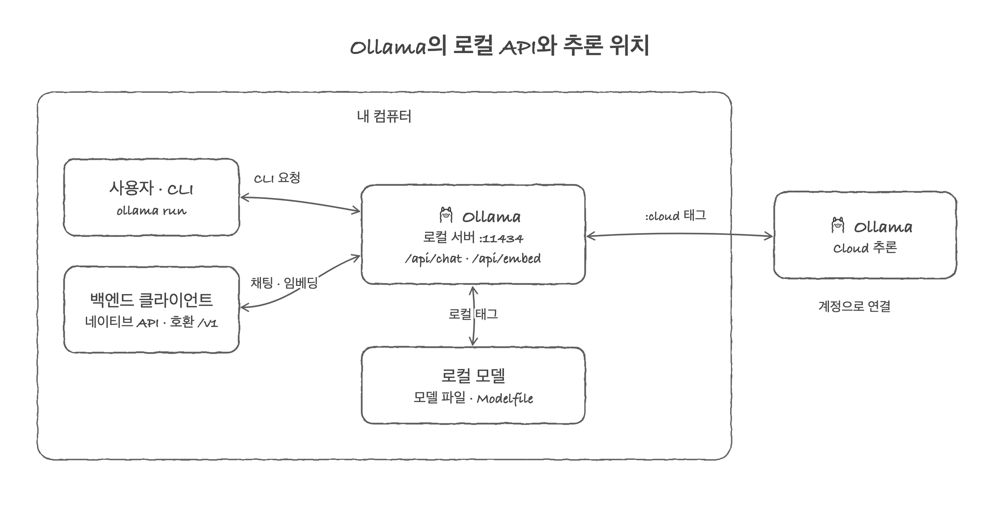

# Running Local Models and APIs with Ollama



그림 근거 · [Ollama CLI](https://docs.ollama.com/cli) · [Ollama API 주소](https://docs.ollama.com/api/introduction) · [Ollama Cloud 연결 방식](https://docs.ollama.com/cloud)

## 1. CLI로 모델을 준비하고 실행한다

앱에서 서버가 이미 실행 중인지 확인하고, 필요한 경우 별도 터미널에서 `ollama serve`로 시작한다. `ollama pull`로 태그를 내려받고 `ollama run`으로 실행한다. `ollama list`는 설치한 모델을, `ollama ps`는 실행 중인 모델을 확인할 때 쓴다. 모델을 고를 때는 태스크와 입력 모달리티, 정확한 태그, 라이선스, 파일 크기와 컨텍스트 요구량을 함께 본다. [Ollama · CLI](https://docs.ollama.com/cli) · [Ollama · Local FAQ](https://docs.ollama.com/faq) · [Ollama · Context Length](https://docs.ollama.com/context-length) · [Ollama · Llama 3.2](https://ollama.com/library/llama3.2)

```bash
ollama pull llama3.2:1b
ollama run llama3.2:1b '이 문장을 한 문장으로 요약해 줘. 오늘 회의에서는 배포 일정을 정했다.'
ollama list
ollama ps
```

## 2. 대화 상태, 시스템 메시지와 Modelfile을 관리한다

`/api/chat`에 `messages` 배열로 시스템 메시지와 대화 이력을 전달하고 `options`에 요청별 생성 설정을 넣는다. 대화형 CLI의 `/save <이름>`과 `/load <이름>`은 저장한 대화를 이어가는 데 쓸 수 있다. 설치한 버전에서 대화형 `/help`로 지원 명령을 확인한다. [Ollama · Chat API](https://docs.ollama.com/api/chat) · [Ollama · Interactive CLI Source](https://github.com/ollama/ollama/blob/main/cmd/interactive.go)

Modelfile의 `FROM`은 기반 모델이나 지원되는 GGUF 파일, `SYSTEM`은 기본 시스템 메시지, `PARAMETER`는 생성 설정, `TEMPLATE`는 모델 입력에 쓰이는 프롬프트 형식을 지정한다. `ollama show --modelfile <태그>`로 기존 구성을 확인하고, GGUF를 가져올 때는 `FROM ./model.gguf`와 `ollama create <이름> -f Modelfile`을 사용한다. [Ollama · Modelfile Reference](https://docs.ollama.com/modelfile) · [Ollama · Importing a Model](https://docs.ollama.com/import)

```text
FROM llama3.2:1b
SYSTEM """한국어로 간결하게 요약한다."""
PARAMETER temperature 0.2
```

## 3. 백엔드에서 Chat과 Embedding을 호출한다

로컬 API의 기본 주소는 `http://localhost:11434/api`다. `POST /api/chat`은 메시지에 답하고, `POST /api/embed`는 입력의 임베딩을 반환한다. 채팅 API는 기본적으로 스트리밍하므로 단일 JSON을 받는 예제는 `stream: false`를 지정한다. 문서 검색은 임베딩 모델로 문서와 질의를 변환하는 흐름부터 실습할 수 있다. [Ollama · API Introduction](https://docs.ollama.com/api/introduction) · [Ollama · Chat API](https://docs.ollama.com/api/chat) · [Ollama · Embed API](https://docs.ollama.com/api/embed)

```bash
curl -fsS http://127.0.0.1:11434/api/chat \
  -H 'Content-Type: application/json' \
  -d '{"model":"llama3.2:1b","messages":[{"role":"user","content":"오늘 회의에서 배포 일정을 정했다는 문장을 요약해 줘."}],"stream":false}'
```

문서 검색 실습에서는 `ollama pull embeddinggemma`로 모델을 준비하고 `/api/embed`에 `model`과 `input`을 보낸다. 문서와 질문은 같은 모델로 변환한다. [Ollama · EmbeddingGemma](https://ollama.com/library/embeddinggemma) · [Ollama · Embed API](https://docs.ollama.com/api/embed)

구조화 출력은 로컬 `/api/chat`의 `format`에 `json` 또는 JSON Schema를 지정한다. 결과의 `message.content`를 파싱하고 필수 필드와 값의 유효성을 확인한다. 공식 문서 확인일 기준으로 Ollama Cloud는 구조화 출력을 지원하지 않는다. [Ollama · Structured Outputs](https://docs.ollama.com/capabilities/structured-outputs) · [Ollama · Cloud](https://docs.ollama.com/cloud)

## 4. OpenAI 호환 API와 Claude Code 연동을 확인한다

OpenAI 호환 기능은 로컬 `/v1`에서 제공된다. 예를 들어 채팅은 `POST /v1/chat/completions`로 호출하며, 클라이언트가 요구하는 키 값은 로컬 Ollama 서버가 무시한다. 사용할 엔드포인트와 파라미터는 호환 목록에서 확인한다. [Ollama · OpenAI Compatibility](https://docs.ollama.com/api/openai-compatibility)

Claude Code는 설치 후 `ollama launch claude --model <태그>`로 연결할 수 있다. Claude Code 연동의 프로토콜과 모델의 컨텍스트 요구량을 통합 가이드에서 확인한다. [Ollama · Claude Code Integration](https://docs.ollama.com/integrations/claude-code)

## 5. 로컬 서버를 통해 클라우드 모델을 호출한다

`ollama signin` 후 클라우드 태그를 실행하면 CLI나 로컬 API를 진입점으로 사용할 수 있고 추론은 Ollama Cloud에서 실행된다. `https://ollama.com/api`에 직접 접속하는 방식은 API 키를 사용한다. 로컬 전용이 필요하면 서버 설정에서 클라우드 기능을 끈다. [Ollama · Cloud](https://docs.ollama.com/cloud) · [Ollama · Local FAQ](https://docs.ollama.com/faq)
