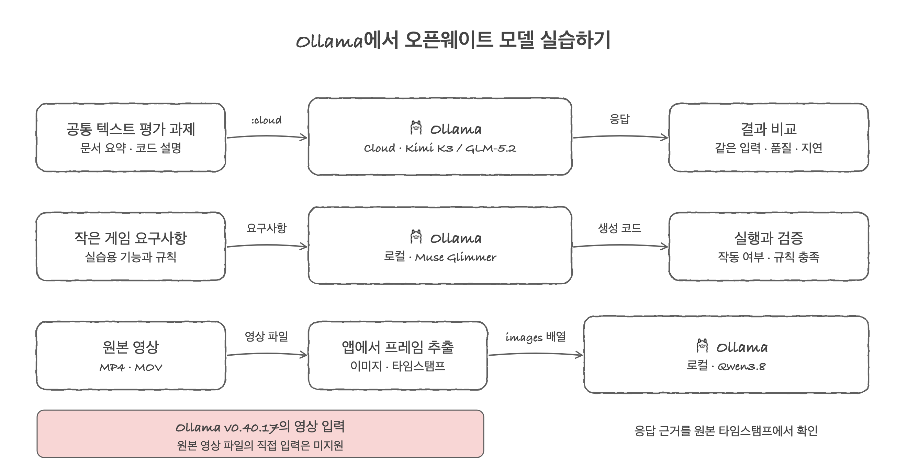

# Evaluating Open-weight Models with Ollama

그림 근거 · [Kimi K3](https://ollama.com/library/kimi-k3) · [GLM-5.2](https://ollama.com/library/glm-5.2) · [Muse Glimmer](https://ollama.com/library/muse-glimmer) · [Qwen3.8](https://ollama.com/library/qwen3.8) · [Ollama 이미지 입력](https://docs.ollama.com/capabilities/vision) · [Ollama v0.40.17 채팅 메시지 타입](https://github.com/ollama/ollama/blob/v0.40.17/api/types.go)

## 1. Kimi K3와 GLM-5.2를 클라우드에서 실행한다

- **Kimi K3.** Ollama 카탈로그의 태그는 `kimi-k3:cloud`이며 Text·Image 입력을 표시한다. `ollama run kimi-k3:cloud`로 실행하고 문서 요약이나 이미지가 포함된 분석 과제를 실습한다. [Ollama · Kimi K3](https://ollama.com/library/kimi-k3)
- **GLM-5.2.** `ollama run glm-5.2:cloud`로 실행한다. 카탈로그에서 해당 태그는 Text 입력으로 표시되므로 텍스트 요약이나 코드 설명처럼 Kimi K3에도 그대로 줄 수 있는 과제로 비교한다. [Ollama · GLM-5.2](https://ollama.com/library/glm-5.2)

`ollama signin`으로 연결하고 프롬프트는 테스트용 데이터로 고정한다. 결과에 실행 태그, 모달리티, 지연, 평가 기준을 남긴다. 로컬 CLI에서 실행한 경우에도 `:cloud` 태그의 추론 위치는 Ollama Cloud다. [Ollama · Cloud](https://docs.ollama.com/cloud)

## 2. Muse Glimmer로 로컬 코드 생성을 실습한다

Muse Glimmer는 Ollama 카탈로그에 30B 로컬 모델로 올라와 있다. `ollama run muse-glimmer`를 사용하며 Apple Silicon용 태그는 `muse-glimmer:30b-mlx`다. 코드 생성 실습은 직접 정한 규칙의 작은 브라우저 게임을 대상으로 잡고, 실행 여부와 규칙 충족 여부를 검증한다. [Ollama · Muse Glimmer](https://ollama.com/library/muse-glimmer)

## 3. Qwen3.8의 영상 입력 범위를 확인한다

**Ollama v0.40.17의 공개 CLI와 채팅 API는 `qwen3.8:27b` 또는 `qwen3.8:27b-mlx`에 `.mp4`나 `.mov` 파일을 직접 입력하는 기능을 지원하지 않는다.** Ollama 카탈로그는 두 태그의 입력을 Text·Image로 표시한다. 영상 입력을 추가하는 Ollama PR #12962는 2026-11-23 확인 당시 열려 있었다. [Ollama · v0.40.17](https://github.com/ollama/ollama/releases/tag/v0.40.17) · [Ollama · Qwen3.8](https://ollama.com/library/qwen3.8) · [Ollama · 영상 입력 PR #12962](https://github.com/ollama/ollama/pull/12962)

Qwen3.8-27B 모델 자체는 영상을 이해할 수 있다. Qwen 공식 모델 카드의 `video_url` 예제는 영상 입력을 구현한 서빙 환경을 전제로 하며, 문서는 vLLM에서 프레임 샘플링을 설정하는 방법도 설명한다. [Qwen · Qwen3.8-27B 모델 카드](https://huggingface.co/Qwen/Qwen3.8-27B)

- **CLI `ollama run`.** v0.40.17의 첨부 경로 파서는 JPG·JPEG·PNG·WebP·WAV 확장자를 인식한다. MP4와 MOV 경로는 첨부 파일로 처리되지 않는다. [Ollama v0.40.17 · CLI 첨부 경로 파서](https://github.com/ollama/ollama/blob/v0.40.17/cmd/interactive.go)
- **네이티브 `POST /api/chat`.** 메시지의 `images` 배열에 Base64로 인코딩한 이미지 데이터를 전달한다. 채팅 요청의 메시지 타입에 `videos` 필드가 없다. [Ollama · Vision API](https://docs.ollama.com/capabilities/vision) · [Ollama v0.40.17 · 채팅 메시지 타입](https://github.com/ollama/ollama/blob/v0.40.17/api/types.go)
- **OpenAI 호환 `POST /v1/chat/completions`.** Ollama는 `image_url` 콘텐츠를 이미지로 변환한다. 이 릴리스의 요청 변환기는 `video_url` 콘텐츠를 지원하지 않는다. [Ollama · OpenAI Compatibility](https://docs.ollama.com/api/openai-compatibility) · [Ollama v0.40.17 · 호환 API 메시지 변환기](https://github.com/ollama/ollama/blob/v0.40.17/openai/openai.go)

Ollama로 영상 내용을 살펴보려면 앱에서 원본 영상의 프레임을 추출하고, 시간순으로 `images`에 넣는다. 질문에는 이미지 순번과 원본 타임스탬프를 함께 적는다. 결과를 검증할 때 원본 영상에서 해당 시점을 열어 관찰 내용과 대조한다. [Ollama · Vision API](https://docs.ollama.com/capabilities/vision)
