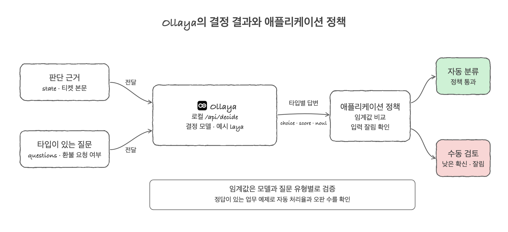

# Running Decision Models with Ollaya



그림 근거 · [Ollaya API의 요청과 답변 타입](https://ollaya.dev/docs/api) · [Ollaya 결정 결과를 이용한 라우팅](https://ollaya.dev/docs/routing)

## 1. Ollaya를 설치하고 결정 모델을 실행한다

공식 Quickstart의 운영체제별 설치 절차를 따른다. `ollaya run`은 첫 실행에 모델을 내려받고 필요하면 서버를 자동으로 시작한다. 공식 문서는 CPU에서 시작할 모델로 `laya`를 소개한다. [Ollaya · Quickstart](https://ollaya.dev/docs/quickstart)

결정 모델에는 티켓 본문 같은 `state`와 타입이 정해진 `questions`를 준다. Ollaya는 질문별로 선택, 점수 또는 확률을 반환하며, 로컬 기본 주소에서 `POST /api/decide`로 요청할 수 있다. [Ollaya · API Reference](https://ollaya.dev/docs/api)

```bash
ollaya run laya --questions '{"refund":{"type":"noul","instructions":"사용자가 환불을 요청했는가?"}}' \
  --format json '결제가 두 번 됐어요. 한 건은 환불해 주세요.'
```

## 2. Choice, Score, Noul을 목적에 맞게 쓴다

- `choice`는 사전에 정의한 선택지 중 가장 확률이 높은 항목을 반환한다. 티켓 담당팀 분류처럼 후보 집합이 정해진 결정에 쓴다. [Ollaya · Questions and Answers](https://ollaya.dev/docs/api)
- `score`는 낮은 수준부터 순서대로 정의한 척도의 기댓값을 반환한다. 긴급도를 세 단계로 정의하면 결과가 단계 사이의 소수일 수 있다. [Ollaya · Questions and Answers](https://ollaya.dev/docs/api)
- `noul`은 주어진 명제가 참일 확률을 반환한다. 환불 요청 유무처럼 예·아니오로 판단할 질문에 쓴다. [Ollaya · Questions and Answers](https://ollaya.dev/docs/api)

## 3. State에 판단 근거를 넣고 질문을 하나씩 쪼갠다

`state`는 문자열, 객체 또는 배열로 전달한다. “환불을 요청했고 오늘 처리가 필요한가?”는 환불 요청 여부와 긴급도를 별도 질문으로 나눠 같은 `state`에 적용한다. `choice`의 각 선택지나 `score`의 각 단계에 무엇이 해당하는지 적고, 요청 본문에 판단에 필요한 근거를 넣는다. [Ollaya · Quickstart의 Custom Questions](https://ollaya.dev/docs/quickstart) · [Ollaya · API Reference](https://ollaya.dev/docs/api)

긴 입력은 응답의 `state_truncated`를 확인한다. 네이티브 `/api/decide`는 잘림을 응답 필드로 알릴 수 있으며, TypeSafe 호환 엔드포인트는 같은 조건에서 `422 STATE_TRUNCATED`를 반환한다고 공식 문서가 설명한다. [Ollaya · API Reference](https://ollaya.dev/docs/api)

## 4. Confidence를 업무 데이터로 검증한다

기본 `choice`·`score` 응답의 `confidence`는 선택지 수를 반영해 정규화한 최상위 확률이다. `noul`의 기본 응답에서는 `noul` 값을 읽는다. `extras: ["laya"]`를 요청하면 추가로 오는 `laya.confidence`는 엔트로피 기반의 별도 값이다. [Ollaya · API Reference](https://ollaya.dev/docs/api)

업무에서 자동 처리와 검토를 가르는 임계값은 모델과 질문 유형별로 정답이 있는 예제를 돌려 정한다. 확신이 낮거나 근거가 잘린 입력은 검토 대상으로 보내고, 정상 사례와 경계 사례에서 자동 처리율과 오판 수를 함께 기록한다. 다음 실습은 티켓 분류 결과를 생성 모델의 답변 단계에 전달하는 흐름으로 연결할 수 있다. [Ollaya · API Reference](https://ollaya.dev/docs/api) · [Ollaya · Routing](https://ollaya.dev/docs/routing)
