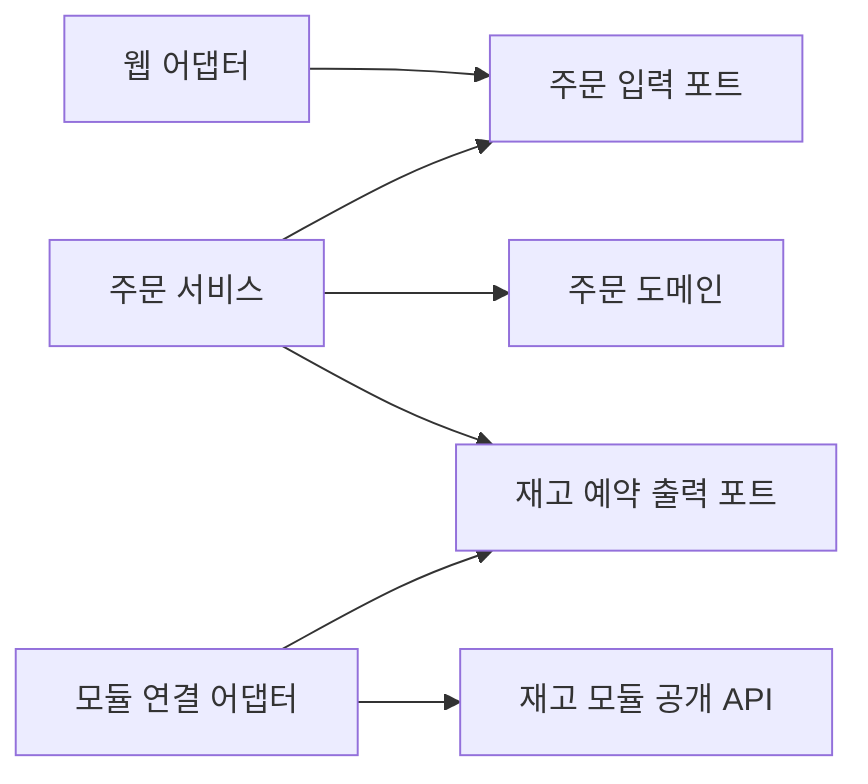
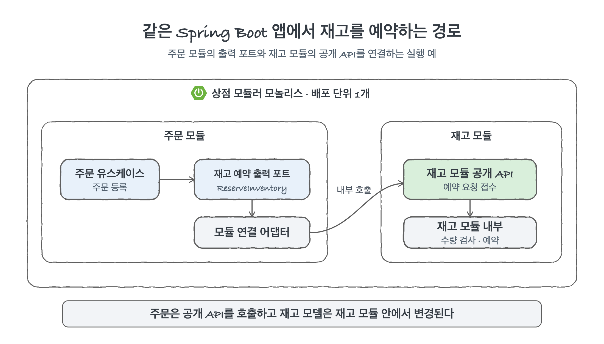

# Modular Monoliths with Hexagonal Boundaries

모듈러 모놀리스는 단일 배포 단위 안에서 업무 모듈이 공개 계약을 통해 협력하도록 설계한다. 모듈 사이에는 공개 API와 허용 의존성을 두고, 각 모듈 안에서는 포트와 어댑터로 업무 규칙과 기술을 연결할 수 있다. [Spring Modulith · Fundamentals](https://docs.spring.io/spring-modulith/reference/fundamentals.html) · [Cockburn · Hexagonal Architecture](https://alistair.cockburn.us/hexagonal-architecture)

## 상점의 모듈 계약

| 모듈 | 소유하는 모델 | 공개할 계약 예 |
| --- | --- | --- |
| 주문 | 주문 항목과 상태 전이 | 주문 생성·조회, 주문 상태 변경 이벤트 |
| 재고 | 판매 가능 수량과 예약의 생명주기 | 재고 예약·해제, 예약 결과 |
| 결제 | 승인·취소와 거래 식별 | 결제 승인·취소, 결제 결과 |

주문 모듈은 자기 언어로 `ReserveInventory` 출력 포트를 정의할 수 있다. 내부 어댑터는 재고 모듈의 공개 입력 계약을 호출한다. 주문 모듈에서 재고의 내부 엔티티나 저장소를 직접 사용하면 재고 모델을 독립적으로 바꾸기 어려워진다. 공용 타입은 두 모듈이 같은 의미와 변경 주기를 실제로 공유할 때만 고려한다.

아래 화살표는 코드의 의존 방향이다. 실행 시 주문 서비스의 재고 예약 요청은 모듈 연결 어댑터를 거쳐 재고 모듈에 도달한다.

## 경계를 지키는 방법

- 패키지는 `order`, `inventory`, `payment`처럼 업무 기능별로 나누고 공개 계약이 무엇인지 표시한다.
- 호출자가 즉시 필요한 결과는 공개 포트를 호출한다. 조회 모델 갱신처럼 지연을 허용할 수 있는 작업은 이벤트로 연결할 수 있다.

그림의 근거 · [Spring Modulith · Fundamentals](https://docs.spring.io/spring-modulith/reference/fundamentals.html) · [Cockburn · Hexagonal Architecture](https://alistair.cockburn.us/hexagonal-architecture)

- 순환 의존과 내부 패키지 참조를 구조 테스트에서 검사한다. Spring Modulith의 `ApplicationModules.verify()`와 `allowedDependencies`는 모듈 규칙을 명시하는 도구다. [Spring Modulith · Verification](https://docs.spring.io/spring-modulith/reference/verification.html)

같은 프로세스의 포트를 원격 어댑터로 교체할 때는 응답 지연, 실패, 업무 결과가 불명확한 경우가 새로 생긴다. 입력·출력 타입을 유지하더라도 서비스로 경계를 옮기는 결정은 [독립 배포와 운영 비용](04_microservice_boundaries_and_operational_tradeoffs.md)까지 함께 평가한다. [DDD 컴포넌트 협력](../ddd/08_connecting_aggregates_through_application_components.md)
