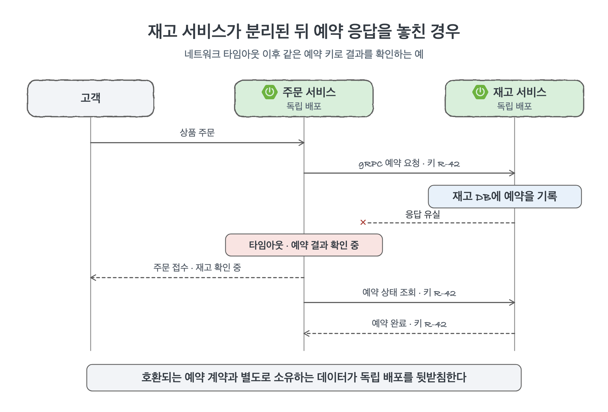

# Microservice Boundaries and Operational Trade-offs

마이크로서비스에서 독립 배포는 계약 호환성과 데이터 소유권을 지킬 때 가능하다. 팀이 따로 코드를 관리해도 매번 동시에 배포하거나 같은 테이블에 직접 쓰면 변경의 결합은 남는다. [Lewis와 Fowler · Microservices](https://martinfowler.com/articles/microservices.html)

## 분리해서 얻는 것과 운영할 것

| 분리의 목적 | 검증할 조건 |
| --- | --- |
| 독립 변경 | 호출자와 이벤트 소비자가 이전·새 계약에 호환되는가? |
| 부하 격리 | 재고의 트래픽 급증 때 주문과 결제의 자원이 함께 고갈되는가? |
| 장애 격리 | 응답이 끊겼을 때 주문을 대기·취소·재처리 중 어떤 상태로 표현하는가? |
| 팀 자율성 | 팀에 배포, 관측, 데이터 변경, 복구의 소유권이 있는가? |

네트워크 호출에는 실패와 지연이 생긴다. 별도 데이터 소유권은 교차 서비스 조회와 트랜잭션을 새롭게 설계하게 한다. 장점은 서비스 수로 측정하기보다 독립 배포 비율, 장애 영향, 변경에 필요한 팀 간 조율을 관측해 판단한다. [Microservice Premium](https://martinfowler.com/bliki/MicroservicePremium.html)

## 주문에서 재고를 분리하는 판단

그림의 근거 · [Lewis와 Fowler · Microservices](https://martinfowler.com/articles/microservices.html) · [gRPC · Deadlines](https://grpc.io/docs/guides/deadlines/)

재고 변경이 독립적이고 부하 패턴도 다르다면 분리 후보가 된다. 먼저 모듈 간 공개 계약과 데이터 접근을 정리하고, 네트워크 경계에서 재고 예약 상태·멱등 키·타임아웃 이후 확인할 방법을 정의한다. 새 경계의 운영 책임을 맡을 팀과 관측 수단을 마련한다. 진행 중인 주문이 장애 때 어떻게 회복되는지는 [분산 트랜잭션과 Saga](11_distributed_transactions_sagas_and_outbox.md)에서 다룬다.

자동 배포, 상태 관측, 안전한 호환 변경과 롤백이 가능한지 확인한다. 현재 경계가 자주 바뀐다면 [모듈러 모놀리스](03_modular_monoliths_with_hexagonal_boundaries.md)에서 계약을 먼저 검증하는 편이 변경 비용을 낮출 수 있다. [Fowler · Microservice Prerequisites](https://martinfowler.com/bliki/MicroservicePrerequisites.html)
