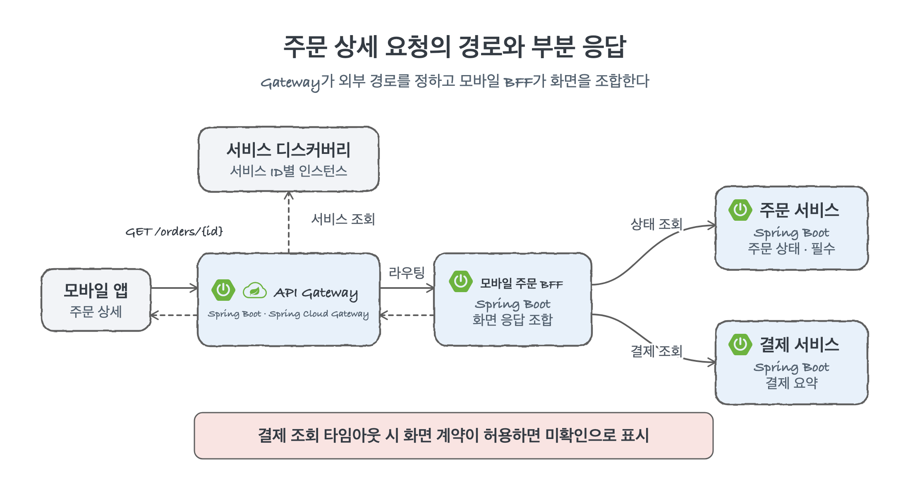

# API Gateways, Service Discovery, and BFFs

진입 경계의 책임은 외부 요청을 올바른 내부 계약에 연결하는 것이다. 주문 확인 화면이 주문과 결제를 함께 보여 주는 경우, 외부 라우팅과 화면 데이터 조합, 주문 상태 결정은 서로 다른 책임이다. [API Gateway pattern](https://microservices.io/patterns/apigateway.html)

## 역할과 소유권

| 구성 | 책임 | 예 |
| --- | --- | --- |
| API Gateway | 외부 경로, 공통 인증 검사, 사용량 제어, 라우팅 | `/orders/**`를 주문 서비스나 주문 BFF로 전달한다. |
| Service Discovery | 논리적 서비스 이름에서 현재 인스턴스 주소를 찾는다. | 주문 서비스의 복제본이 바뀌어도 이름을 유지한다. |
| Aggregator | 여러 조회 응답을 합쳐 결과를 제공한다. | 주문 상태와 결제 요약을 합친다. |
| BFF | 특정 클라이언트의 화면 계약을 소유한다. | 모바일 화면에는 작은 요약을 제공하고 웹에는 상세 내역을 제공한다. |

Discovery의 결과는 실제 라우팅에 쓰이지만, 공개할 경로는 경계 정책에서 정한다. Spring Cloud Gateway는 DiscoveryClient로 찾은 서비스에 대한 라우트를 구성할 수 있다. 외부 라우트의 목록, 서비스 ID로의 매핑, 상태 변화가 반영되는 시간을 확인한다. [Spring Cloud Gateway · DiscoveryClient Routes](https://docs.spring.io/spring-cloud-gateway/reference/spring-cloud-gateway-server-webflux/the-discoveryclient-route-definition-locator.html) · [Sam Newman · Backends for Frontends](https://samnewman.io/patterns/architectural/bff/)

## 주문 상세에서 실패를 다루는 방식

그림의 근거 · [Spring Cloud Gateway · DiscoveryClient Route Definition Locator](https://docs.spring.io/spring-cloud-gateway/reference/spring-cloud-gateway-server-webflux/the-discoveryclient-route-definition-locator.html) · [Sam Newman · Backends For Frontends](https://samnewman.io/patterns/architectural/bff/)

주문 상태는 필수다. 결제 상세가 조회되지 않으면 화면이 허용하는 경우에만 미확인으로 표시한다. 주문 조회의 전체 지연 예산과 하위 호출별 타임아웃을 명시한다. 결제 승인이나 주문 확정 결정은 각 서비스를 통해 수행한다. 클라이언트마다 다른 화면 표현은 BFF가 조합하고 주문의 의미를 바꾸는 규칙은 주문 서비스가 소유한다. [게이트웨이와 BFF의 구조](../architecture-pattern/05_single_entry_point_for_microservices.md)
