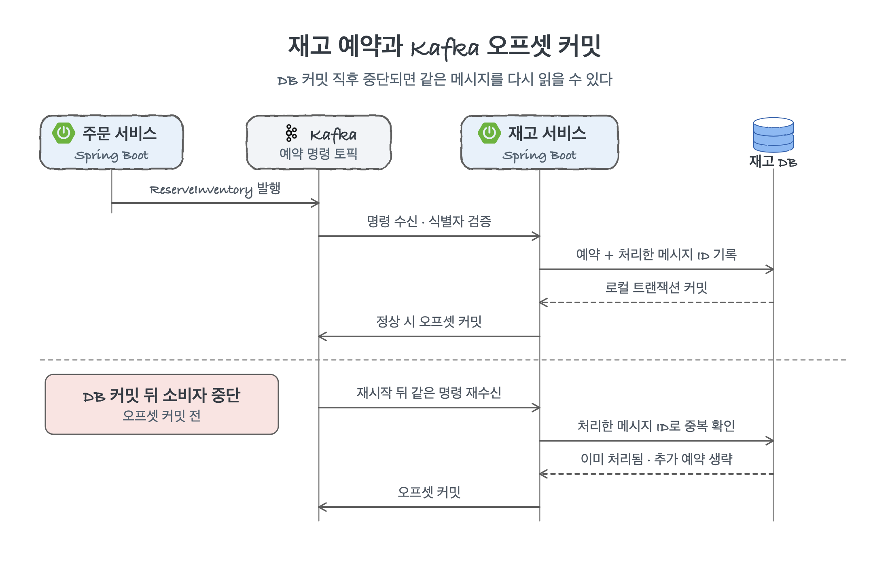

# Reliable Asynchronous Messaging Between Services

주문 접수가 바로 결제 완료를 뜻하지 않을 때, 접수 응답과 처리 결과를 분리할 수 있다. 메시징 어댑터는 명령·이벤트를 송수신하고, 주문·재고 도메인은 진행 상태와 재처리 의미를 소유한다. [Messaging patterns](https://microservices.io/patterns/)

## Kafka와 RabbitMQ

| 항목 | Kafka | RabbitMQ의 일반적인 큐 사용 |
| --- | --- | --- |
| 전달과 분배 | 토픽의 파티션에 기록하고, 그룹 내 소비자가 파티션을 나눠 처리한다. | Exchange가 규칙에 따라 큐로 라우팅하고 소비자가 큐에서 처리한다. |
| 처리 위치 | 그룹의 커밋 오프셋으로 다음 읽기 위치를 관리한다. | 소비자 ACK로 해당 전달의 처리를 확인한다. |
| 다시 처리 | 보존 기간 안에서 오프셋을 조정하거나 별도 그룹으로 다시 읽을 수 있다. | 미승인 처리의 재전달과 실패 큐 정책을 설계한다. |

Kafka에서 순서의 기본 단위는 파티션이다. 같은 주문의 순서를 유지해야 한다면 파티셔닝 정책과 소비자 내부의 동시 처리 방식도 확인한다. RabbitMQ의 publisher confirm은 브로커가 받아들였음을 확인하는 절차이고, 소비자의 업무 처리 완료는 소비자 ACK와 별도다. [Kafka Consumer API](https://kafka.apache.org/43/javadoc/org/apache/kafka/clients/consumer/KafkaConsumer.html) · [RabbitMQ Reliability](https://www.rabbitmq.com/docs/reliability)

## 재고 예약 소비자의 처리 흐름

1. 수신 어댑터는 `ReserveInventory` 계약과 메시지 식별자를 검증하고 재고 유스케이스를 호출한다.
2. 재고 서비스는 예약과 처리한 메시지 식별자를 같은 로컬 트랜잭션에서 기록한다.
3. 커밋 뒤 오프셋 또는 ACK를 갱신한다. 이 사이에 중단되면 재전달을 멱등하게 처리한다.
4. 일시 오류는 제한적으로 재시도하고, 계속 실패하는 메시지는 원인·재처리 권한·보존 기간이 정의된 실패 경로로 보낸다.

그림의 근거 · [Apache Kafka · KafkaConsumer API 4.3](https://kafka.apache.org/43/javadoc/org/apache/kafka/clients/consumer/KafkaConsumer.html) · [Microservices.io · Idempotent Consumer](https://microservices.io/patterns/communication-style/idempotent-consumer.html)

메시지 발행 확인, 소비자 진행 위치, 외부 DB의 커밋은 각각 다른 경계다. Kafka 트랜잭션의 보장 범위를 외부 DB 변경까지 자동으로 확장해 해석하지 않는다. 발행과 DB 변경을 연결하는 방법은 [Transactional Outbox](11_distributed_transactions_sagas_and_outbox.md), 이벤트 스키마는 [이벤트 주도 설계](12_designing_event_driven_service_interactions.md)에서 다룬다. [Kafka Producer API](https://kafka.apache.org/43/javadoc/org/apache/kafka/clients/producer/KafkaProducer.html) · [Idempotent Consumer](https://microservices.io/patterns/communication-style/idempotent-consumer.html)
