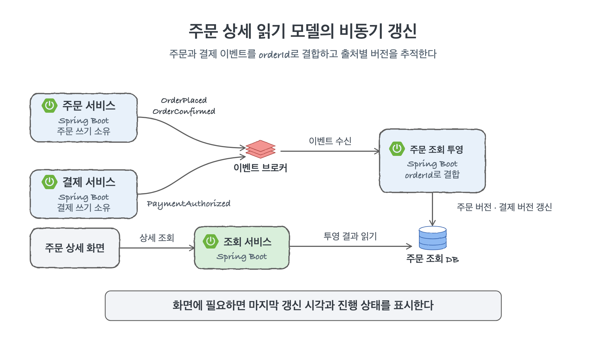

# Cross-Service Queries, CQRS, and Event Sourcing

주문 상세는 주문, 결제, 배송 데이터를 함께 보여 줄 수 있다. 각 데이터의 쓰기 소유권을 유지하면서 읽기에 필요한 화면 데이터를 어떻게 만들지 선택한다. [API Composition](https://microservices.io/patterns/data/api-composition.html)

## 읽기 계약을 고르는 방법

| 방식 | 적합한 상황 | 확인할 비용 |
| --- | --- | --- |
| API Composition | 적은 수의 서비스에서 지금 필요한 정보를 가져온다. | 하위 호출의 지연, 부분 실패와 서비스 간 관측 시점 차이 |
| CQRS와 읽기 모델 | 주문 목록처럼 반복되는 조회에 맞춰 형태를 최적화한다. | 투영 지연, 재처리, 새 필드의 백필과 재구축 |
| 이벤트 소싱 | 상태의 원본을 도메인 사건의 순서로 보존해야 한다. | 이벤트 스키마 진화, 동시 append, 재생 비용과 장기 운영 |

CQRS의 중심은 명령 모델과 조회 모델의 책임 분리다. 같은 DB를 사용할 수도 있다. 이벤트 소싱은 사건의 순서를 상태의 원본으로 쓰는 별도 결정이다. 이벤트로 읽기 모델을 갱신하면서 명령 모델의 원본은 현재 상태 테이블에 둘 수도 있다. [Fowler · CQRS](https://martinfowler.com/bliki/CQRS.html) · [Fowler · Event Sourcing](https://martinfowler.com/eaaDev/EventSourcing.html)

## 주문 조회 투영 예

주문 서비스에서 `OrderPlaced`와 `OrderConfirmed`를, 결제 서비스에서 `PaymentAuthorized`를 발행한다고 가정한다. 주문 조회 모델은 `orderId`로 필요한 정보만 결합한다. 주문 이벤트와 결제 이벤트는 다른 데이터 소스에서 오므로, 주문 버전과 결제 버전을 각각 추적하고 전체 서비스 순서를 가정하지 않는다. 소비자는 중복 이벤트를 처리하고, 화면에는 필요한 경우 갱신 시점과 진행 상태를 표시한다.

그림의 근거 · [Martin Fowler · CQRS](https://martinfowler.com/bliki/CQRS.html) · [Microservices.io · CQRS](https://microservices.io/patterns/data/cqrs.html)

이벤트 소싱을 선택한 모델은 이벤트 스트림을 재생해 애그리거트를 복원한다. 새 기록을 추가할 때 기대 스트림 버전을 비교하고, 스냅샷으로 재생 비용을 낮출 수 있다. 투영을 재구축할 때 원본 이벤트의 보존 범위와 계약 버전을 확인한다. [읽기·쓰기 모델 분리](../architecture-pattern/03_separating_read_and_write_models.md) · [이벤트 소싱의 원본과 스냅샷](../architecture-pattern/07_why_store_change_history_as_the_source_of_truth.md)
