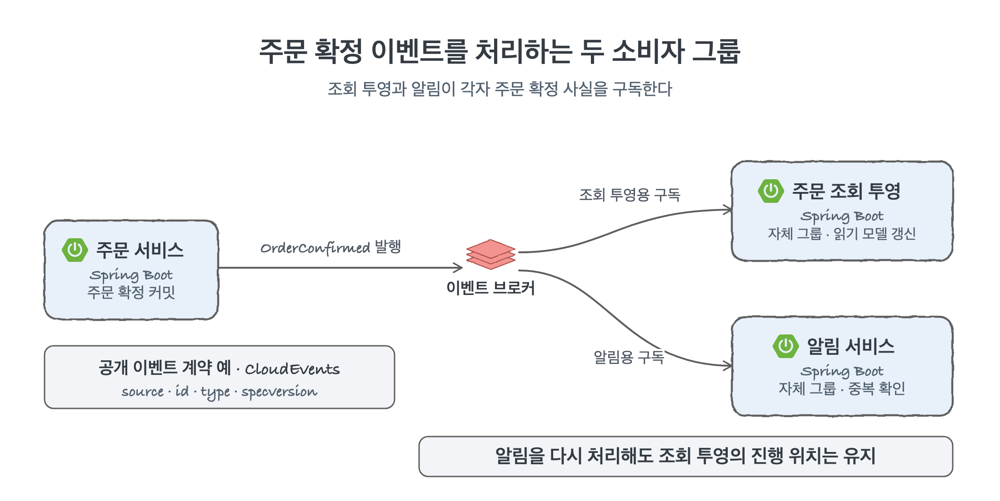

# Designing Event-Driven Service Interactions

이벤트는 어떤 도메인에서 이미 일어난 사실을 말한다. 명령은 수신자가 해야 할 작업을 요청한다. `ReserveInventory`는 요청이고, `InventoryReserved`는 재고 서비스가 발행하는 결과다. 사실의 이름과 의미는 그 상태를 소유한 도메인이 정한다. [Fowler · What do you mean by Event-Driven?](https://martinfowler.com/articles/201701-event-driven.html)

## 이벤트가 제공할 정보의 범위

| 방식 | 주문 예 | 설계할 부분 |
| --- | --- | --- |
| 이벤트 알림 | 주문이 변경됐다는 사실과 주문 ID를 보낸다. | 수신자가 다시 조회할 수단과 호출 실패 |
| Event-carried state transfer | 수신에 필요한 주문 상태와 요약 정보를 보낸다. | 필드의 공개 범위, 계약 버전, 소비자가 보유한 사본의 갱신 |
| 이벤트로 업무 흐름 연결 | 재고 예약 결과가 다음 결제 단계 판단에 쓰인다. | 중간 상태, 시간 제한, 순서와 보상 |

도메인 이벤트를 외부에 전달할 때는 어댑터에서 공개 계약으로 변환한다. 내부 엔티티의 모든 필드를 그대로 내보내면 생산자의 모델 변경이 소비자에게 전파될 수 있다. CloudEvents를 쓰는 경우 `source`, `id`, `type`, `specversion`은 전달 공통 계약을 이루며, 업무 스키마의 버전은 별도로 관리한다. [CloudEvents Specification](https://github.com/cloudevents/spec/blob/v1.0.2/cloudevents/spec.md)

## 주문 확정 이후의 흐름 검토

주문 서비스가 `OrderConfirmed`를 커밋과 연결해 발행하면, 조회 투영과 알림은 각자 구독해 처리한다. 알림 소비자는 주문 ID와 이벤트 식별자로 중복 처리를 방지한다. 한 소비자의 재처리가 다른 소비자의 처리 위치와 업무 상태를 바꾸지 않도록 그룹과 저장 책임을 구분한다.

그림의 근거 · [Martin Fowler · What do you mean by Event-Driven?](https://martinfowler.com/articles/201701-event-driven.html) · [CloudEvents 1.0.2 Specification](https://github.com/cloudevents/spec/blob/v1.0.2/cloudevents/spec.md#required-attributes) · [Apache Kafka · KafkaConsumer API 4.3](https://kafka.apache.org/43/javadoc/org/apache/kafka/clients/consumer/KafkaConsumer.html) · [Microservices.io · Transactional Outbox](https://microservices.io/patterns/data/transactional-outbox.html)

도입할 때는 중복, 역순, 스키마 세대 혼재, 오래된 이벤트 재생을 대표 시나리오로 검증한다. 보존 기간과 복구 목표가 맞는지 확인하고, 수신 지연과 처리 실패를 별도 지표로 관측한다. [메시지 전달과 소비자 재처리](08_reliable_asynchronous_messaging_between_services.md) · [읽기 투영](10_cross_service_queries_cqrs_and_event_sourcing.md)
