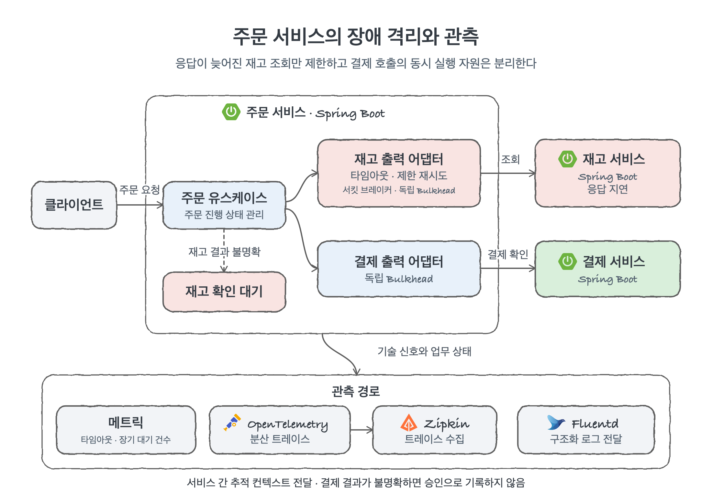

# Resilience, Observability, and Monitoring

기술 장애가 일어나도 주문 도메인은 주문이 어디까지 처리됐는지 설명할 수 있어야 한다. 회복성 정책은 원격 호출을 보호하고, 관측 지표는 기술 오류와 업무 처리 지연을 드러낸다. [실패 전파를 막는 패턴](../architecture-pattern/06_preventing_failure_propagation_in_microservices.md)

그림의 근거 · [Resilience4j · Spring Boot 연동](https://resilience4j.readme.io/docs/getting-started-3) · [Resilience4j · Bulkhead](https://resilience4j.readme.io/docs/bulkhead) · [Spring Boot 3.5 · Tracing](https://docs.spring.io/spring-boot/3.5/reference/actuator/tracing.html#actuator.micrometer-tracing.tracer-implementations.otel-zipkin) · [Fluentd · Introduction](https://docs.fluentd.org/)

## 회복성 정책을 출력 어댑터에 배치하기

| 정책 | 주문 요청에서의 역할 |
| --- | --- |
| Timeout | 느린 외부 호출이 요청의 전체 시간 예산을 쓰지 않도록 제한한다. |
| Retry | 일시적 실패에서 제한적으로 재시도한다. 상태 변경은 멱등성과 결과 확인 경로를 전제로 한다. |
| Circuit Breaker | 실패가 누적된 의존성으로 가는 호출을 일정 기간 줄이고 회복을 확인한다. |
| Bulkhead | 결제와 상품 조회의 동시 실행 자원을 격리해 한쪽 포화가 전파되는 범위를 줄인다. |
| Fallback | 계약이 허용하는 대체 결과나 대기 상태를 반환한다. 결제 승인을 확인할 수 없으면 승인 성공으로 간주하지 않는다. |

Resilience4j는 Retry, CircuitBreaker, Bulkhead, TimeLimiter 같은 도구를 제공한다. 어떤 예외를 재시도하고 어떤 타임아웃을 포함할지 정의한다. 예를 들어 800ms 전체 예산 안에서 원격 시도를 최대 2회로 두고 각 시도 250ms, 중간 대기 최대 50ms를 배정하면 원격 구간은 최대 550ms다. 연결, 큐 대기와 응답 변환 시간도 남은 예산에서 고려한다. 여러 계층의 재시도가 곱해지지 않게 한 책임 위치를 정한다. [Resilience4j · CircuitBreaker](https://resilience4j.readme.io/docs/circuitbreaker) · [Retry](https://resilience4j.readme.io/docs/retry) · [Bulkhead](https://resilience4j.readme.io/docs/bulkhead) · [TimeLimiter](https://resilience4j.readme.io/docs/timeout)

## 관측 흐름과 검증 시나리오

| 신호 | 볼 항목 |
| --- | --- |
| 메트릭 | 요청률·오류·p95 지연, 타임아웃과 재시도, 주문 확정까지의 시간과 장기 대기 건수 |
| 트레이스 | 주문 접수에서 재고·결제까지의 호출, 메시지 처리 구간, 지연이 시작된 곳 |
| 구조화 로그 | 기술 오류 유형, 안전한 상관 식별자, 업무 상태 전이 |

OpenTelemetry로 구간을 계측하고 HTTP·메시지 경계에서 컨텍스트를 전달한다. Zipkin은 호환되는 연동 경로로 받은 트레이스를 조회하고, Fluentd는 구조화 로그를 수집·전달할 수 있다. 트레이스 ID와 업무 주문 ID는 목적이 다르다. 요청별 식별자는 로그·트레이스에서 조회하고, 메트릭 태그에는 동작·결과처럼 값의 종류가 통제되는 항목을 사용한다. [OpenTelemetry · Context Propagation](https://opentelemetry.io/docs/concepts/context-propagation/) · [Zipkin](https://zipkin.io/) · [Fluentd 문서](https://docs.fluentd.org/)

재고 서비스가 느려진 상황을 검토할 때는 주문의 대기 상태와 호출 제한, 결제 경로에 대한 영향, 회복 후 지표를 함께 확인한다. 운영의 기준값은 [SLI·SLO와 오류 예산](../architecture-design-for-operations/01_managing_reliability_with_slis_slos_and_error_budgets.md)을 참고한다.
