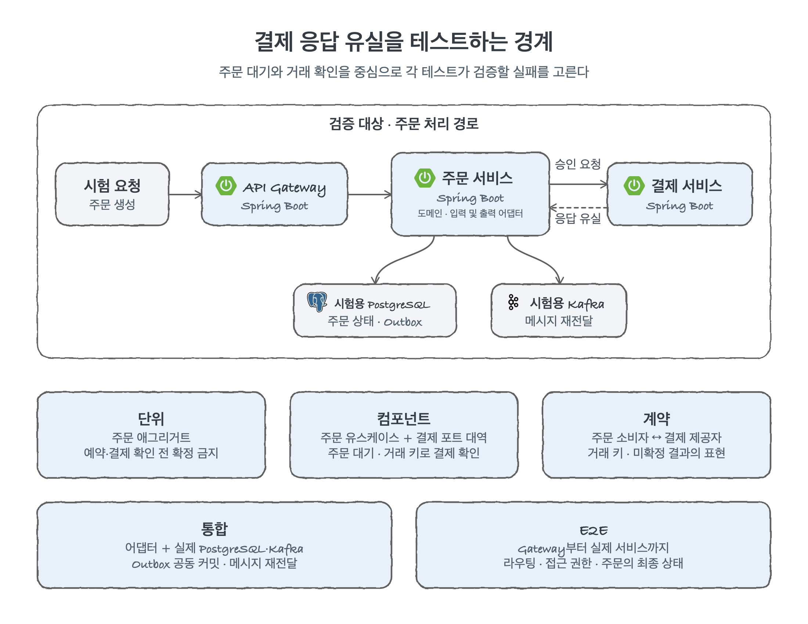

# Testing Domains, Adapters, and Service Contracts

테스트의 범위는 그 테스트에서 검출할 실패를 기준으로 정한다. 도메인 불변식, 어댑터의 변환, 서비스 간 호환성, 실제 배포 경로는 각각 다른 지점에서 깨질 수 있다. [Toby Clemson · Testing Strategies in a Microservice Architecture](https://martinfowler.com/articles/microservice-testing/)

그림의 근거 · [Toby Clemson · Microservice Testing](https://martinfowler.com/articles/microservice-testing/) · [Spring Boot 3.5 · Testcontainers](https://docs.spring.io/spring-boot/3.5/reference/testing/testcontainers.html) · [Testcontainers · PostgreSQL](https://java.testcontainers.org/modules/databases/postgres/) · [Testcontainers · Kafka](https://java.testcontainers.org/modules/kafka/)

## 주문 시스템의 테스트 범위

| 테스트 | 실제로 실행하는 범위 | 검증할 실패 |
| --- | --- | --- |
| 단위 | 주문 애그리거트와 값 객체 | 예약·결제 확인 전 주문 확정, 잘못된 상태 전이 |
| 컴포넌트 | 주문 서비스의 유스케이스와 포트 대역 | 결제 거절 후 재고 해제 요청, 결과 불명확 때 대기 |
| 통합 | 실제 DB·브로커를 사용하는 특정 어댑터 | 유일 제약, Outbox와 상태의 공동 커밋, 메시지 직렬화 |
| 계약 | 서비스 소비자와 제공자의 호출·이벤트 약속 | 필드·오류 의미 변경, 이전 소비자와의 호환성 |
| E2E | API Gateway부터 여러 서비스를 지나는 흐름 | 실제 경로·권한·배포 구성이 합쳐져 주문이 확정되는지 |

테스트 피라미드는 빠르고 원인 파악이 쉬운 검증에 많은 사례를 두고, 여러 시스템이 필요할 때 범위를 올리는 방식이다. 서비스 경계를 넘는 테스트에서는 실제 시간 지연을 고정 sleep으로 추측하기보다, 정해진 완료 시간 안에서 관측 가능한 업무 상태가 될 때까지 확인한다. [Ham Vocke · The Practical Test Pyramid](https://martinfowler.com/articles/practical-test-pyramid.html)

## 실패 시나리오를 어느 경계에서 검증할까

결제 승인 응답이 끊겼다면 컴포넌트 테스트는 주문이 대기 상태를 유지하는지, 결제 확인 포트를 쓰는지 검사한다. 통합 테스트는 메시지 재전달과 영속화 경계를, 계약 테스트는 거래 키와 결과 표현을 확인한다. 제한된 E2E는 실제 라우팅과 설정이 연결된 경로를 다룬다. 독립 배포의 검증에는 이전 버전 소비자가 새 응답·이벤트를 처리하는 사례도 넣는다. [Testcontainers 통합 테스트](../java-testing/03_integration_testing_with_testcontainers_and_docker_compose.md) · [ArchUnit 경계 검증](../ddd/09_verifying_hexagonal_architecture_boundaries.md)
