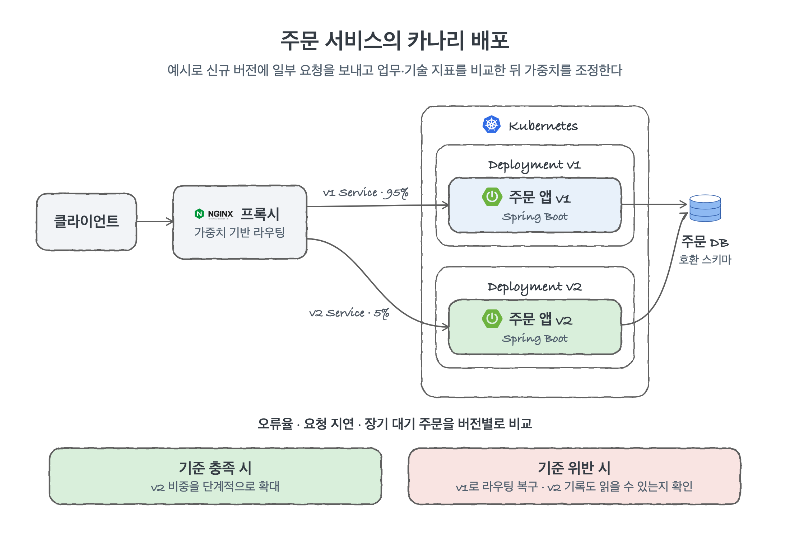

# Container Deployment and Progressive Delivery

컨테이너는 애플리케이션과 실행에 필요한 파일을 묶고, 오케스트레이터는 원하는 복제본 수와 배포 상태를 유지한다. 서비스를 여러 버전으로 동시에 배포할 수 있는지는 HTTP나 이벤트의 포트 계약과 DB 스키마의 호환성에 달려 있다. [Kubernetes · Deployments](https://kubernetes.io/docs/concepts/workloads/controllers/deployment/) · [Kubernetes · Containers](../kubernetes/01_container.md)

## 실행 경계에서 역할 나누기

Sidecar는 같은 Pod에서 앱과 함께 동작하는 보조 컨테이너다. 서비스 메시의 데이터 평면은 라우팅·mTLS·트래픽 정책을 담당할 수 있다. 배치 방식은 메시 구현마다 다르다. 결제 승인이나 주문 취소의 판단은 애플리케이션 포트와 도메인에 둔다. [Kubernetes · Sidecar Containers](https://kubernetes.io/docs/concepts/workloads/pods/sidecar-containers/) · [Istio · Traffic Management](https://istio.io/latest/docs/concepts/traffic-management/)

그림의 근거 · [Kubernetes · Deployments](https://kubernetes.io/docs/concepts/workloads/controllers/deployment/#canary-deployment) · [Kubernetes · Service](https://kubernetes.io/docs/concepts/services-networking/service/) · [NGINX · HTTP Upstream](https://nginx.org/en/docs/http/ngx_http_upstream_module.html#server)

## 트래픽을 옮기는 방식

| 방식 | 목적과 확인 기준 |
| --- | --- |
| Rolling | 복제본을 순차 교체한다. 준비 상태가 정상이고 구·신 버전이 동시에 동작하는지 확인한다. |
| Blue-Green | 별도 배포 집합을 준비하고 트래픽을 전환한다. 되돌릴 때 새 버전에서 이미 저장한 데이터도 읽을 수 있어야 한다. |
| Canary | 일부 트래픽부터 노출해 오류율·지연·주문 상태 이상을 비교한 뒤 단계적으로 확대한다. |
| A/B | 실험 가설에 따라 사용자 집단별 동작을 비교한다. 동일 사용자가 안정적으로 같은 집단에 속하도록 배정한다. |

NGINX를 이용한 설계 검토에서는 Blue-Green의 라우트 전환, Canary의 가중치, A/B의 안정된 집단 키를 구분한다. 시험에서 쓰기 요청을 두 버전에 각각 보내면 부작용이 중복될 수 있으므로, 실제 배포 경로의 호출과 데이터 변경을 확인한다. [NGINX · HTTP Upstream](https://nginx.org/en/docs/http/ngx_http_upstream_module.html) · [NGINX · Split Clients](https://nginx.org/en/docs/http/ngx_http_split_clients_module.html)

새 필드는 추가 후 사용 전환, 이전 필드 제거를 나눌 수 있다. 같은 기간 동안 이벤트 소비자와 읽기 모델이 이전·새 스키마를 처리하는지 검사하고 롤백 기준을 정한다. [서비스와 DB의 무중단 배포](../architecture-design-for-operations/05_designing_zero_downtime_deployments_for_services_and_databases.md)
