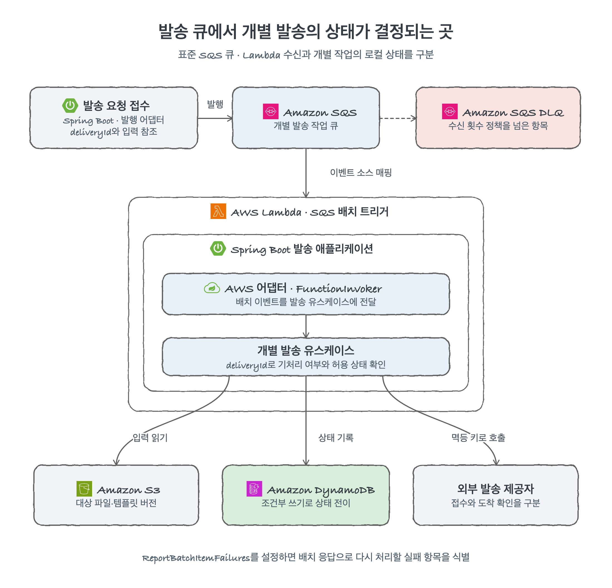

# AWS Serverless Foundations for Bulk Notification Workflows

대량 발송의 핵심 질문은 몇 개의 함수를 실행할지보다 **어떤 발송을 접수했고, 어디까지 처리했으며, 무엇을 안전하게 다시 처리할 수 있는지**다. [서버리스의 도메인 경계](18_serverless_microservices_with_domain_boundaries.md)에 이어, AWS 계정 없이도 검토할 수 있는 발송 사례로 포트와 어댑터의 책임을 살펴본다. [Cockburn · Hexagonal Architecture](https://alistair.cockburn.us/hexagonal-architecture)

## 1. 캠페인과 개별 발송의 경계

캠페인은 대상 목록·템플릿 버전과 발송 정책을 결정한다. 개별 발송은 한 대상에 대해 예약된 작업과 그 결과를 기록한다. 10만 건의 수신 상태는 개별 발송 단위로 갱신하고, 캠페인 진행률은 그 결과를 모아 계산한다. 작업자 여러 개가 같은 캠페인 레코드 하나를 매번 갱신하는 구조는 쓰기 경합과 재처리 비용을 높일 수 있다.

| 도메인 규칙 | 설계에 반영할 내용 |
| --- | --- |
| 재전달되어도 같은 발송은 같은 작업이다. | 안정적인 `deliveryId`를 만들고 중복 요청이 기존 상태를 참조하도록 한다. SQS 메시지 ID는 큐 전달을 추적하는 데 쓴다. |
| 외부 제공자의 접수와 수신자 도착은 구분한다. | 제공자가 수락하면 `ACCEPTED_BY_PROVIDER`로 기록한다. 실제 도착 여부가 필요하면 제공자의 결과를 별도로 수신한다. |
| 결과를 모르는 타임아웃은 별도 상태다. | `REVIEW_REQUIRED` 등으로 보존하고 제공자의 결과를 조회하거나 멱등 키로 재시도할 수 있는지 확인한다. |

Spring에서 서비스·저장소를 나누던 판단을 서버리스에서도 적용할 수 있다. Spring MVC 컨트롤러와 Lambda 핸들러는 서로 다른 환경에서 같은 유스케이스 계약을 호출할 수 있다. 호출 계약과 도메인 규칙을 명확히 하면 로컬 대역으로 검증한 뒤 AWS 어댑터를 연결할 수 있다. [애그리거트와 일관성 경계](../ddd/05_designing_aggregates_and_consistency_boundaries.md)

이 예시의 발행 앱과 발송 워커는 Spring Boot를 사용한다. Lambda의 Spring Cloud Function AWS 어댑터는 SQS 배치를 발송 함수에 전달한다. 부분 배치 실패를 보고하려면 이벤트 소스 매핑에서 해당 기능을 활성화하고 함수 응답에 실패 항목을 넣는다. [Spring Cloud Function AWS 어댑터](https://docs.spring.io/spring-cloud-function/reference/adapters/aws-intro.html) · [AWS Lambda 부분 배치 실패](https://docs.aws.amazon.com/lambda/latest/dg/services-sqs-errorhandling.html)

## 2. Lambda, SQS, DLQ, S3, DynamoDB의 역할

그림의 근거 · [Spring Cloud Function의 Lambda 핸들러](https://docs.spring.io/spring-cloud-function/reference/adapters/aws-intro.html) · [Lambda의 SQS 배치](https://docs.aws.amazon.com/lambda/latest/dg/with-sqs.html) · [부분 실패 응답](https://docs.aws.amazon.com/lambda/latest/dg/services-sqs-errorhandling.html) · [SQS DLQ 정책](https://docs.aws.amazon.com/AWSSimpleQueueService/latest/SQSDeveloperGuide/sqs-dead-letter-queues.html) · [DynamoDB 조건부 쓰기](https://docs.aws.amazon.com/amazondynamodb/latest/developerguide/Expressions.ConditionExpressions.html) · [S3 객체 버전](https://docs.aws.amazon.com/AmazonS3/latest/userguide/Versioning.html)

| AWS 구성 | 헥사고날 관점의 책임 |
| --- | --- |
| Lambda | SQS 이벤트를 개별 발송 명령으로 바꾸고 처리 결과를 배치 응답으로 변환하는 입력 어댑터 |
| SQS | 발행 출력 어댑터와 소비 입력 어댑터 사이에 요청을 보관해 처리 속도를 분리하는 큐 |
| SQS DLQ | 수신 횟수 정책을 넘긴 메시지를 격리하는 운영 경로. 업무 상태는 발송 저장소에서 확인한다. |
| S3 | 대상 목록·템플릿 같은 객체를 읽는 출력 어댑터. 버전 ID 등으로 재처리할 때도 같은 입력을 가리키게 한다. |
| DynamoDB | 개별 발송 상태와 멱등 키를 보관하는 출력 어댑터. 조건부 쓰기로 허용된 상태 전이와 중복 선점을 검사한다. |

조건부 쓰기는 DynamoDB에서 같은 작업을 동시에 선점하는 경우를 다룬다. 외부 제공자가 발송을 접수한 직후 상태 기록 전에 작업자가 멈출 수도 있다. 외부 부작용까지 보호하려면 제공자의 멱등 키나 결과 조회를 활용하고, 둘 다 어려우면 결과가 불명확한 작업을 별도 복구 대상으로 남긴다. [DynamoDB Condition Expressions](https://docs.aws.amazon.com/amazondynamodb/latest/developerguide/Expressions.ConditionExpressions.html) · [S3 Versioning](https://docs.aws.amazon.com/AmazonS3/latest/userguide/Versioning.html)

## 3. 발행에서 실패와 정리까지

1. **발행**. 발송 요청을 검증하고 `deliveryId`와 입력 객체 참조를 정한다. 상태 저장과 큐 발행 사이의 중단을 복구해야 한다면 상태와 Outbox를 같은 트랜잭션에 기록하고 릴레이에서 발행한다.
2. **소비**. Lambda가 SQS 배치를 받아 항목별로 유스케이스를 호출한다. 이미 완료된 `deliveryId`는 저장한 결과를 사용하고, 새 작업은 상태 전이를 조건부로 기록한다.
3. **실패**. 재시도 가능한 항목은 다시 처리할 수 있게 반환한다. 표준 큐에서 이벤트 소스 매핑에 `ReportBatchItemFailures`를 켜면 실패한 항목을 배치 응답에 식별할 수 있다. 유효한 요청이 영구 거절되면 업무 실패를 저장하고 해당 메시지 처리를 완료한다. 반복 실패가 격리되면 DLQ에서 원인과 발송 상태를 대조한 후 재투입 여부를 결정한다.
4. **정리**. 완료 상태, 큐의 삭제, 객체와 멱등 기록의 보존을 각각 판단한다. 재시도나 DLQ 재투입에 필요한 템플릿·대상 목록 버전과 멱등 기록은 그 복구 기간까지 유지한다.

SQS 메시지는 처리 중 가시성 제한 시간 동안 숨겨진다. Lambda의 SQS 소비에서는 중복 처리가 발생할 수 있으므로, 대기열의 처리 결과와 도메인의 최종 상태를 따로 확인한다. [Lambda와 SQS](https://docs.aws.amazon.com/lambda/latest/dg/with-sqs.html) · [부분 배치 실패](https://docs.aws.amazon.com/lambda/latest/dg/services-sqs-errorhandling.html) · [SQS DLQ](https://docs.aws.amazon.com/AWSSimpleQueueService/latest/SQSDeveloperGuide/sqs-dead-letter-queues.html) · [Transactional Outbox](11_distributed_transactions_sagas_and_outbox.md)

## 4. AWS 계정 없이 검증하고 클라우드로 옮기기

로컬에서 SQS 이벤트 형태의 표본, 임시 발송 상태 저장소, 파일로 둔 템플릿, 기록만 하는 제공자 대역을 사용한다. 성공·일시 실패·중복 전달을 한 배치에 섞어 보고, 제공자의 접수 직후 상태 기록이 끊겼을 때도 결과를 복구할 수 있는지 확인한다. AWS로 옮길 때는 같은 표본으로 이벤트 매핑, 가시성 제한 시간, 재투입, 어댑터별 IAM 권한을 점검한다. 처리량 검증용 제공자는 기록만 남기는 대역으로 두고, 실제 제공자 검사에는 별도의 제한된 테스트 대상을 사용할 수 있다.

**10만 건 검증**에서는 큐에 넣은 건수와 업무상 처리를 끝낸 건수를 나눠 센다. 목표가 10분 이내 처리라면 초당 약 167건의 최종 처리량이 필요하다. 중복 전달, 재시도, 느린 제공자를 섞고 완료 시간, 대기 건수와 가장 오래 기다린 시간, 중복 발송 수, 실패와 DLQ 잔량을 확인한다. 큐가 비는 것과 모든 발송이 성공하는 것은 별개의 결과다. [AWS Serverless Applications Lens](https://docs.aws.amazon.com/wellarchitected/latest/serverless-applications-lens/welcome.html)

**설계 준비도 확인**

1. 캠페인과 개별 발송은 각각 어떤 상태를 소유하는가?
2. Lambda 핸들러가 호출하는 유스케이스의 입출력은 무엇인가?
3. 같은 작업을 식별하는 ID를 발행과 재처리에서 어떻게 유지하는가?
4. 제공자가 접수한 직후 작업자가 멈추면 무엇을 확인하는가?
5. 어떤 실패를 재시도하고, DLQ 메시지는 어떤 근거로 다시 넣는가?
6. 입력 객체와 멱등 기록은 복구 가능 기간에 맞춰 보존되는가?
7. 10만 건의 완료율과 중복 발송 수를 어떤 상태 기록에서 확인하는가?
