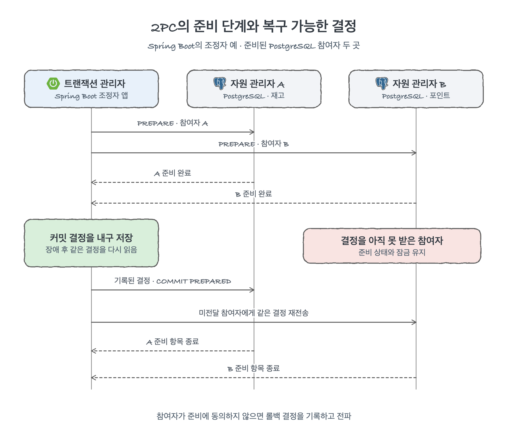

# Two-Phase Commit and Prepared Transaction Recovery

2PC는 트랜잭션 관리자와 여러 자원 관리자가 같은 커밋 결정을 따르는 프로토콜이다. 참여 자원이 준비 상태를 복구하고, 트랜잭션 관리자가 최종 결정을 내구성 있게 저장할 수 있어야 한다. [PostgreSQL · Two-Phase Transactions](https://www.postgresql.org/docs/17/two-phase.html)

## 1. 준비와 결정

| 단계 | 트랜잭션 관리자 | 자원 관리자 |
| --- | --- | --- |
| Prepare | 참여 자원에 커밋 준비가 가능한지 묻는다. | 커밋 가능한 작업을 준비 상태로 저장하거나 실패를 반환한다. |
| Commit 또는 Rollback | 모든 참여자가 준비에 동의하면 커밋을 결정한다. 거절이 발생하면 롤백을 결정한다. 최종 결정을 기록하고 전달한다. | 수신한 결정에 따라 준비된 트랜잭션을 종료한다. |

준비에 동의한 참여자는 통신 장애가 발생하더라도 임의로 롤백하지 않는다. 관리자가 이미 커밋을 결정했을 수 있기 때문이다. 관리자는 재시작 후 기록된 결정을 읽고 통지를 재개한다. PostgreSQL에서는 준비된 동안 잠금이 유지되고, 오래 방치하면 `VACUUM`에도 영향을 줄 수 있다. 준비 트랜잭션의 수와 대기 시간을 모니터링하고, 일치하는 관리자 기록을 근거로 복구한다. [PostgreSQL · PREPARE TRANSACTION](https://www.postgresql.org/docs/17/sql-prepare-transaction.html) · [PostgreSQL · pg_prepared_xacts](https://www.postgresql.org/docs/17/view-pg-prepared-xacts.html)

그림에서는 별도로 구성한 트랜잭션 관리자가 Spring Boot 애플리케이션의 2PC 조정을 맡는다. 각 참여자가 준비 단계를 지원하고, 관리자는 재시작한 뒤에도 기록한 최종 결정을 복구할 수 있어야 한다. [Spring 트랜잭션 관리자](https://docs.spring.io/spring-framework/reference/data-access/transaction/strategies.html) · [PostgreSQL 2단계 트랜잭션](https://www.postgresql.org/docs/17/two-phase.html)



그림의 근거 · [Spring 트랜잭션 관리자](https://docs.spring.io/spring-framework/reference/data-access/transaction/strategies.html) · [PostgreSQL 2단계 트랜잭션](https://www.postgresql.org/docs/17/two-phase.html) · [트랜잭션 준비와 락](https://www.postgresql.org/docs/17/sql-prepare-transaction.html) · [기록된 커밋 적용](https://www.postgresql.org/docs/17/sql-commit-prepared.html)

## 2. Docker에서 참여자의 준비 상태 관찰

이 실습은 PostgreSQL 자원 관리자 **한 곳**의 동작을 관찰한다. 아래 구성을 `compose.yaml`에 저장하고 `docker compose up -d --wait`로 시작한다.

```yaml
services:
  db:
    image: postgres:17-alpine
    command: ["postgres", "-c", "max_prepared_transactions=8"]
    environment:
      POSTGRES_PASSWORD: local-2pc-demo
    healthcheck:
      test: ["CMD-SHELL", "pg_isready -h 127.0.0.1 -U postgres"]
      interval: 2s
      timeout: 3s
      retries: 15
```

`docker compose exec db psql -U postgres`에서 준비 쿼리를 실행한다. 가용 수량은 아직 5이고, `pg_prepared_xacts`에는 주문이 표시된다.

```sql
CREATE TABLE inventory_demo (
    sku text PRIMARY KEY,
    available integer NOT NULL
);

INSERT INTO inventory_demo VALUES ('item-01', 5);

BEGIN;
UPDATE inventory_demo SET available = available - 1 WHERE sku = 'item-01';
PREPARE TRANSACTION 'demo-order-01';

SELECT gid, prepared FROM pg_prepared_xacts WHERE gid = 'demo-order-01';
SELECT sku, available FROM inventory_demo;
```

새 `psql` 세션에서 다음 문장을 실행하면 수량이 4가 되고 준비 목록이 비게 된다. 취소 결과는 새 실습에서 준비한 후 `ROLLBACK PREPARED 'demo-order-01'`을 실행해 비교한다. 최종 결정 SQL은 트랜잭션 블록 밖에서 실행한다. [PostgreSQL · COMMIT PREPARED](https://www.postgresql.org/docs/17/sql-commit-prepared.html) · [PostgreSQL · ROLLBACK PREPARED](https://www.postgresql.org/docs/17/sql-rollback-prepared.html)

```sql
COMMIT PREPARED 'demo-order-01';

SELECT sku, available FROM inventory_demo;
SELECT gid FROM pg_prepared_xacts WHERE gid = 'demo-order-01';
```

주문·재고·포인트 DB를 실제로 조정하려면 각 자원이 참여 계약을 지원해야 한다. 일반 HTTP 주문 API를 호출하는 것만으로는 해당 서비스가 2PC에 참여하지 않는다. 독립 서비스가 예약과 확정을 제공한다면 [Try-Confirm-Cancel](23_coordinating_reservations_with_try_confirm_cancel.md)의 업무 상태와 복구 방식을 검토한다.
