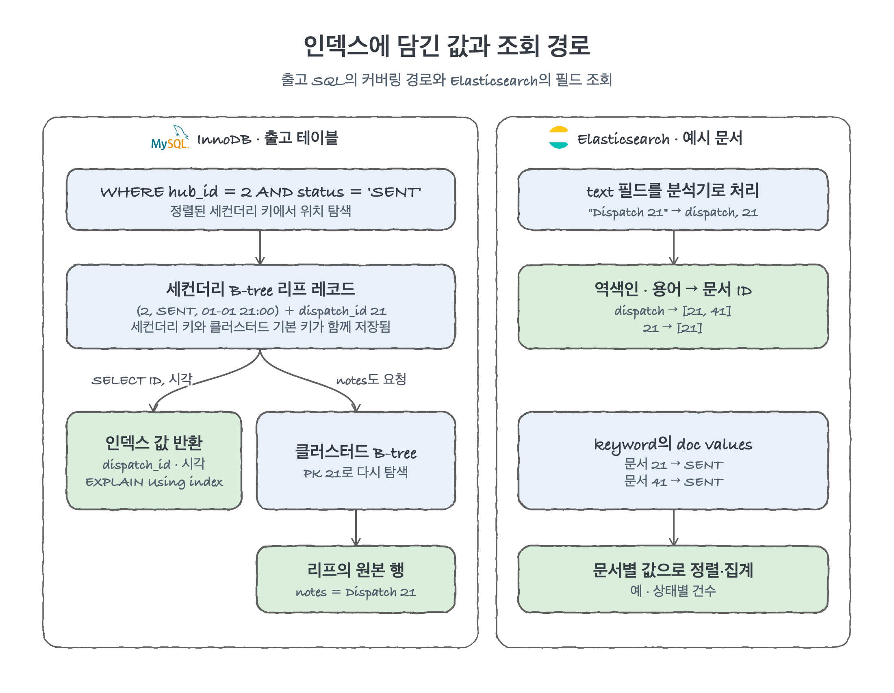

# Covering Indexes and Elasticsearch Indexing

커버링 인덱스는 특정 SQL 쿼리가 요구하는 열을 인덱스 항목에서 제공하는 접근 방식이다. Elasticsearch의 역색인은 검색어가 들어 있는 문서를 찾는 구조다. 두 경우 모두 어떤 질의를 빠르게 처리해야 하는지가 인덱스 설계의 출발점이다.

| 구조 | 저장 방향과 주요 용도 |
| --- | --- |
| InnoDB B-tree 인덱스 | 정렬된 키로 동등·범위 검색을 한다. 세컨더리 인덱스에 쿼리에 필요한 값이 있으면 그 인덱스에서 결과를 만들 수 있다. |
| Elasticsearch 역색인 | 용어에서 그 용어가 있는 문서로 찾는다. 기본적으로 `text` 필드는 분석기를 거쳐 전문 검색에 적합한 용어를 만든다. |
| Elasticsearch doc values | 문서에서 필드 값을 읽는 열 지향 구조다. `keyword`처럼 지원되는 필드에서 정렬과 집계에 쓰인다. |

[InnoDB Clustered and Secondary Indexes](https://dev.mysql.com/doc/refman/8.4/en/innodb-index-types.html) · [Elasticsearch Text Field](https://www.elastic.co/docs/reference/elasticsearch/mapping-reference/text) · [Elasticsearch Doc Values](https://www.elastic.co/docs/reference/elasticsearch/mapping-reference/doc-values)



그림의 근거 · [클러스터드·세컨더리 구조](https://dev.mysql.com/doc/refman/8.4/en/innodb-index-types.html) · [커버링 계획](https://dev.mysql.com/doc/refman/8.4/en/explain-output.html) · [text 분석기](https://www.elastic.co/docs/reference/elasticsearch/mapping-reference/text) · [역색인과 doc values](https://www.elastic.co/docs/reference/elasticsearch/mapping-reference/doc-values)

## 실습 · SELECT 열에 따라 달라지는 커버링

실습 환경은 MySQL 8.4(InnoDB)다. [01번의 출고 테이블](01_composite_indexes_and_access_types.md)을 사용한다.

```sql
EXPLAIN FORMAT=TRADITIONAL
SELECT dispatch_id, dispatched_at
FROM mysql_lab_dispatches
WHERE hub_id = 2 AND status = 'SENT';

EXPLAIN FORMAT=TRADITIONAL
SELECT dispatch_id, dispatched_at, notes
FROM mysql_lab_dispatches
WHERE hub_id = 2 AND status = 'SENT';
```

InnoDB의 세컨더리 인덱스에는 기본 키인 `dispatch_id`도 들어 있다. 첫 조회에서 해당 인덱스를 사용하면 `Extra`의 `Using index`로 커버링을 확인할 수 있다. 두 번째 조회는 `notes`가 필요하므로 같은 접근 경로를 사용해도 원본 행 조회가 추가된다. [EXPLAIN Output Format](https://dev.mysql.com/doc/refman/8.4/en/explain-output.html)
