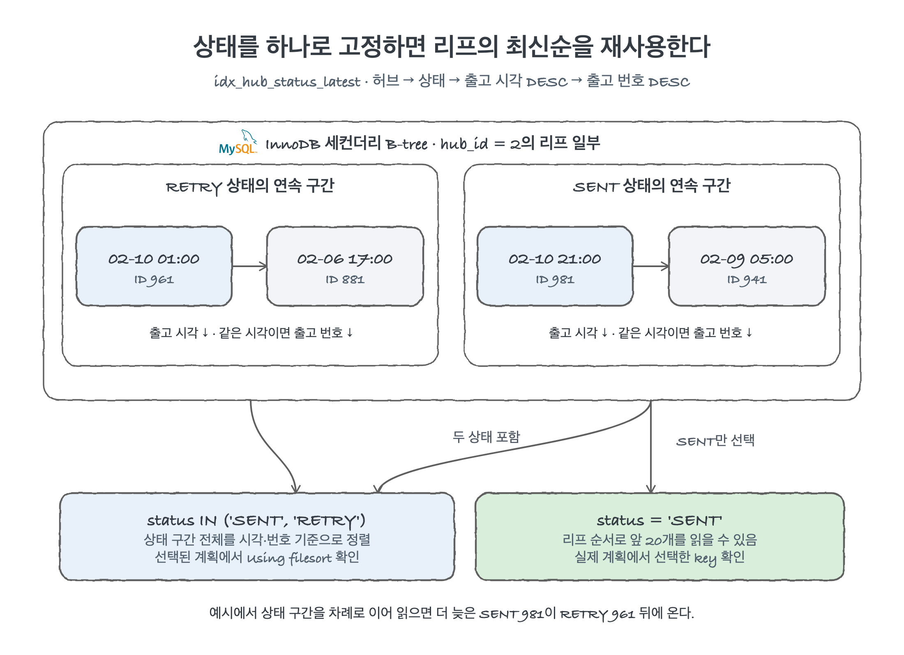

# ORDER BY Optimization with Indexes

`ORDER BY`의 열과 방향이 인덱스의 읽기 순서에 맞으면 MySQL은 정렬된 행을 인덱스에서 가져올 수 있다. 복합 인덱스의 선행 열을 각각 같은 값으로 고정하면 나머지 열의 순서가 결과 전체에 적용된다. 선행 열 중 하나가 여러 값을 가지면 그 뒤의 열은 각 값 그룹 안에서만 정렬되어 있다. [ORDER BY Optimization](https://dev.mysql.com/doc/refman/8.4/en/order-by-optimization.html)



그림의 근거 · [인덱스 순서와 정렬](https://dev.mysql.com/doc/refman/8.4/en/order-by-optimization.html) · [내림차순 키](https://dev.mysql.com/doc/refman/8.4/en/descending-indexes.html)

## 실습 · 선행 열을 고정한 경우와 여러 값을 읽는 경우

실습 환경은 MySQL 8.4(InnoDB)다. [01번의 출고 테이블](01_composite_indexes_and_access_types.md)을 사용한다. 인덱스에 정렬 보조 키를 명시해 같은 시각의 행 순서도 결정한다.

```sql
CREATE INDEX idx_hub_status_latest ON mysql_lab_dispatches
    (hub_id, status, dispatched_at DESC, dispatch_id DESC);

EXPLAIN FORMAT=TRADITIONAL
SELECT dispatch_id, dispatched_at
FROM mysql_lab_dispatches
WHERE hub_id = 2 AND status = 'SENT'
ORDER BY dispatched_at DESC, dispatch_id DESC
LIMIT 20;

EXPLAIN FORMAT=TRADITIONAL
SELECT dispatch_id, dispatched_at
FROM mysql_lab_dispatches
WHERE hub_id = 2 AND status IN ('SENT', 'RETRY')
ORDER BY dispatched_at DESC, dispatch_id DESC
LIMIT 20;

DROP INDEX idx_hub_status_latest ON mysql_lab_dispatches;
```

첫 조회는 허브와 상태를 고정해 한 구간의 정렬을 재사용할 수 있다. 두 번째 조회는 상태가 서로 다른 두 구간에서 전체 최신순을 만들어야 한다. `key`와 `Extra`에서 실제로 선택한 접근 경로와 `Using filesort` 여부를 확인한다.

복합 키의 정렬 방향이 모두 반대이면 역방향 스캔도 사용할 수 있다. `DESC, ASC`처럼 방향이 섞이면 인덱스의 방향 조합이나 그 전체를 뒤집은 조합이 맞아야 한다. [Descending Indexes](https://dev.mysql.com/doc/refman/8.4/en/descending-indexes.html) · [Diagnosing Filesort and Enabling Early Termination](../database-performance/07_diagnosing_filesort_and_enabling_early_termination.md)
