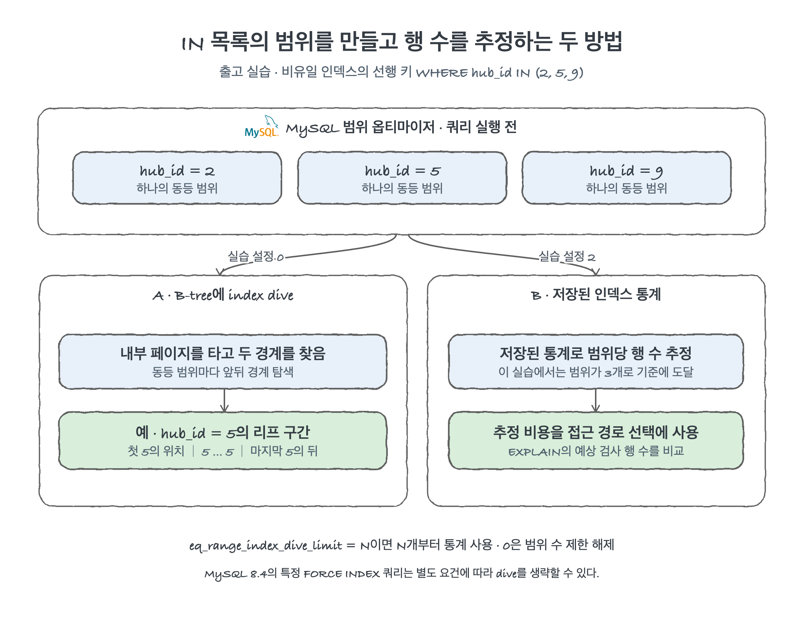

# Index Dives for IN Predicates

인덱스가 있는 열에 `IN (...)` 조건을 주면 MySQL 범위 옵티마이저는 여러 동등 범위를 고려한다. 비유일 인덱스의 동등 범위별 행 수를 추정할 때는 인덱스 구간의 양 끝을 탐색하는 index dive와 저장된 인덱스 통계 중 하나를 사용할 수 있다. 탐색은 값의 분포를 더 직접 반영할 수 있고, 범위가 많아지면 계획을 만드는 비용도 늘어난다. [Equality Range Optimization of Many-Valued Comparisons](https://dev.mysql.com/doc/refman/8.4/en/range-optimization.html)

## 동등 범위 수와 추정 방식

`eq_range_index_dive_limit`은 비유일 인덱스의 동등 범위가 많아질 때 통계를 사용할 기준을 조절한다. 대입 값이 `N`이면 해당 기준에서 최대 `N - 1`개 범위까지 탐색을 사용하며, `0`은 이 범위 수 제한을 없앤다. 유일 인덱스의 동등 범위는 최대 한 행으로 추정할 수 있다. MySQL 8.4에는 특정 단일 테이블 조회에서 단일 인덱스를 `FORCE INDEX`로 지정했을 때 탐색을 생략하는 별도 최적화도 있다. [Range Optimization](https://dev.mysql.com/doc/refman/8.4/en/range-optimization.html) · [Server System Variables](https://dev.mysql.com/doc/refman/8.4/en/server-system-variables.html#sysvar_eq_range_index_dive_limit)



그림의 근거 · [동등 범위 추정](https://dev.mysql.com/doc/refman/8.4/en/range-optimization.html) · [변수 기준값](https://dev.mysql.com/doc/refman/8.4/en/server-system-variables.html#sysvar_eq_range_index_dive_limit)

## 실습 · 세션에서 추정치 비교

실습 환경은 MySQL 8.4(InnoDB)다. [01번의 출고 테이블](01_composite_indexes_and_access_types.md)을 사용한다. 세션 값만 변경하고 비교가 끝나면 복원한다.

```sql
SET @saved_dive_limit = @@SESSION.eq_range_index_dive_limit;

SET SESSION eq_range_index_dive_limit = 0;
EXPLAIN FORMAT=JSON
SELECT dispatch_id, notes FROM mysql_lab_dispatches WHERE hub_id IN (2, 5, 9);

SET SESSION eq_range_index_dive_limit = 2;
EXPLAIN FORMAT=JSON
SELECT dispatch_id, notes FROM mysql_lab_dispatches WHERE hub_id IN (2, 5, 9);

SET SESSION eq_range_index_dive_limit = @saved_dive_limit;
```

`rows_examined_per_scan`과 선택한 접근 경로를 비교한다. 균등 분포에서는 두 추정이 비슷할 수 있다. 값의 빈도가 치우친 데이터에서도 비교하고, 계획 비용과 결과 행 수는 [EXPLAIN ANALYZE](../database-performance/03_measuring_query_execution_with_explain_analyze.md)로 대조한다.
