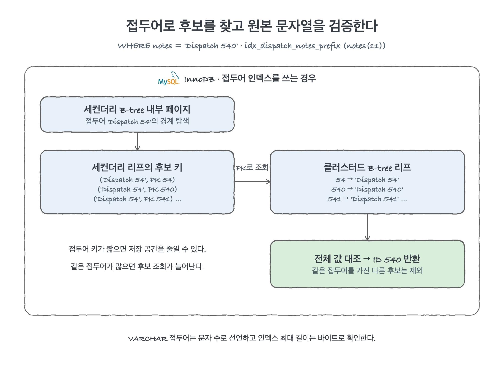

# Prefix Index Trade-Offs

MySQL의 접두어 인덱스는 문자열 또는 바이너리 열의 앞부분을 키로 저장한다. 긴 값의 앞부분만으로도 후보를 충분히 줄일 수 있다면 인덱스 공간을 절약할 수 있다. 같은 접두어가 자주 반복되면 후보를 많이 읽고 원래 값으로 다시 비교해야 한다. [Column Indexes](https://dev.mysql.com/doc/refman/8.4/en/column-indexes.html)

## 키 길이를 정할 때 살필 점

- `VARCHAR`의 접두어 길이는 문자 수다. 인덱스의 최대 키 길이는 바이트 기준이므로 멀티바이트 문자 집합의 영향을 받는다.
- 전체 열을 반환해야 할 때 접두어만 담은 인덱스로는 그 값을 재구성할 수 없다. 접두어 이후의 문자에 따라 달라지는 전체 값의 정렬 순서도 제공할 수 없다.
- 유일 접두어 인덱스는 접두어 자체의 유일성을 강제한다. 서로 다른 전체 값이라도 접두어가 같으면 함께 저장할 수 없다.

[Column Indexes](https://dev.mysql.com/doc/refman/8.4/en/column-indexes.html) · [CREATE INDEX](https://dev.mysql.com/doc/refman/8.4/en/create-index.html) · [ORDER BY Optimization](https://dev.mysql.com/doc/refman/8.4/en/order-by-optimization.html)



그림의 근거 · [접두어 길이와 후보](https://dev.mysql.com/doc/refman/8.4/en/column-indexes.html) · [문자 길이와 바이트 한도](https://dev.mysql.com/doc/refman/8.4/en/create-index.html) · [PK로 원본 행 탐색](https://dev.mysql.com/doc/refman/8.4/en/innodb-index-types.html)

## 실습 · 길이별로 구별되는 값의 비율 비교

실습 환경은 MySQL 8.4(InnoDB)다. [01번의 출고 테이블](01_composite_indexes_and_access_types.md)에서 `notes`를 예로 사용한다.

```sql
SELECT COUNT(DISTINCT LEFT(notes, 9)) / NULLIF(COUNT(*), 0) AS prefix_9_ratio,
       COUNT(DISTINCT LEFT(notes, 11)) / NULLIF(COUNT(*), 0) AS prefix_11_ratio,
       COUNT(DISTINCT notes) / NULLIF(COUNT(*), 0) AS full_value_ratio
FROM mysql_lab_dispatches;

CREATE INDEX idx_dispatch_notes_prefix ON mysql_lab_dispatches (notes(11));

EXPLAIN FORMAT=TRADITIONAL
SELECT dispatch_id, notes FROM mysql_lab_dispatches WHERE notes = 'Dispatch 540';

DROP INDEX idx_dispatch_notes_prefix ON mysql_lab_dispatches;
```

전체 비율과 접두어 비율을 비교하고, 실제로 자주 검색하는 값에서 후보가 얼마나 겹치는지도 확인한다. 특정 접두어에 값이 몰려 있으면 전체 비율이 높아도 그 구간의 조회 비용은 커질 수 있다.
