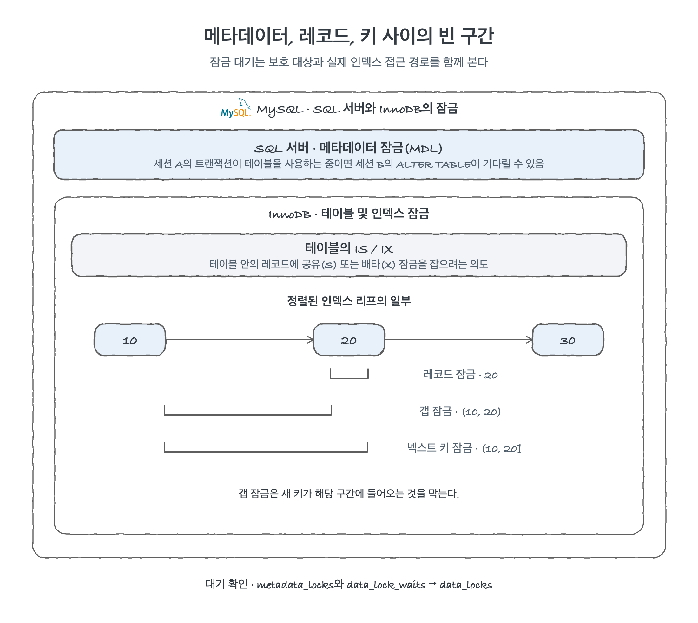

# MySQL and InnoDB Lock Types

MySQL에서는 잠금이 보호하는 대상을 먼저 구분한다. SQL 서버의 메타데이터 잠금은 객체 정의를 보호하고, InnoDB는 테이블과 인덱스 레코드 및 키 구간을 보호한다. 데이터 조회가 느릴 때는 대기 중인 잠금의 종류와 이를 보유한 세션을 함께 찾는다. [Metadata Locking](https://dev.mysql.com/doc/refman/8.4/en/metadata-locking.html) · [InnoDB Locking](https://dev.mysql.com/doc/refman/8.4/en/innodb-locking.html)

| 잠금 | InnoDB에서 보호하는 대상 |
| --- | --- |
| 공유(`S`)·배타(`X`) 잠금 | 같은 레코드의 읽기 잠금끼리는 공존할 수 있다. 배타 잠금은 같은 레코드에 대한 다른 공유·배타 잠금과 충돌한다. |
| 의도 잠금(`IS`·`IX`) | 테이블 수준에서 그 안의 행에 공유·배타 잠금을 잡으려는 의도를 표시한다. |
| 레코드 잠금 | 인덱스 레코드를 보호한다. 복합 유일 키의 모든 열을 동등 비교해 존재하는 행을 찾으면 해당 레코드만 잠글 수 있다. |
| 갭 잠금 | 인덱스 레코드 사이의 빈 구간에 다른 트랜잭션이 삽입하는 것을 막는다. |
| 넥스트 키 잠금 | 레코드 잠금과 그 레코드 바로 앞 갭 잠금을 함께 잡는다. |
| 삽입 의도 잠금 | 삽입에 앞서 해당 갭에 설정된다. 같은 갭의 서로 다른 위치에 삽입하는 작업은 서로를 막지 않을 수 있다. |

일반 `SELECT`는 `READ COMMITTED`나 `REPEATABLE READ`에서 보통 MVCC 스냅샷을 읽는다. `FOR SHARE`, `FOR UPDATE`와 쓰기 문장은 잠금을 획득하며, 잠금 범위는 검색 조건, 실제 접근 경로와 격리 수준에 따라 달라진다. InnoDB의 `READ COMMITTED`에서는 검색과 인덱스 스캔의 갭 잠금을 대부분 사용하지 않지만 외래 키와 중복 키 검사에서는 사용할 수 있다. [Locks Set by SQL Statements](https://dev.mysql.com/doc/refman/8.4/en/innodb-locks-set.html) · [Transaction Isolation Levels](https://dev.mysql.com/doc/refman/8.4/en/innodb-transaction-isolation-levels.html)



그림의 근거 · [메타데이터 잠금과 DDL 대기](https://dev.mysql.com/doc/refman/8.4/en/metadata-locking.html) · [InnoDB 잠금과 구간](https://dev.mysql.com/doc/refman/8.4/en/innodb-locking.html) · [잠금 확인 테이블](https://dev.mysql.com/doc/refman/8.4/en/performance-schema-lock-tables.html)

## 대기 원인 조회

실습 환경은 MySQL 8.4(InnoDB)다. Performance Schema 조회 권한이 있는 세션에서 다음 테이블을 확인한다.

```sql
SELECT * FROM performance_schema.data_lock_waits;
SELECT * FROM performance_schema.data_locks;
SELECT OBJECT_TYPE, OBJECT_SCHEMA, OBJECT_NAME, LOCK_TYPE, LOCK_STATUS, OWNER_THREAD_ID
FROM performance_schema.metadata_locks
WHERE LOCK_STATUS = 'PENDING';
```

`data_lock_waits`에서 요청 잠금과 차단 잠금 ID를 찾고, `data_locks`의 `ENGINE_LOCK_ID`와 맞춰 테이블과 인덱스를 확인한다. [Performance Schema Lock Tables](https://dev.mysql.com/doc/refman/8.4/en/performance-schema-lock-tables.html)
