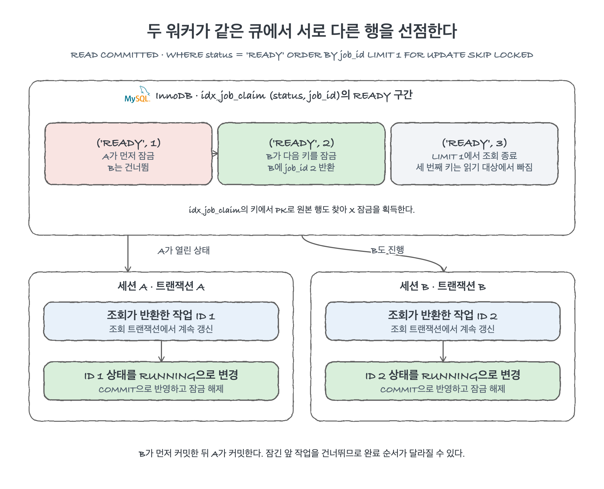

# Locking Reads with SKIP LOCKED

`SELECT ... FOR UPDATE SKIP LOCKED`는 다른 트랜잭션에 잠긴 행을 기다리지 않고 건너뛰어 잠글 수 있는 행을 반환한다. 여러 워커가 하나의 작업 큐를 읽을 때 서로 다른 작업을 선점하는 데 쓸 수 있다. 정렬 앞쪽의 작업이 잠겨 있으면 뒤쪽 작업을 먼저 가져갈 수 있으므로 엄격한 FIFO 처리는 별도로 설계한다. [Locking Reads](https://dev.mysql.com/doc/refman/8.4/en/innodb-locking-reads.html)

| 잠금 읽기 | 이미 잠긴 행을 만났을 때 |
| --- | --- |
| `FOR UPDATE` | 잠금이 풀리거나 대기 시간이 초과될 때까지 기다린다. |
| `FOR UPDATE NOWAIT` | 즉시 잠금 오류를 반환한다. |
| `FOR UPDATE SKIP LOCKED` | 그 행을 제외하고 계속 찾는다. 잠글 수 있는 행이 없으면 빈 결과가 나올 수 있다. |

`NOWAIT`과 `SKIP LOCKED`는 행 수준 잠금에 적용한다. 건너뛴 행이 빠진 결과는 전체 데이터를 일관되게 읽어야 하는 조회에 적합하지 않다. MySQL 매뉴얼은 이 옵션을 포함한 문장이 문장 기반 복제에서 안전하지 않다고 설명한다. [Locking Reads](https://dev.mysql.com/doc/refman/8.4/en/innodb-locking-reads.html)



그림의 근거 · [SKIP LOCKED 동작](https://dev.mysql.com/doc/refman/8.4/en/innodb-locking-reads.html) · [세컨더리와 클러스터드 잠금](https://dev.mysql.com/doc/refman/8.4/en/innodb-locks-set.html)

## 실습 · 두 세션에서 서로 다른 작업 선점

실습 환경은 MySQL 8.4(InnoDB)다. 같은 스키마의 두 세션을 사용한다. 먼저 테이블과 작업을 한 번 만든다.

```sql
CREATE TABLE mysql_lab_jobs (
    job_id INT PRIMARY KEY,
    status VARCHAR(12) NOT NULL,
    INDEX idx_job_claim (status, job_id)
) ENGINE = InnoDB;

INSERT INTO mysql_lab_jobs VALUES (1, 'READY'), (2, 'READY'), (3, 'READY');
COMMIT;
```

세션 A에서 다음 문장을 실행하고 트랜잭션을 열어 둔다. 처음에는 작업 `1`을 선택한다.

```sql
SET TRANSACTION ISOLATION LEVEL READ COMMITTED;
START TRANSACTION;
SELECT job_id FROM mysql_lab_jobs FORCE INDEX (idx_job_claim)
WHERE status = 'READY'
ORDER BY job_id LIMIT 1 FOR UPDATE SKIP LOCKED;
```

세션 B에서 같은 블록을 실행한다. A가 선점한 행을 건너뛰고 작업 `2`를 선택한다. 그 결과를 사용해 같은 트랜잭션에서 작업 상태를 갱신한 후 커밋한다.

```sql
UPDATE mysql_lab_jobs SET status = 'RUNNING' WHERE job_id = 2;
COMMIT;
```

세션 A로 돌아와 선택한 작업 `1`의 상태를 바꾸고 커밋한다.

```sql
UPDATE mysql_lab_jobs SET status = 'RUNNING' WHERE job_id = 1;
COMMIT;
```

실제 코드에서는 조회가 반환한 ID를 갱신에 사용한다. 상태 변경을 커밋한 뒤 오래 걸리는 처리를 시작하면 잠금 보유 시간을 줄일 수 있다. 워커 장애에 대비해 `RUNNING` 상태의 만료와 재처리 기준을 정하고, 같은 작업이 재시도되더라도 효과가 중복되지 않게 처리한다.
