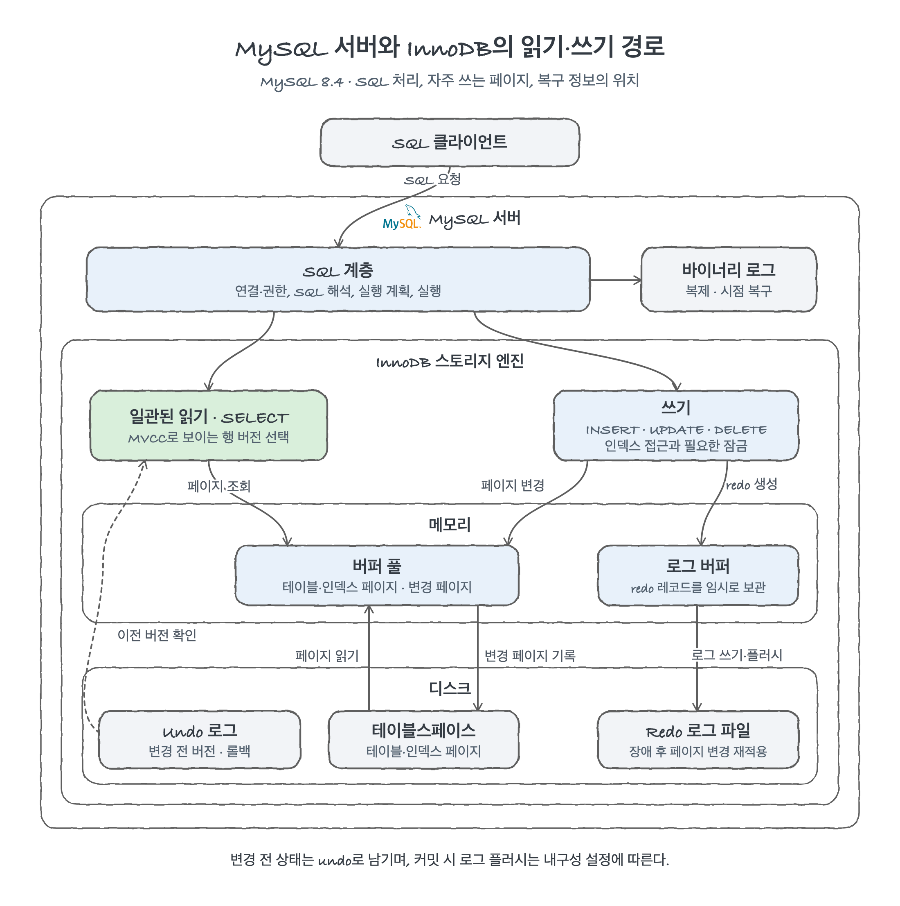

# MySQL Architecture and InnoDB Internals

MySQL 서버는 연결과 권한, SQL 해석, 실행 계획과 연산자를 관리한다. 스토리지 엔진은 테이블의 저장 형식과 인덱스 접근, 트랜잭션 지원을 맡는다. InnoDB는 클러스터드 인덱스와 세컨더리 인덱스를 사용하고, 트랜잭션과 MVCC를 지원한다. 실습 환경은 MySQL 8.4(InnoDB)다. [InnoDB Architecture](https://dev.mysql.com/doc/refman/8.4/en/innodb-architecture.html) · [Clustered and Secondary Indexes](../database-performance/06_clustered_and_secondary_indexes.md)



그림의 근거 · [MySQL의 서버·스토리지 엔진 구조](https://dev.mysql.com/doc/refman/8.4/en/pluggable-storage-overview.html) · [InnoDB 메모리·디스크 구조](https://dev.mysql.com/doc/refman/8.4/en/innodb-architecture.html) · [버퍼 풀 페이지 기록](https://dev.mysql.com/doc/refman/8.4/en/innodb-buffer-pool-flushing.html) · [일관된 읽기와 스냅샷](https://dev.mysql.com/doc/refman/8.4/en/innodb-consistent-read.html) · [Undo 로그](https://dev.mysql.com/doc/refman/8.4/en/innodb-undo-logs.html) · [Redo 로그 버퍼](https://dev.mysql.com/doc/refman/8.4/en/innodb-redo-log-buffer.html) · [Redo 로그 파일](https://dev.mysql.com/doc/refman/8.4/en/innodb-redo-log.html) · [서버 바이너리 로그](https://dev.mysql.com/doc/refman/8.4/en/binary-log.html)

## 1. 메모리와 로그가 하는 일

| 구성 요소 | 역할 |
| --- | --- |
| 버퍼 풀 | 테이블과 인덱스 페이지를 메모리에 보관한다. 변경된 페이지도 메모리에 있다가 나중에 기록될 수 있다. |
| redo 로그 | 페이지 변경을 복구하는 데 필요한 정보를 기록한다. 장애가 발생했을 때 아직 데이터 파일에 반영되지 않은 변경을 복구하는 데 사용한다. |
| undo 로그 | 트랜잭션을 롤백할 때 변경 전 상태를 되돌릴 수 있게 한다. 일관된 읽기가 이전 행 버전을 찾을 때도 사용한다. |
| 바이너리 로그 | 서버 수준에서 데이터 변경 이벤트를 기록하며 복제와 시점 복구에 쓰인다. |

[Buffer Pool](https://dev.mysql.com/doc/refman/8.4/en/innodb-buffer-pool.html) · [Redo Log](https://dev.mysql.com/doc/refman/8.4/en/innodb-redo-log.html) · [Undo Logs](https://dev.mysql.com/doc/refman/8.4/en/innodb-undo-logs.html) · [The Binary Log](https://dev.mysql.com/doc/refman/8.4/en/binary-log.html)

## 2. 트랜잭션, 스냅샷, 잠금

- 일반적인 일관된 읽기에서는 MVCC가 행의 가시성을 판단한다. InnoDB의 `REPEATABLE READ`는 한 트랜잭션에서 첫 일관된 읽기의 스냅샷을 재사용한다. `READ COMMITTED`는 일관된 읽기마다 새 스냅샷을 얻는다.
- `SELECT ... FOR UPDATE`, `UPDATE`, `DELETE`는 다른 쓰기와 충돌할 수 있는 잠금을 획득한다. 같은 조건이라도 격리 수준과 인덱스 경로에 따라 잠그는 레코드와 범위가 달라질 수 있다.
- 오래 열린 읽기 트랜잭션은 그 스냅샷에 필요한 이전 버전의 정리를 늦출 수 있다. 쓰기 트랜잭션에서는 오래 유지하는 잠금 때문에 다른 세션이 대기할 수 있다.

[Consistent Nonlocking Reads](https://dev.mysql.com/doc/refman/8.4/en/innodb-consistent-read.html) · [Transaction Isolation Levels](https://dev.mysql.com/doc/refman/8.4/en/innodb-transaction-isolation-levels.html) · [MySQL and InnoDB Lock Types](08_mysql_and_innodb_lock_types.md)

## 3. 운영 지표 확인

```sql
SELECT @@GLOBAL.innodb_buffer_pool_size, @@GLOBAL.innodb_flush_log_at_trx_commit,
       @@SESSION.transaction_isolation;

SHOW ENGINE INNODB STATUS;
```

`SHOW ENGINE INNODB STATUS`는 권한이 있는 계정에서 실행한다. `TRANSACTIONS`와 `BUFFER POOL AND MEMORY`를 보면 쿼리 지연이 락 대기나 페이지 읽기 증가와 함께 나타나는지 조사할 수 있다. 한 시점의 값은 관측 구간의 상태 지표와 비교한다. [InnoDB Standard Monitor Output](https://dev.mysql.com/doc/refman/8.4/en/innodb-standard-monitor.html)
