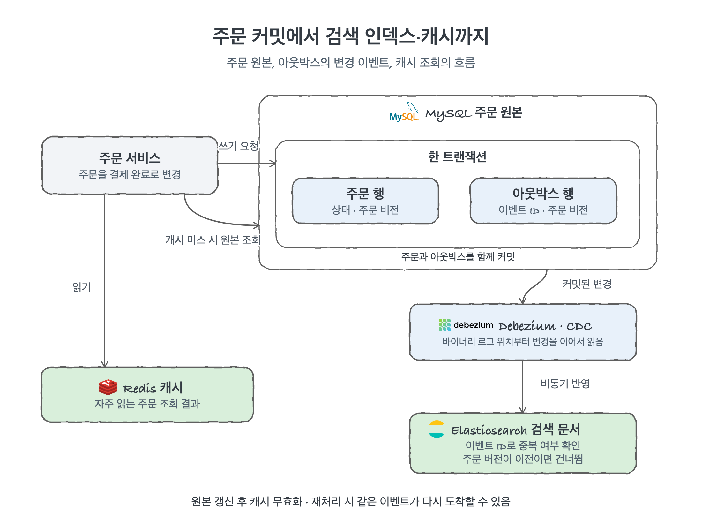

# Production Data Processing and System Design

주문 서비스에서 결제와 주문 상태의 원본은 MySQL에 저장한다. 주문 검색, 알림, 집계에는 각각 다른 읽기 방식과 처리 지연이 허용된다. 원본 변경과 후속 작업을 연결할 때는 커밋 경계, 처리 위치, 실패 후 재시도 방법을 명시한다.



그림의 근거 · [트랜잭셔널 아웃박스](https://docs.aws.amazon.com/prescriptive-guidance/latest/cloud-design-patterns/transactional-outbox.html) · [Debezium MySQL CDC](https://debezium.io/documentation/reference/stable/connectors/mysql.html) · [캐시 어사이드 패턴](https://learn.microsoft.com/en-us/azure/architecture/patterns/cache-aside)

## 1. 스트리밍 변경 데이터 처리

변경 데이터 캡처(CDC)는 MySQL 바이너리 로그에서 커밋된 삽입·수정·삭제를 읽어 하류 시스템에 전달할 수 있다. Debezium의 MySQL 커넥터는 필요에 따라 초기 스냅샷을 만들고 바이너리 로그의 위치를 이어서 읽는다. 운영에서는 처리 위치, 이벤트가 발생한 뒤 반영되기까지의 지연, 소스에서 필요한 로그를 보존하는 기간을 관찰한다. 재시작이나 재처리에서 동일한 변경이 도착할 수 있으므로 소비자가 중복을 처리할 수 있어야 한다. [Debezium MySQL Connector](https://debezium.io/documentation/reference/stable/connectors/mysql.html)

## 2. 대용량 배치와 체크포인트

안정된 입력 집합을 키 범위별로 나누고, 각 배치의 출력이 성공한 뒤 처리한 키를 기록한다. 다시 실행할 때 같은 범위가 들어와도 결과가 중복되지 않도록 출력 키나 처리 이력을 사용한다. 배치 크기는 트랜잭션 시간, 메모리, 복제 지연을 보며 조정한다.

실습 환경은 MySQL 8.4(InnoDB)다. [13번의 주문 스키마](13_practical_database_design_and_data_modeling.md)와 [14번의 주문 데이터](14_optimizing_crud_queries_in_mysql.md)를 사용한다. 아래 예시는 입력 구간이 이미 확정된 백필에서 마지막 처리 키 이후를 읽는다.

```sql
SET @last_order_id = 0;
SET @batch_end_order_id = 503;

SELECT order_id, customer_id, order_state, ordered_at
FROM mysql_lab_service_orders
WHERE order_id > @last_order_id AND order_id <= @batch_end_order_id
ORDER BY order_id
LIMIT 2;
```

첫 결과의 501·502번이 대상 저장소에 반영된 뒤 502를 체크포인트로 기록한다. 다음 실행은 503번을 읽는다. 실시간 쓰기가 계속되는 테이블에서는 키의 증가 순서와 커밋 순서가 다를 수 있다. 종료 시점까지 모든 변경을 반영해야 한다면 일관된 스냅샷과 CDC 위치를 맞추거나 확정된 입력에서 배치한다. [Consistent Nonlocking Reads](https://dev.mysql.com/doc/refman/8.4/en/innodb-consistent-read.html) · [Debezium MySQL Connector](https://debezium.io/documentation/reference/stable/connectors/mysql.html)

## 3. 실시간 동기화와 트랜잭셔널 아웃박스

주문을 결제 완료로 바꾸는 트랜잭션에서 아웃박스 행도 기록한다. 별도 릴레이 또는 CDC가 커밋된 아웃박스 행을 전달한다. 이벤트에는 고유한 이벤트 ID, 주문 ID, 주문 버전을 포함할 수 있다. 이벤트 ID는 중복 처리를 막는 데 쓰고, 주문 버전은 늦게 도착한 이전 상태가 더 최신 상태를 덮어쓰는 것을 막는 데 쓸 수 있다. [Transactional Outbox Pattern](https://docs.aws.amazon.com/prescriptive-guidance/latest/cloud-design-patterns/transactional-outbox.html)

## 4. MySQL 작업 큐와 비동기 워커

작업 큐는 요청을 받은 시점과 실제 실행 시점을 분리한다. 여러 워커가 MySQL 큐를 공유할 때는 [SKIP LOCKED 예제](11_locking_reads_with_skip_locked.md)처럼 읽기와 선점 상태 변경을 짧은 트랜잭션으로 묶고, 커밋 후 실제 작업을 시작한다. 작업 상태, 시도 횟수, 다음 실행 시각과 선점 만료 시각을 기록하면 실패한 작업을 다시 예약할 수 있다. 선점이 만료되어 다른 워커가 작업을 가져갈 수 있으므로 완료 갱신에는 현재 선점 토큰을 조건으로 확인한다. 외부 시스템에 수행하는 작업에도 별도의 멱등 키가 필요할 수 있다. [Locking Reads](https://dev.mysql.com/doc/refman/8.4/en/innodb-locking-reads.html) · [Queue-Based Load Leveling](https://learn.microsoft.com/en-us/azure/architecture/patterns/queue-based-load-leveling)

## 5. MySQL과 NoSQL을 함께 쓰는 구성

| 역할 | 주문 서비스에서의 예 |
| --- | --- |
| MySQL 원본 | 결제와 주문 상태를 트랜잭션으로 관리한다. 최종 상태나 최신성이 중요한 화면은 원본에서 확인한다. |
| Elasticsearch 검색 문서 | 주문 데이터에서 검색에 필요한 필드만 비동기로 반영한다. 검색 인덱스의 반영 지연과 재구축 절차를 정한다. |
| Redis 캐시 | 조회 결과를 키로 저장하고 캐시 미스 시 원본에서 읽는다. 원본 쓰기 후 무효화와 TTL을 사용해 오래된 값이 남는 시간을 관리한다. |

파생 저장소마다 허용 가능한 지연과 복구 방법을 정한다. 예를 들어 검색 문서를 다시 만들 때는 초기 데이터와 그 이후 변경이 빠지지 않도록 스냅샷과 이벤트 위치를 함께 관리한다. [Covering Indexes and Elasticsearch Indexing](02_covering_indexes_and_elasticsearch_indexing.md) · [Cache-Aside Pattern](https://learn.microsoft.com/en-us/azure/architecture/patterns/cache-aside) · [Debezium MySQL Connector](https://debezium.io/documentation/reference/stable/connectors/mysql.html)
