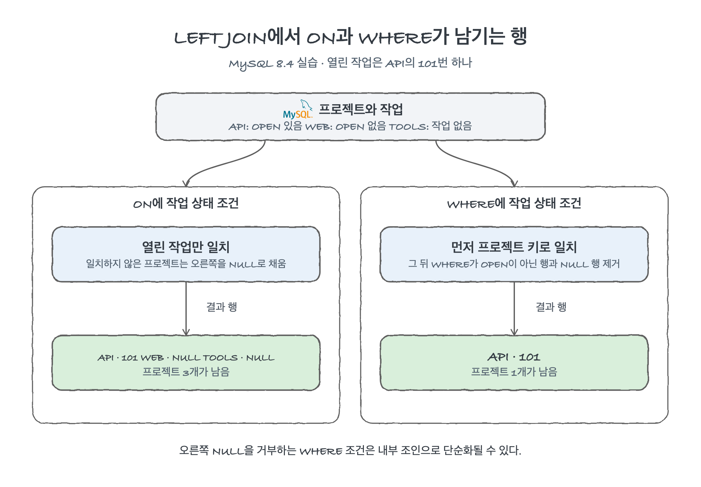

# MySQL Joins, Subqueries, and Query Rewrites

조인 종류는 결과에 어떤 행을 남길지 결정하고, 실행 알고리즘은 그 결과를 얻는 방법을 결정한다. 실습 환경은 MySQL 8.4(InnoDB)다. [18번의 프로젝트·작업 데이터](18_mysql_dml_fundamentals_and_advanced_query_patterns.md)를 사용한다.

## 1. 조인의 결과와 실행

| 논리 연산 | 남기는 행 |
| --- | --- |
| INNER JOIN | 조건에 일치하는 행의 조합 |
| LEFT JOIN | 왼쪽의 모든 행. 오른쪽에 일치 행이 없으면 오른쪽 열을 NULL로 채운다. |
| RIGHT JOIN | 오른쪽의 모든 행. MySQL 옵티마이저는 테이블 순서를 바꿔 LEFT JOIN으로 변환할 수 있다. |
| 의도적인 카테시안 곱 | 조인 조건을 제한하지 않아 두 입력의 모든 조합을 만든다. |
| SELF JOIN | 같은 테이블에 서로 다른 별칭을 지정해 행 사이의 관계를 찾는다. |

중첩 루프는 바깥 입력의 각 행을 기준으로 안쪽 입력을 탐색한다. 안쪽 조인 열에 인덱스가 있으면 반복 탐색에서 읽는 범위를 줄일 수 있다. 외부 조인의 중첩 루프를 설명할 때는 안쪽에서 일치 행을 찾았는지 표시하는 플래그를 사용한다. MySQL의 `MATCH() AGAINST()`는 FULLTEXT 검색을 위한 별도 SQL 기능이다. [MySQL JOIN Syntax](https://dev.mysql.com/doc/refman/8.4/en/join.html) · [Nested Join Optimization](https://dev.mysql.com/doc/refman/8.4/en/nested-join-optimization.html) · [Full-Text Search Functions](https://dev.mysql.com/doc/refman/8.4/en/fulltext-search.html) · [Join Algorithms and Join Order Optimization](../database-performance/11_join_algorithms_and_join_order_optimization.md)



그림의 근거 · [MySQL LEFT JOIN의 NULL 보완](https://dev.mysql.com/doc/refman/8.4/en/join.html) · [MySQL 외부 조인 단순화](https://dev.mysql.com/doc/refman/8.4/en/outer-join-simplification.html)

## 2. LEFT JOIN의 ON 조건과 WHERE 조건

```sql
SELECT p.project_code, t.task_id
FROM mysql_lab_projects AS p
LEFT JOIN mysql_lab_tasks AS t
    ON t.project_id = p.project_id AND t.task_state = 'OPEN'
ORDER BY p.project_id, t.task_id;

SELECT p.project_code, t.task_id
FROM mysql_lab_projects AS p
LEFT JOIN mysql_lab_tasks AS t ON t.project_id = p.project_id
WHERE t.task_state = 'OPEN'
ORDER BY p.project_id, t.task_id;
```

첫 조회는 열린 작업이 없는 WEB과 TOOLS도 남긴다. 두 번째 조회에서 WEB의 작업은 상태 조건을 통과하지 못하고, TOOLS에 대해 NULL로 채운 행도 비교식이 참이 되지 않아 제외된다. 이런 NULL 거부 조건에서는 옵티마이저가 외부 조인을 내부 조인으로 바꿀 수 있다. 프로젝트를 남기면서 일치 작업 수를 셀 때는 오른쪽의 NULL 불가 열에 `COUNT(t.task_id)`를 적용한다. [Outer Join Simplification](https://dev.mysql.com/doc/refman/8.4/en/outer-join-simplification.html)

## 3. 서브쿼리 변환, CTE, 구문 트리

SQL을 파싱하면 조인·필터·서브쿼리 등의 구조를 나타내는 구문 트리로 볼 수 있다. 옵티마이저는 결과가 같음을 보장하는 범위에서 그 구조를 변환하고 실행 계획을 고른다. 서브쿼리 펼치기의 한 예는 요건을 만족하는 `IN`이나 `EXISTS`를 세미조인으로 바꾸는 것이다. 세미조인은 안쪽에 여러 행이 일치해도 바깥 행을 중복해 출력할 필요가 없다. 부정 조건에서 `NOT IN`은 비교 대상에 NULL이 있으면 결과가 달라질 수 있으므로 `NOT EXISTS`와 바꾸기 전에 의미를 확인한다. [Semijoin and Antijoin Transformations](https://dev.mysql.com/doc/refman/8.4/en/semijoins-antijoins.html)

```sql
EXPLAIN FORMAT=TRADITIONAL
SELECT p.project_id
FROM mysql_lab_projects AS p
WHERE EXISTS (
    SELECT 1 FROM mysql_lab_tasks AS t
    WHERE t.project_id = p.project_id AND t.task_state = 'OPEN'
);
SHOW WARNINGS;

EXPLAIN FORMAT=TREE
WITH open_tasks AS (
    SELECT project_id, task_id FROM mysql_lab_tasks WHERE task_state = 'OPEN'
)
SELECT p.project_code, o.task_id
FROM mysql_lab_projects AS p
JOIN open_tasks AS o ON o.project_id = p.project_id;
```

`EXPLAIN` 직후의 `SHOW WARNINGS`에서 옵티마이저 변환 메시지를 확인할 수 있다. CTE는 이름을 붙인 쿼리 블록이며, MySQL은 조건에 따라 바깥 쿼리와 병합하거나 중간 결과로 구체화한다. 실행 계획의 물리 연산자와 SQL의 문법 구조를 구분해서 읽는다. [EXPLAIN Output Format](https://dev.mysql.com/doc/refman/8.4/en/explain-output.html) · [Derived Table, View, and CTE Optimization](https://dev.mysql.com/doc/refman/8.4/en/derived-table-optimization.html)
