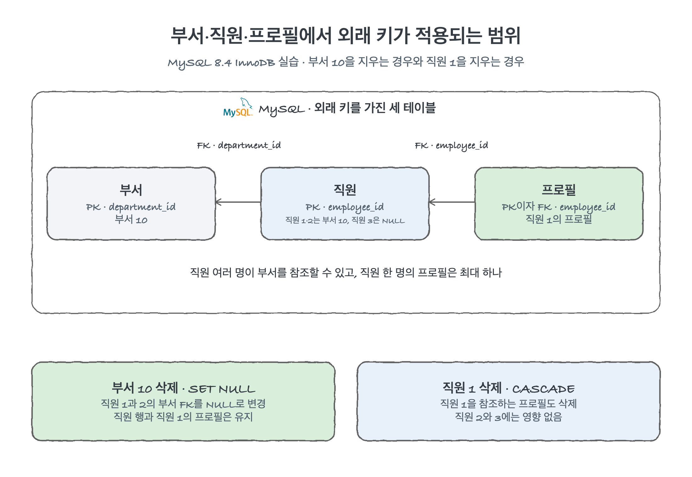

# Foreign Keys and Referential Integrity in MySQL

관계형 모델의 참조 무결성은 다른 테이블의 행을 가리키는 값이 유효하도록 하는 규칙이다. 외래 키는 그 규칙을 스키마에 선언해 자식 행을 추가하거나 부모 키를 변경하는 여러 쓰기 경로에 일관되게 적용한다. 실습 환경은 MySQL 8.4(InnoDB)다. [Data Integrity and Constraints](../database/09_data_integrity_and_constraints.md) · [MySQL FOREIGN KEY Constraints](https://dev.mysql.com/doc/refman/8.4/en/create-table-foreign-keys.html)

## 1. 제약 검사와 참조 동작

| 동작 | 부모 키 갱신 또는 부모 행 삭제 시 결과 |
| --- | --- |
| `RESTRICT` | 자식 행이 참조할 때 변경을 거부한다. |
| `NO ACTION` | InnoDB에서는 `RESTRICT`와 같이 변경을 즉시 거부한다. |
| `CASCADE` | 부모 키 변경을 자식에게 전달하거나, 삭제 시 해당 자식 행도 제거한다. |
| `SET NULL` | 자식의 외래 키를 NULL로 바꾼다. 해당 열은 NULL을 허용해야 한다. |

자식 열에는 외래 키를 검사할 인덱스가 필요하다. 쓸 수 있는 인덱스가 없으면 MySQL이 자식 쪽에 생성한다. 부모 참조 키를 기본 키나 유일 키로 정의하면 참조 대상이 명확하다. `foreign_key_checks`를 끈 동안 추가한 데이터는 값을 다시 켜도 자동으로 재검사되지 않는다. [MySQL FOREIGN KEY Constraints](https://dev.mysql.com/doc/refman/8.4/en/create-table-foreign-keys.html)



그림의 근거 · [MySQL 외래 키와 참조 동작](https://dev.mysql.com/doc/refman/8.4/en/create-table-foreign-keys.html)

## 2. 실습 · 선택적 참조와 일대일 제약

```sql
CREATE TABLE mysql_lab_fk_departments (
    department_id INT PRIMARY KEY,
    name VARCHAR(40) NOT NULL
) ENGINE = InnoDB;

CREATE TABLE mysql_lab_fk_employees (
    employee_id INT PRIMARY KEY,
    department_id INT,
    FOREIGN KEY (department_id) REFERENCES mysql_lab_fk_departments (department_id)
        ON UPDATE CASCADE ON DELETE SET NULL
) ENGINE = InnoDB;

CREATE TABLE mysql_lab_fk_profiles (
    employee_id INT PRIMARY KEY,
    display_name VARCHAR(60) NOT NULL,
    FOREIGN KEY (employee_id) REFERENCES mysql_lab_fk_employees (employee_id)
        ON DELETE CASCADE
) ENGINE = InnoDB;

INSERT INTO mysql_lab_fk_departments VALUES (10, 'Operations');
INSERT INTO mysql_lab_fk_employees VALUES (1, 10), (2, 10), (3, NULL);
INSERT INTO mysql_lab_fk_profiles VALUES (1, 'Ari');

SELECT e.employee_id, d.name
FROM mysql_lab_fk_employees AS e
LEFT JOIN mysql_lab_fk_departments AS d ON d.department_id = e.department_id
ORDER BY e.employee_id;
```

부서 외래 키는 여러 직원이 같은 부서를 참조하는 것을 허용한다. 프로필은 외래 키가 기본 키이기도 하므로 직원별로 최대 한 행만 가질 수 있다. 위 왼쪽 조인은 부서가 없는 직원도 남긴다.

## 3. 외래 키와 조인 조건은 다른 규칙

외래 키를 선언해도 SELECT에서 어떤 열로 조인할지는 직접 지정한다. `ON 1 = 1`은 양쪽 키의 관계를 표현하지 않고 모든 행 쌍을 일치시킨다. INNER JOIN에서는 카테시안 곱을 만들며, LEFT JOIN은 오른쪽 입력이 비었을 때도 왼쪽 행을 보존한다. 일반 필터에서 `WHERE 1 = 1`은 항상 참인 조건이다. 실제 조인 성능은 접근 경로와 인덱스를 `EXPLAIN`으로 확인한다. [MySQL JOIN Syntax](https://dev.mysql.com/doc/refman/8.4/en/join.html) · [WHERE Clause Optimization](https://dev.mysql.com/doc/refman/8.4/en/where-optimization.html)

## 4. 외래 키를 적용할 경계

한 데이터베이스에서 함께 갱신되는 관계는 외래 키로 보호할 수 있다. 스키마를 나눈 샤드나 독립 서비스 사이에 걸친 관계는 애플리케이션 또는 메시지 흐름에서 검증하고, 누락된 관계를 찾는 대사 절차를 둔다. 삭제 규칙을 고를 때는 연쇄로 바뀔 행 범위와 업무상 보존 요구를 확인한다. MySQL에서는 사용자 정의 파티셔닝을 적용한 InnoDB 테이블과 외래 키를 함께 사용할 수 없으므로 분할 전략도 고려한다. [Partitioning Limitations Relating to Storage Engines](https://dev.mysql.com/doc/refman/8.4/en/partitioning-limitations-storage-engines.html) · [Scaling MySQL with Replication, Partitioning, and Sharding](16_scaling_mysql_with_replication_partitioning_and_sharding.md)
