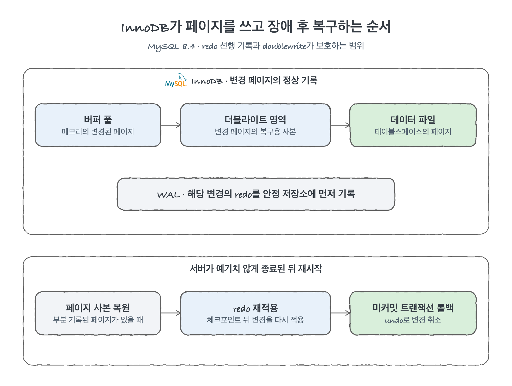

# Advanced MySQL Internals and Query Optimization

MySQL 쿼리의 지연은 SQL 실행, 잠금 대기, 메모리와 디스크 접근, 커밋 단계 중 어디에서 발생하는지에 따라 조사 방법이 달라진다. 실습 환경은 MySQL 8.4(InnoDB)다. 설정은 조회하고, 실행 계획은 별도 실습 데이터에서 확인한다.

## 1. 트랜잭션 수명 주기와 바이너리 로그

`autocommit`이 켜져 있으면 명시적 트랜잭션 밖의 각 SQL 문장이 자체 트랜잭션이 된다. 여러 변경이 원자적으로 끝나야 할 때 `START TRANSACTION`으로 묶고 `COMMIT`으로 반영하거나 `ROLLBACK`으로 취소한다. 일부 DDL은 암시적 커밋을 일으키므로 데이터 변경과 같은 방식으로 롤백할 수 있는지 문장별로 확인한다. [Autocommit, Commit, and Rollback](https://dev.mysql.com/doc/refman/8.4/en/innodb-autocommit-commit-rollback.html) · [Statements That Cause an Implicit Commit](https://dev.mysql.com/doc/refman/8.4/en/implicit-commit.html)

바이너리 로그의 statement 형식은 SQL을 기록하고, row 형식은 변경된 행에 대한 이벤트를 기록한다. mixed 형식은 문장에 따라 기록 형식을 고른다. 기록 형식은 레플리카가 변경을 적용하는 방식과 CDC 이벤트에 영향을 준다. [Replication Formats](https://dev.mysql.com/doc/refman/8.4/en/replication-formats.html) · [The Binary Log](https://dev.mysql.com/doc/refman/8.4/en/binary-log.html)

## 2. 다중 세분화 잠금과 격리 수준

InnoDB의 의도 잠금(`IS`, `IX`)은 테이블 수준에서 행 잠금 의도를 표시한다. 레코드 잠금은 인덱스 항목을, 갭 잠금은 항목 사이의 삽입 가능 범위를 보호한다. 넥스트 키 잠금은 레코드와 바로 앞의 갭을 함께 잠근다. 유일 인덱스에서 완전한 키로 존재하는 행을 검색하면 행만 잠글 수 있다. 잠금 범위는 WHERE 조건과 실제로 탐색한 인덱스 범위에서 확인한다. [InnoDB Locking](https://dev.mysql.com/doc/refman/8.4/en/innodb-locking.html) · [Locks Set by SQL Statements](https://dev.mysql.com/doc/refman/8.4/en/innodb-locks-set.html)

| 격리 수준 | 일반 조회와 잠금에 미치는 영향 |
| --- | --- |
| `READ UNCOMMITTED` | 일반 조회가 커밋되지 않은 변경을 관찰할 수 있다. |
| `READ COMMITTED` | 일관된 조회마다 새 스냅샷을 얻는다. 검색의 갭 잠금을 줄이며 외래 키 검사와 중복 검사 등에는 예외가 있다. |
| `REPEATABLE READ` | 일관된 조회는 트랜잭션의 첫 일관된 읽기에서 정해진 스냅샷을 재사용한다. 잠금 읽기와 쓰기는 실제 접근 범위에 잠금을 잡는다. |
| `SERIALIZABLE` | InnoDB에서 autocommit이 꺼져 있으면 일반 SELECT에 공유 잠금을 적용한다. |

스냅샷의 영향을 받는 일반 조회와 잠금을 거는 현재 행 조회를 같은 트랜잭션에서 섞으면 서로 다른 상태를 볼 수 있다. [Transaction Isolation Levels](https://dev.mysql.com/doc/refman/8.4/en/innodb-transaction-isolation-levels.html) · [MySQL and InnoDB Lock Types](08_mysql_and_innodb_lock_types.md)

## 3. InnoDB 복구와 MVCC

redo에는 장애 뒤 페이지 변경을 다시 적용하는 데 필요한 정보가 있다. InnoDB는 체크포인트 이후의 변경을 재적용하고 미완료 트랜잭션을 롤백해 상태를 복구한다. undo는 롤백과 일관된 읽기를 위한 이전 버전을 제공한다. 오래 열린 스냅샷이 이전 행 버전을 필요로 하면 purge가 이를 즉시 정리할 수 없다. [InnoDB Recovery](https://dev.mysql.com/doc/refman/8.4/en/innodb-recovery.html) · [InnoDB Multi-Versioning](https://dev.mysql.com/doc/refman/8.4/en/innodb-multi-versioning.html)

## 4. 옵티마이저의 쿼리 변환과 히스토그램

옵티마이저는 결과를 보존하는 범위에서 외부 조인을 단순화하거나 서브쿼리를 세미조인으로 바꿀 수 있다. 변환 후에는 통계와 비용 추정으로 접근 경로를 고른다. 값의 빈도가 치우친 열에서는 히스토그램이 조건을 통과할 행 수 추정을 도울 수 있다. 쿼리 계획에서는 예상 행 수를, 실행 결과에서는 실제 행 수와 반복 횟수를 본다. [MySQL Joins, Subqueries, and Query Rewrites](19_mysql_joins_subqueries_and_query_rewrites.md) · [Optimizer Statistics](https://dev.mysql.com/doc/refman/8.4/en/optimizer-statistics.html) · [Cost-Based Optimization and Histograms](../database-performance/10_cost_based_optimization_and_histograms.md)

## 5. Filesort, 내부 임시 테이블, 파티션 프루닝

| 계획에서 볼 항목 | 어떤 작업을 나타내는가 |
| --- | --- |
| `Using filesort` | 인덱스 순서로 결과를 반환할 수 없을 때 별도 정렬을 한다. 메모리에서 끝나거나 디스크 임시 파일을 사용할 수 있다. |
| `Using temporary` | 집계나 중복 제거 등에서 내부 임시 테이블을 사용할 수 있다. 이 표시가 모든 구체화 작업을 포착하지는 않는다. |
| `partitions` | 읽을 파티션을 보여 준다. 기간 조건으로 읽는 파티션을 줄여도 그 안에서 필요한 필터, 집계, 정렬은 별도 작업이다. |

[ORDER BY Optimization](https://dev.mysql.com/doc/refman/8.4/en/order-by-optimization.html) · [Internal Temporary Table Use](https://dev.mysql.com/doc/refman/8.4/en/internal-temporary-tables.html) · [Partition Pruning](https://dev.mysql.com/doc/refman/8.4/en/partitioning-pruning.html)

## 6. 페이지, B-tree, 행 형식

일반 InnoDB 인덱스는 B-tree를 사용한다. 페이지는 디스크와 메모리에서 데이터를 다루는 단위이며 기본 크기는 16 KiB다. 클러스터드 인덱스의 리프는 행을 담고 세컨더리 인덱스의 리프는 인덱스 키와 기본 키를 담는다. 원본에만 있는 열이 필요하면 세컨더리에서 찾은 기본 키로 클러스터드 인덱스를 한 번 더 탐색할 수 있다. [Physical Structure of an InnoDB Index](https://dev.mysql.com/doc/refman/8.4/en/innodb-physical-structure.html) · [Clustered and Secondary Indexes](https://dev.mysql.com/doc/refman/8.4/en/innodb-index-types.html)

행 형식은 레코드를 페이지에 넣는 방식에 영향을 준다. `DYNAMIC`은 필요에 따라 긴 가변 길이 값을 별도 페이지에 저장하고 클러스터드 레코드에는 포인터를 남길 수 있다. 기본 키가 넓으면 세컨더리 인덱스에도 그 키가 포함되므로 인덱스 저장 공간과 캐시 효율을 함께 본다. [InnoDB Row Formats](https://dev.mysql.com/doc/refman/8.4/en/innodb-row-format.html)

## 7. 버퍼 풀과 LRU

InnoDB는 버퍼 풀의 LRU 목록을 새 페이지 구역과 오래된 페이지 구역으로 나눈다. 새로 읽어 온 페이지는 중간 지점에 들어가며 접근 패턴에 따라 앞쪽으로 이동할 수 있다. 큰 테이블 스캔이 평소 사용하는 페이지를 밀어낼 수 있으므로 누적 읽기 지표의 구간별 증가량을 워크로드와 비교한다. [Buffer Pool](https://dev.mysql.com/doc/refman/8.4/en/innodb-buffer-pool.html)



그림의 근거 · [InnoDB 더블라이트 버퍼](https://dev.mysql.com/doc/refman/8.4/en/innodb-doublewrite-buffer.html) · [MySQL 8.4.8 페이지 플러시 구현](https://raw.githubusercontent.com/mysql/mysql-server/mysql-8.4.8/storage/innobase/buf/buf0flu.cc) · [InnoDB 체크포인트](https://dev.mysql.com/doc/refman/8.4/en/innodb-checkpoints.html) · [InnoDB 크래시 복구](https://dev.mysql.com/doc/refman/8.4/en/innodb-recovery.html) · [InnoDB Undo 로그](https://dev.mysql.com/doc/refman/8.4/en/innodb-undo-logs.html) · [InnoDB Redo 로그](https://dev.mysql.com/doc/refman/8.4/en/innodb-redo-log.html)

## 8. WAL, 더블라이트와 fsync

WAL(Write-Ahead Logging)은 데이터 페이지보다 복구에 필요한 redo를 먼저 안정적인 저장소에 남긴다는 규칙이다. 더블라이트 버퍼는 데이터 파일에 페이지를 쓰는 도중 중단되어 일부만 기록되는 경우 복구 가능한 페이지 사본을 제공한다. 두 메커니즘은 장애 복구에서 다른 역할을 맡는다. [Redo Log](https://dev.mysql.com/doc/refman/8.4/en/innodb-redo-log.html) · [Doublewrite Buffer](https://dev.mysql.com/doc/refman/8.4/en/innodb-doublewrite-buffer.html)

`innodb_flush_log_at_trx_commit`은 InnoDB redo의 커밋 시점 쓰기·플러시 동작에, `sync_binlog`는 바이너리 로그 동기화에 영향을 준다. 동기화 비용은 스토리지의 쓰기 지연과 동시 커밋에 영향을 받는다. 성능을 비교할 때는 내구성 설정과 허용 가능한 데이터 손실 범위도 함께 기록한다. [InnoDB System Variables](https://dev.mysql.com/doc/refman/8.4/en/innodb-parameters.html) · [Binary Logging Options and Variables](https://dev.mysql.com/doc/refman/8.4/en/replication-options-binary-log.html)

```sql
SELECT @@SESSION.autocommit, @@SESSION.transaction_isolation,
       @@GLOBAL.innodb_page_size, @@GLOBAL.innodb_buffer_pool_size,
       @@GLOBAL.innodb_flush_log_at_trx_commit, @@GLOBAL.sync_binlog,
       @@GLOBAL.innodb_doublewrite;

SHOW GLOBAL STATUS
WHERE Variable_name IN (
    'Innodb_buffer_pool_reads', 'Innodb_buffer_pool_read_requests',
    'Created_tmp_tables', 'Created_tmp_disk_tables'
);
```

이 값들은 인스턴스 수준의 관측치다. 특정 SQL의 비용을 조사할 때 [서버 지표와 실행 계획](12_inspecting_mysql_configuration_access_and_performance.md)을 함께 읽는다.
