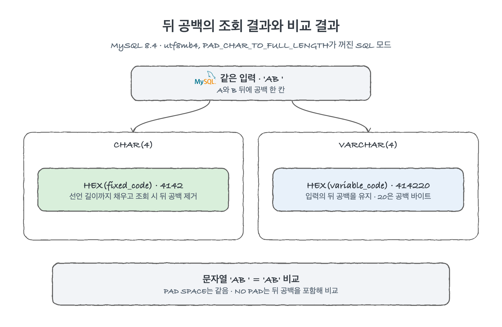

# CHAR and VARCHAR Storage and Comparison

MySQL 8.4에서 `CHAR(n)`과 `VARCHAR(n)`의 `n`은 최대 문자 수다. 문자 집합에 따라 필요한 바이트 수가 달라진다. 길이가 일정한 국가 코드는 `CHAR(2)`, 길이 편차가 큰 표시 이름은 `VARCHAR(n)`을 고려한다. [MySQL 8.4의 CHAR와 VARCHAR](https://dev.mysql.com/doc/refman/8.4/en/char.html)

## 저장과 조회

| 항목 | `CHAR(n)` | `VARCHAR(n)` |
| --- | --- | --- |
| 짧은 값 | 선언 길이까지 오른쪽을 공백으로 채운다. | 입력 길이 그대로 저장한다. |
| 뒤 공백 조회 | 기본 SQL 모드에서 제거한다. | 허용 길이 안에서 입력한 뒤 공백을 유지한다. |
| 저장 길이 | 실제 레코드 표현은 InnoDB 행 형식과 문자 집합에 따른다. | 값에 1바이트 또는 2바이트의 길이 정보가 붙는다. |

`VARCHAR`의 길이 정보는 열에 가능한 최대 바이트 길이가 255를 넘는지에 따라 달라진다. 고정 길이 타입도 InnoDB에서 행 형식과 최대 바이트 길이에 따라 가변 길이처럼 인코딩될 수 있다. [문자열 저장 요구량](https://dev.mysql.com/doc/refman/8.4/en/storage-requirements.html#data-types-storage-reqs-strings) · [InnoDB 행 형식](https://dev.mysql.com/doc/refman/8.4/en/innodb-row-format.html)



그림의 근거 · [MySQL CHAR와 VARCHAR](https://dev.mysql.com/doc/refman/8.4/en/char.html) · [MySQL 비교 시 뒤 공백](https://dev.mysql.com/doc/refman/8.4/en/charset-binary-collations.html)

## 공백 비교 확인

같은 `'AB '`를 두 열에 넣은 다음 조회된 바이트를 확인한다. 아래 예제는 기본 SQL 모드에서 `CHAR`가 `4142`, `VARCHAR`가 `414220`을 반환한다.

```sql
CREATE TEMPORARY TABLE string_width_demo (
    fixed_code CHAR(4),
    variable_code VARCHAR(4)
) DEFAULT CHARSET = utf8mb4;

INSERT INTO string_width_demo VALUES ('AB ', 'AB ');
SELECT HEX(fixed_code), HEX(variable_code) FROM string_width_demo;
```

`=` 비교의 뒤 공백 처리는 열의 저장 타입과 별도로 콜레이션의 `PAD SPACE` 또는 `NO PAD` 속성에 따른다. 타입을 바꿀 때는 기존 값의 뒤 공백, 길이 제한, 유일성 제약에 미치는 영향도 확인한다. [문자열 비교와 뒤 공백](https://dev.mysql.com/doc/refman/8.4/en/charset-binary-collations.html)
