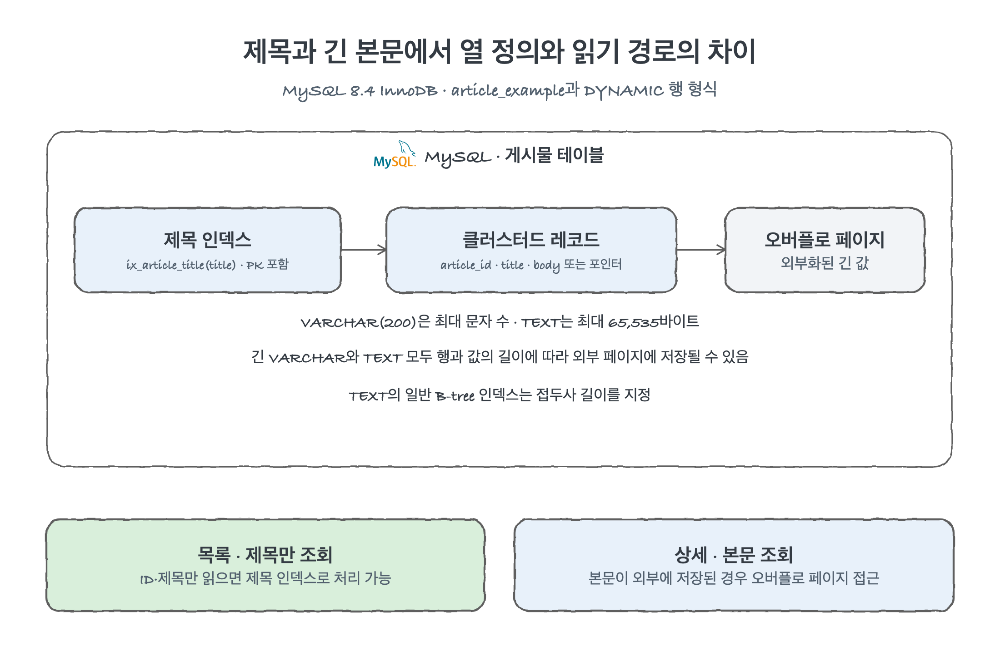

# VARCHAR and TEXT Storage Trade-Offs

`VARCHAR(n)`은 최대 문자 수가 명확한 이름이나 코드에 적합하다. `TEXT` 계열은 본문처럼 값이 길거나 길이 편차가 큰 입력에 사용하며, 각 타입의 최대 용량을 바이트로 계산한다. `TEXT`의 최대값은 65,535바이트다. `utf8mb4`에서는 문자별 바이트 수가 달라 같은 문자 수라도 저장 크기가 달라진다. [MySQL의 BLOB과 TEXT 타입](https://dev.mysql.com/doc/refman/8.4/en/blob.html) · [문자열 저장 요구량](https://dev.mysql.com/doc/refman/8.4/en/storage-requirements.html)



그림의 근거 · [InnoDB DYNAMIC 행 형식](https://dev.mysql.com/doc/refman/8.4/en/innodb-row-format.html) · [InnoDB 클러스터드·세컨더리 인덱스](https://dev.mysql.com/doc/refman/8.4/en/innodb-index-types.html) · [MySQL BLOB과 TEXT](https://dev.mysql.com/doc/refman/8.4/en/blob.html) · [MySQL 문자열 저장 요구량](https://dev.mysql.com/doc/refman/8.4/en/storage-requirements.html)

## 행 길이와 인덱스

- MySQL의 최대 행 크기는 65,535바이트다. `VARCHAR`의 선언 크기는 다른 열과 이 한도를 공유한다. `TEXT` 열은 값 전체 대신 내부 참조 정보가 이 한도에 포함된다. [MySQL의 테이블과 행 크기 제한](https://dev.mysql.com/doc/refman/8.4/en/column-count-limit.html)
- InnoDB의 `DYNAMIC` 행 형식에서는 긴 `VARCHAR`와 `TEXT` 모두 값의 길이와 행 크기에 따라 외부 페이지에 저장될 수 있다. 목록 API에서는 본문을 실제로 표시할 때만 조회해 전송량과 페이지 접근을 줄인다. [InnoDB 행 형식](https://dev.mysql.com/doc/refman/8.4/en/innodb-row-format.html)
- 일반 B-tree 인덱스를 `TEXT`에 만들 때는 접두사 길이를 지정한다. 짧은 접두사는 값 구분 능력을 떨어뜨릴 수 있으므로 실제 데이터 분포를 확인한다. 본문에서 단어나 구문을 찾는 요구에는 `FULLTEXT`의 검색 의미와 제약을 따로 검토한다. [문자열 접두사와 FULLTEXT 인덱스](https://dev.mysql.com/doc/refman/8.4/en/create-index.html) · [Prefix Index Trade-Offs](07_prefix_index_trade_offs.md)

```sql
CREATE TABLE article_example (
    article_id BIGINT PRIMARY KEY,
    title VARCHAR(200) NOT NULL,
    body TEXT NOT NULL,
    INDEX ix_article_title (title)
) ENGINE = InnoDB DEFAULT CHARSET = utf8mb4;
```

제목의 길이는 제품 규칙으로 정하고, 본문은 예상 최대 바이트 수와 읽기 경로를 기준으로 설계한다. 스키마 변경 전에는 `MAX(CHAR_LENGTH(body))`와 `MAX(OCTET_LENGTH(body))`를 함께 확인한다. [MySQL 문자열 함수](https://dev.mysql.com/doc/refman/8.4/en/string-functions.html)
