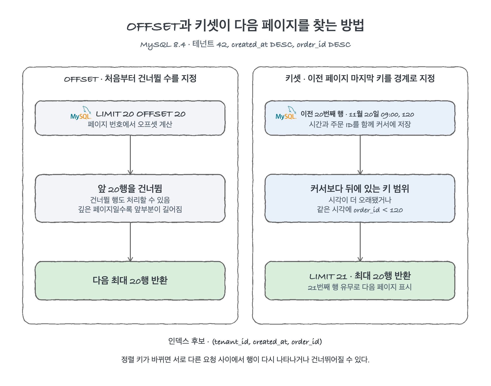

# OFFSET and Keyset Pagination

`LIMIT ... OFFSET ...`은 페이지 번호로 이동하기 쉽다. 깊은 페이지에서는 앞에서 건너뛸 행까지 처리할 수 있다. 키셋 페이지네이션은 이전 페이지의 마지막 정렬 키를 경계로 다음 구간을 찾는다. 순차 탐색이 주된 피드나 주문 목록에 적합하다. [MySQL LIMIT 최적화](https://dev.mysql.com/doc/refman/8.4/en/limit-optimization.html) · [Keyset Pagination Without OFFSET](10_keyset_pagination_without_offset.md)



그림의 근거 · [MySQL SELECT의 LIMIT과 OFFSET](https://dev.mysql.com/doc/refman/8.4/en/select.html) · [MySQL LIMIT의 정렬 동률 처리](https://dev.mysql.com/doc/refman/8.4/en/limit-optimization.html) · [MySQL ORDER BY 인덱스 사용](https://dev.mysql.com/doc/refman/8.4/en/order-by-optimization.html) · [MySQL 일관된 읽기](https://dev.mysql.com/doc/refman/8.4/en/innodb-consistent-read.html)

## 날짜와 기본 키를 함께 사용한다

`orders`에 `NOT NULL`인 `created_at`, 고유한 `order_id`가 있다고 가정한다. `(tenant_id, created_at, order_id)` 인덱스를 후보로 두고, 같은 시각에 생성된 행의 순서도 `order_id`로 결정한다.

```sql
-- 첫 페이지
SELECT order_id, created_at
FROM orders
WHERE tenant_id = 42
ORDER BY created_at DESC, order_id DESC
LIMIT 21;

-- 이전 페이지의 마지막 반환 행이 ('2026-11-20 09:00:00', 120)인 경우
SELECT order_id, created_at
FROM orders
WHERE tenant_id = 42
  AND (created_at < '2026-11-20 09:00:00'
       OR (created_at = '2026-11-20 09:00:00' AND order_id < 120))
ORDER BY created_at DESC, order_id DESC
LIMIT 21;
```

페이지 크기가 20이면 21번째 행의 존재로 다음 페이지 여부를 확인하고, 반환한 20번째 행으로 커서를 만든다. `OFFSET` 방식에서도 결과 순서가 일정하려면 고유한 타이브레이커가 필요하다. [MySQL LIMIT과 동일 정렬 키 처리](https://dev.mysql.com/doc/refman/8.4/en/limit-optimization.html) · [ORDER BY Optimization with Indexes](03_order_by_optimization_with_indexes.md)

커서는 사용한 정렬 키와 필터에 맞춰 재사용한다. 서로 다른 요청이 동일한 DB 스냅샷을 공유한다고 가정할 수 없으므로, 탐색 중 정렬 키가 바뀌는 행이 있다면 다시 나타나거나 건너뛸 수 있다. 제품에서 고정된 시점의 목록을 요구하면 조회 기간과 변경 허용 범위를 별도로 정의한다. [MySQL InnoDB 일관된 읽기](https://dev.mysql.com/doc/refman/8.4/en/innodb-consistent-read.html)
