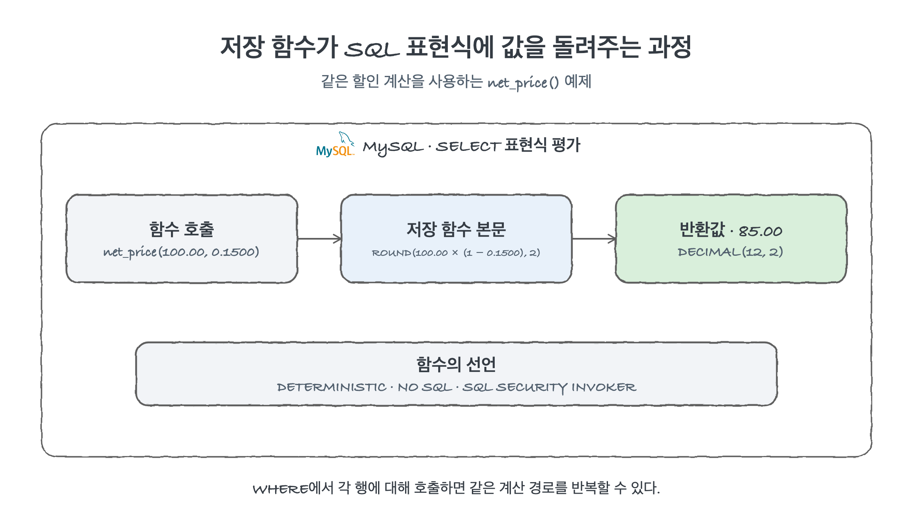

# MySQL Stored Functions

저장 함수는 하나의 값을 반환하고, `SELECT`나 다른 SQL 표현식에서 호출할 수 있다. 여러 호출자가 동일한 계산을 DB에서 사용해야 할 때 실행 위치와 타입을 명시할 수 있다. 결과 집합을 반환하거나 트랜잭션을 제어하는 작업에는 프로시저나 애플리케이션 경계를 검토한다. [CREATE FUNCTION과 CREATE PROCEDURE](https://dev.mysql.com/doc/refman/8.4/en/create-procedure.html) · [MySQL 저장 프로그램 제약](https://dev.mysql.com/doc/refman/8.4/en/stored-program-restrictions.html)



그림의 근거 · [저장 함수의 호출과 특성](https://dev.mysql.com/doc/refman/8.4/en/create-procedure.html)

## 부작용 없는 계산 함수

```sql
CREATE FUNCTION net_price(
    list_price DECIMAL(12, 2),
    discount_rate DECIMAL(5, 4)
)
RETURNS DECIMAL(12, 2)
DETERMINISTIC
NO SQL
SQL SECURITY INVOKER
RETURN ROUND(list_price * (1 - discount_rate), 2);

SELECT net_price(100.00, 0.1500); -- 85.00
```

`DETERMINISTIC`은 같은 입력에서 같은 값을 낸다는 선언이고, `NO SQL`은 본문에 SQL 문이 없다는 선언이다. 이 예제는 입력값과 산술 표현식만 사용한다. 서버가 함수의 동작을 선언과 대조해 검사하지는 않으므로, 본문과 선언을 일치시킨다. 바이너리 로깅이 켜진 서버에서는 함수 생성에 별도 특성과 권한 조건이 적용될 수 있다. [MySQL 함수 특성](https://dev.mysql.com/doc/refman/8.4/en/create-procedure.html) · [저장 프로그램의 바이너리 로깅](https://dev.mysql.com/doc/refman/8.4/en/stored-programs-logging.html)

## 행마다 호출하는 비용

수십만 행의 `WHERE`에서 `net_price(price, discount_rate)`를 평가하면 함수 호출이 반복된다. 또한 원래 열에 있는 인덱스만으로 함수 결과를 곧바로 범위 탐색하기 어렵다. 통화 반올림과 `NULL` 의미를 보존하면서 계산 열에 인덱스를 둘 수 있는지 검토한다. 생성 컬럼이나 함수 기반 인덱스에서는 사용자 정의 저장 함수 호출이 제한되므로 허용된 내장 표현식으로 작성한다. [생성 컬럼 표현식 제약](https://dev.mysql.com/doc/refman/8.4/en/create-table-generated-columns.html) · [Generated Columns and Functional Indexes](32_generated_columns_and_functional_indexes.md)
