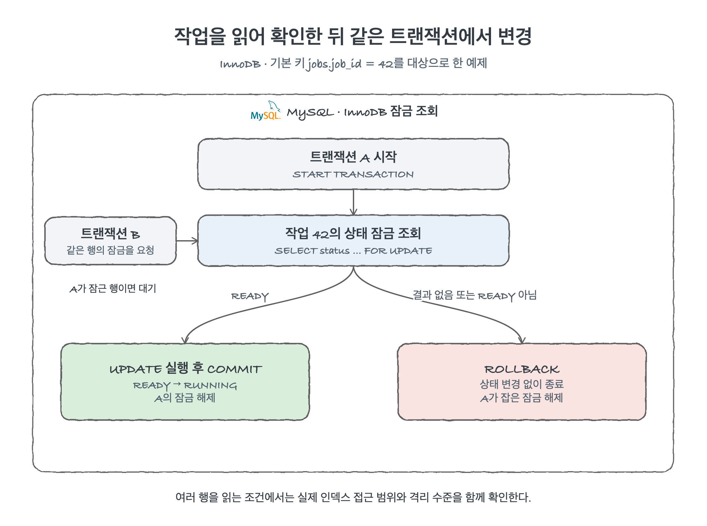

# Locking Reads with SELECT FOR UPDATE

InnoDB의 `SELECT ... FOR UPDATE`는 검색한 인덱스 레코드에 쓰기와 같은 방식으로 잠금을 잡는다. 같은 행을 갱신하려는 다른 트랜잭션이나 충돌하는 잠금 조회는 기다릴 수 있다. 명시적 트랜잭션에서 조회와 갱신을 수행하고, 커밋 또는 롤백으로 잠금을 푼다. [InnoDB 잠금 조회](https://dev.mysql.com/doc/refman/8.4/en/innodb-locking-reads.html)



그림의 근거 · [잠금 조회 및 해제 시점](https://dev.mysql.com/doc/refman/8.4/en/innodb-locking-reads.html) · [고유 키 검색의 잠금 범위](https://dev.mysql.com/doc/refman/8.4/en/innodb-locks-set.html)

## 읽고 검증한 뒤 변경한다

`jobs.job_id`가 기본 키일 때 다음 흐름은 한 작업의 상태를 보호한다. 애플리케이션은 조회 결과가 없거나 `READY` 상태가 아니면 롤백한다.

```sql
START TRANSACTION;

SELECT status
FROM jobs
WHERE job_id = 42
FOR UPDATE;

-- 조회 결과가 READY인 경로에서 실행
UPDATE jobs
SET status = 'RUNNING'
WHERE job_id = 42 AND status = 'READY';

COMMIT;
```

## 잠금 범위와 경합 처리

- 고유 인덱스의 전체 키로 존재하는 행을 찾으면 해당 레코드만 잠글 수 있다. `REPEATABLE READ`에서 범위 조건으로 조회할 때는 실제 인덱스 스캔 범위에 갭 또는 넥스트 키 잠금을 사용할 수 있다. `EXPLAIN`에서 잠금 조회가 접근하는 인덱스와 행 범위를 본다. [SQL 문장별 잠금 범위](https://dev.mysql.com/doc/refman/8.4/en/innodb-locks-set.html)
- `NOWAIT`는 충돌 시 오류를 반환하고, `SKIP LOCKED`는 잠긴 행을 건너뛴다. `SKIP LOCKED`는 다른 워커가 잡은 작업을 건너뛰는 큐에 사용할 수 있다. 모든 대상 행이 필요한 조회에는 누락 여부를 고려한다. [InnoDB 잠금 조회의 NOWAIT와 SKIP LOCKED](https://dev.mysql.com/doc/refman/8.4/en/innodb-locking-reads.html) · [Locking Reads with SKIP LOCKED](11_locking_reads_with_skip_locked.md)
- 현재 상태에 따라 단순하게 한 행을 바꾸는 작업은 조건부 `UPDATE`와 영향받은 행 수로도 처리할 수 있다. 여러 단계 판단에 잠금이 필요하다면 락을 보유하는 동안 외부 호출을 피하고, 여러 행을 잠글 때는 순서를 맞춘다. [Reproducing and Handling InnoDB Deadlocks](09_reproducing_and_handling_innodb_deadlocks.md)
