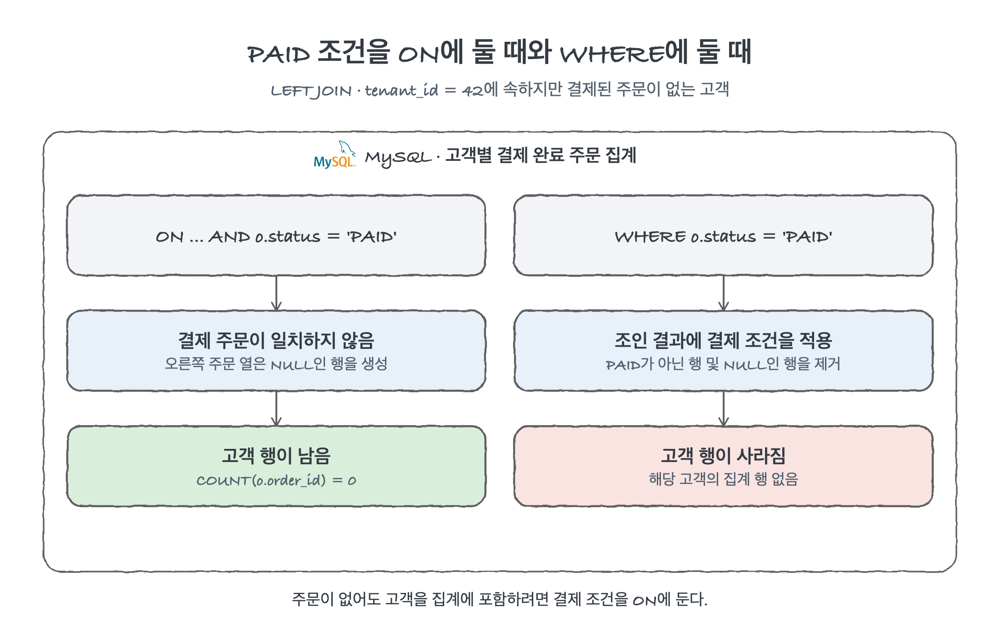

# LEFT JOIN Semantics and Optimization

`LEFT JOIN`은 왼쪽 행을 보존하고 오른쪽에 일치 행이 없으면 그 열들을 `NULL`로 채운다. 오른쪽 테이블 조건을 `ON`에 두면 일치의 범위를 좁히고, `WHERE`에 두면 조인 결과를 거른다. 의미가 달라지므로 인덱스 변경 전에 일치 행이 없는 경우까지 확인한다. [MySQL 외부 조인 최적화](https://dev.mysql.com/doc/refman/8.4/en/outer-join-optimization.html) · [MySQL 외부 조인 단순화](https://dev.mysql.com/doc/refman/8.4/en/outer-join-simplification.html)



그림의 근거 · [ON의 일치 판정과 오른쪽 NULL 행](https://dev.mysql.com/doc/refman/8.4/en/outer-join-optimization.html) · [NULL 행을 제거하는 WHERE 조건](https://dev.mysql.com/doc/refman/8.4/en/outer-join-simplification.html) · [NULL을 제외하는 COUNT](https://dev.mysql.com/doc/refman/8.4/en/aggregate-functions.html#function_count)

## 주문이 없는 고객도 집계에 포함한다

```sql
SELECT c.customer_id, COUNT(o.order_id) AS paid_order_count
FROM customers AS c
LEFT JOIN orders AS o
    ON o.customer_id = c.customer_id
   AND o.status = 'PAID'
WHERE c.tenant_id = 42
GROUP BY c.customer_id;
```

예제에서 고객 ID는 전체 테넌트에서 고유하다. 주문의 기본 키 `o.order_id`는 `NULL`이 될 수 없는 열이다. `COUNT(o.order_id)`는 일치가 없는 고객에 대해 `0`을 반환한다. `COUNT(*)`는 `NULL`로 채워진 결과 행까지 세므로 그 고객에게 `1`을 반환한다. `o.status = 'PAID'`를 `WHERE`로 옮기면 일치가 없는 고객은 결과에서 빠진다. [MySQL 집계 함수](https://dev.mysql.com/doc/refman/8.4/en/aggregate-functions.html)

## 비용과 결과 행 수를 함께 본다

- `orders(customer_id, status)`를 조인 접근 후보로 두고 `EXPLAIN ANALYZE`에서 오른쪽 테이블의 실제 행 수와 반복 횟수를 비교한다. [MySQL EXPLAIN ANALYZE](https://dev.mysql.com/doc/refman/8.4/en/explain.html)
- 1:N 관계 두 개를 연속으로 조인하면, 같은 고객의 주문 행과 주소 행이 서로 곱해질 수 있다. 집계의 단위가 고객이면 각 자식 집합을 먼저 집계한 뒤 조인할 수 있다. [MySQL Joins, Subqueries, and Query Rewrites](19_mysql_joins_subqueries_and_query_rewrites.md)
- 오른쪽 행 존재가 조회 조건이면 `INNER JOIN`으로 그 의도를 표현한다. 옵티마이저도 `NULL`로 채워진 행을 제거하는 조건이 있으면 외부 조인을 내부 조인으로 변환할 수 있다. [MySQL 외부 조인 단순화](https://dev.mysql.com/doc/refman/8.4/en/outer-join-simplification.html)
