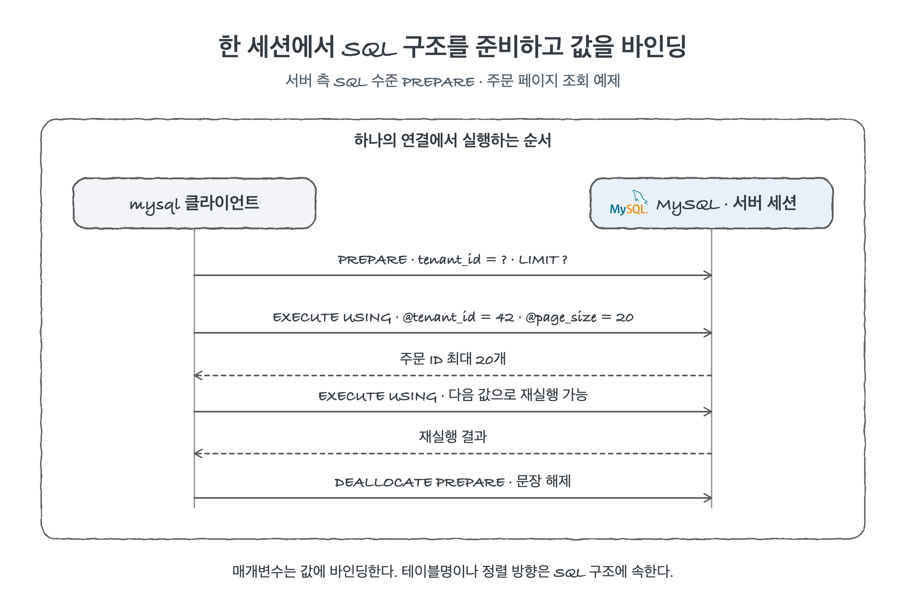

# Prepared Statements and Parameter Binding

준비된 문장은 SQL 구조를 먼저 정하고 실행할 때 값을 바인딩한다. 같은 형태의 쿼리를 반복할 때 서버 측 문장 준비를 재사용할 수 있고, 입력값을 SQL 구문과 분리해 전달한다. 드라이버 설정에 따라 서버 측 준비 여부가 달라지므로 성능 효과는 실제 요청과 실행 빈도로 확인한다. [MySQL 준비된 문장](https://dev.mysql.com/doc/refman/8.4/en/sql-prepared-statements.html)



그림의 근거 · [SQL 수준 준비된 문장 개요](https://dev.mysql.com/doc/refman/8.4/en/sql-prepared-statements.html) · [매개변수와 세션 범위](https://dev.mysql.com/doc/refman/8.4/en/prepare.html) · [EXECUTE USING](https://dev.mysql.com/doc/refman/8.4/en/execute.html)

## `mysql` 클라이언트에서 값 바인딩

```sql
PREPARE orders_page FROM
    'SELECT order_id FROM orders WHERE tenant_id = ? ORDER BY order_id DESC LIMIT ?';

SET @tenant_id = 42;
SET @page_size = 20;
EXECUTE orders_page USING @tenant_id, @page_size;
DEALLOCATE PREPARE orders_page;
```

SQL 수준의 준비된 문장은 만든 세션에 속한다. 애플리케이션에서는 JDBC 같은 드라이버의 매개변수 바인딩 API를 쓰고, 재사용 범위와 리소스 반환은 사용하는 커넥션의 수명에 맞춘다. [MySQL PREPARE](https://dev.mysql.com/doc/refman/8.4/en/prepare.html) · [MySQL EXECUTE](https://dev.mysql.com/doc/refman/8.4/en/execute.html)

## 바인딩할 수 있는 범위

`?`는 데이터 값 위치에 둔다. 테이블명, 열 이름, 정렬 방향처럼 SQL 구조를 고르는 UI는 허용된 선택을 고정 SQL 조각에 매핑한다. 예를 들어 화면의 `newest`를 `created_at DESC, order_id DESC`에 연결한다. 비교하는 컬럼과 매개변수 타입을 맞추고, 다른 타입이나 분포의 값이 들어올 때도 실행 계획이 합리적인지 확인한다. [MySQL PREPARE의 매개변수와 타입](https://dev.mysql.com/doc/refman/8.4/en/prepare.html)
