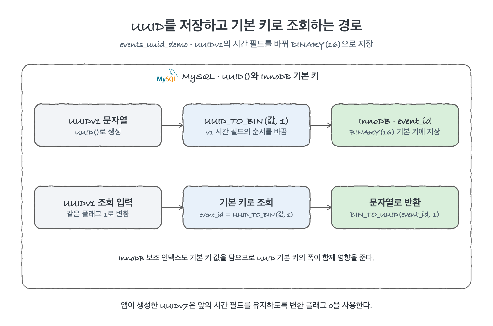

# UUID Storage and Indexing in MySQL

UUID는 128비트 식별자다. 하이픈이 포함된 표준 문자열은 `CHAR(36)`으로 저장하면 조회 결과에서 바로 읽을 수 있다. `BINARY(16)`은 같은 UUID를 16바이트 값으로 저장하고, 변환 함수로 문자열과 오간다. InnoDB 보조 인덱스에도 기본 키가 들어가므로 UUID를 기본 키로 쓸 때는 키 폭이 보조 인덱스 크기에도 영향을 준다. [RFC 9562의 UUID 형식](https://www.rfc-editor.org/rfc/rfc9562.html#section-4) · [MySQL BINARY와 VARBINARY](https://dev.mysql.com/doc/refman/8.4/en/binary-varbinary.html) · [InnoDB 클러스터형·보조 인덱스](https://dev.mysql.com/doc/refman/8.4/en/innodb-index-types.html)

## 키 크기와 삽입 순서

UUIDv4처럼 무작위인 키로 삽입하면 클러스터형 인덱스의 여러 페이지에 쓰기가 분산된다. 키가 순서대로 들어올 때보다 페이지가 덜 채워질 수 있다. 외부 식별자는 UUID로 유지하고 내부 기본 키를 짧게 두고 싶다면 `BIGINT AUTO_INCREMENT` 기본 키와 `UNIQUE` UUID 보조 인덱스를 조합할 수 있다. 이 설계에서 UUID로 원본 행을 조회할 때는 보조 인덱스에서 기본 키를 찾은 뒤 클러스터형 인덱스를 읽는다. [RFC 9562의 UUIDv4](https://www.rfc-editor.org/rfc/rfc9562.html#section-5.4) · [InnoDB 인덱스 페이지](https://dev.mysql.com/doc/refman/8.4/en/innodb-physical-structure.html) · [InnoDB 클러스터형·보조 인덱스](https://dev.mysql.com/doc/refman/8.4/en/innodb-index-types.html) · [Auto-Increment Lock Modes in InnoDB](05_auto_increment_lock_modes_in_innodb.md)



그림의 근거 · [UUID와 저장·역변환 플래그](https://dev.mysql.com/doc/refman/8.4/en/miscellaneous-functions.html#function_uuid-to-bin) · [InnoDB 보조 인덱스에 포함되는 기본 키](https://dev.mysql.com/doc/refman/8.4/en/innodb-index-types.html) · [RFC 9562 UUIDv7 형식](https://www.rfc-editor.org/rfc/rfc9562.html#section-5.7)

## UUIDv1의 저장과 조회

MySQL 8.4의 `UUID()`는 UUIDv1을 생성한다. `UUID_TO_BIN(..., 1)`은 v1의 시간 필드 순서를 바꿔 자주 변하는 부분이 뒤로 가게 한다. 이 배치로 비슷한 시점에 생성된 v1 키가 인덱스에서 가까이 놓일 수 있다. 같은 값을 문자열로 복원하거나 조회 조건에 넣을 때도 저장할 때의 플래그를 사용한다. [MySQL UUID 변환 함수](https://dev.mysql.com/doc/refman/8.4/en/miscellaneous-functions.html#function_uuid-to-bin)

```sql
CREATE TABLE events_uuid_demo (
    event_id BINARY(16) PRIMARY KEY,
    created_at TIMESTAMP(6) NOT NULL DEFAULT CURRENT_TIMESTAMP(6),
    INDEX ix_events_created_at (created_at)
) ENGINE = InnoDB;

SET @event_uuid = UUID();
INSERT INTO events_uuid_demo (event_id) VALUES (UUID_TO_BIN(@event_uuid, 1));

SELECT BIN_TO_UUID(event_id, 1) AS event_uuid, created_at
FROM events_uuid_demo
WHERE event_id = UUID_TO_BIN(@event_uuid, 1);
```

`WHERE`에서는 입력값을 변환해 기본 키 컬럼을 그대로 비교한다. 앱에서 생성한 UUIDv7은 앞 48비트가 밀리초 타임스탬프이므로 `UUID_TO_BIN(..., 0)`과 `BIN_TO_UUID(..., 0)`으로 원래 바이트 순서를 유지한다. UUIDv7끼리도 같은 밀리초에 생성된 값의 순서는 생성 방식에 따라 달라진다. [MySQL UUID 변환 함수](https://dev.mysql.com/doc/refman/8.4/en/miscellaneous-functions.html#function_uuid-to-bin) · [RFC 9562의 UUIDv7](https://www.rfc-editor.org/rfc/rfc9562.html#section-5.7)
