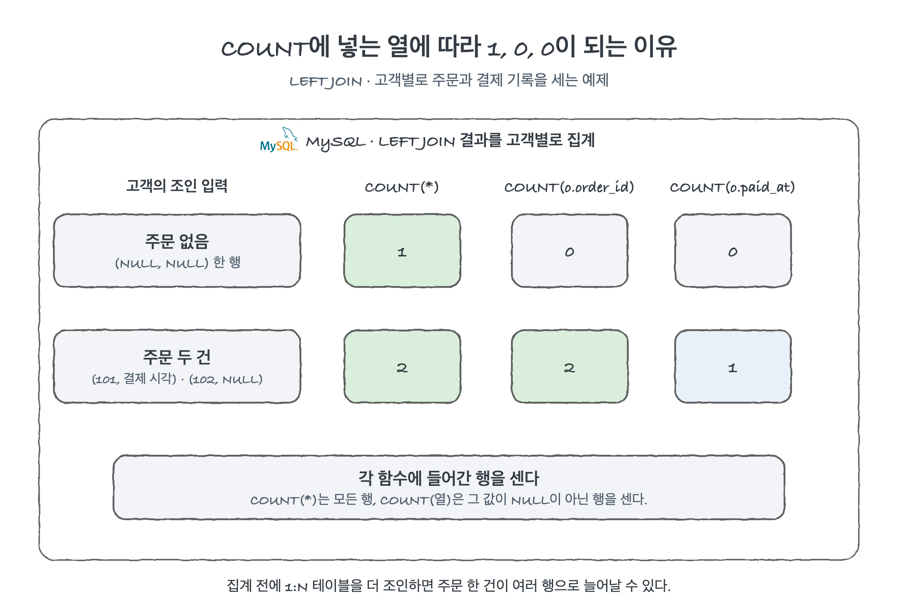

# COUNT(*) and COUNT(column)

`COUNT(*)`는 필터와 조인을 거친 모든 행을 센다. `COUNT(column)`은 그중 지정한 열의 값이 `NULL`이 아닌 행만 센다. 같은 값이 여러 행에 있으면 그만큼 세며, 그룹 없는 집계에서 입력이 비어 있으면 둘 다 `0`을 반환한다. [MySQL 8.4 집계 함수](https://dev.mysql.com/doc/refman/8.4/en/aggregate-functions.html)



그림의 근거 · [COUNT(*)와 COUNT(expr)의 입력](https://dev.mysql.com/doc/refman/8.4/en/aggregate-functions.html#function_count) · [외부 조인에서의 NULL 보완 행](https://dev.mysql.com/doc/refman/8.4/en/outer-join-optimization.html)

## LEFT JOIN에서 자식 행 수를 센다

`orders.order_id`는 기본 키이고 `orders.paid_at`은 `NULL`을 허용한다고 가정한다. 주문이 없는 고객까지 포함해 고객별 주문 수와 결제 시각이 기록된 주문 수를 구한다.

```sql
SELECT
    c.customer_id,
    COUNT(*) AS joined_rows,
    COUNT(o.order_id) AS order_count,
    COUNT(o.paid_at) AS paid_order_count
FROM customers AS c
LEFT JOIN orders AS o ON o.customer_id = c.customer_id
GROUP BY c.customer_id
ORDER BY c.customer_id;
```

| 고객의 주문 상태 | `joined_rows` | `order_count` | `paid_order_count` |
| --- | ---: | ---: | ---: |
| 주문 없음 | 1 | 0 | 0 |
| 주문 두 건 중 한 건에 결제 시각 있음 | 2 | 2 | 1 |

`LEFT JOIN`은 일치하는 주문이 없을 때 오른쪽 열이 모두 `NULL`인 행을 만든다. `NOT NULL`인 기본 키도 이 결과 행에서는 `NULL`이 된다. 주문 상세처럼 여러 행이 연결되는 테이블을 추가로 조인하면 주문 한 건이 여러 번 집계될 수 있으므로 집계에 들어가는 행의 단위를 확인한다. [MySQL 외부 조인](https://dev.mysql.com/doc/refman/8.4/en/outer-join-optimization.html)

## 집계 의미와 접근 비용을 확인한다

- 집계 입력에서 열이 항상 `NOT NULL`이면 `COUNT(column)`과 `COUNT(*)`의 결과는 같다. `NULL`을 허용하는 열은 값을 확인해야 하므로 해당 열과 필터 열을 함께 포함하는 인덱스로 집계를 처리할 수 있는지 `EXPLAIN`에서 확인한다. [MySQL 인덱스 사용](https://dev.mysql.com/doc/refman/8.4/en/mysql-indexes.html)
- InnoDB에서 `COUNT(1)`과 `COUNT(*)`의 처리 방식과 성능은 같다. 조건 없는 단일 테이블의 `COUNT(*)`는 일반적으로 가장 작은 보조 인덱스를 읽고, 보조 인덱스가 없으면 클러스터형 인덱스를 읽는다. 두 표현 모두 현재 트랜잭션에 보이는 행을 센다. [MySQL 8.4 집계 함수](https://dev.mysql.com/doc/refman/8.4/en/aggregate-functions.html)

조건부 집계와 `COUNT(DISTINCT ...)`의 실행 계획 비교는 [Tuning COUNT and COUNT DISTINCT](27_tuning_count_and_count_distinct.md)에서 이어서 다룬다.
