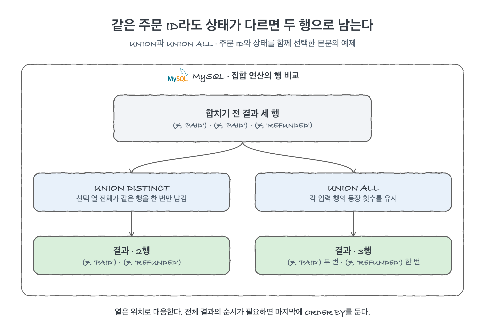

# UNION and UNION ALL in MySQL

`UNION`의 기본 동작인 `UNION DISTINCT`는 두 쿼리의 결과를 합쳐 선택한 열 전체가 같은 행을 한 번만 반환한다. `UNION ALL`은 각 입력 행을 그대로 이어 붙인다. 다음 예제에서는 `(7, 'PAID')`가 한 번 나오고 `(7, 'REFUNDED')`도 남는다. 모든 연산자를 `UNION ALL`로 바꾸면 세 행이 나온다. [MySQL 8.4 집합 연산](https://dev.mysql.com/doc/refman/8.4/en/set-operations.html)

```sql
SELECT 7 AS order_id, 'PAID' AS status
UNION
SELECT 7, 'PAID'
UNION
SELECT 7, 'REFUNDED';
```



그림의 근거 · [집합 연산의 중복, 열 대응 및 정렬](https://dev.mysql.com/doc/refman/8.4/en/set-operations.html)

## 열 타입과 정렬을 맞춘다

- 각 쿼리의 열 개수는 같아야 하며, 열은 위치로 대응한다. 결과 열 이름은 첫 쿼리에서 가져오고, 타입과 길이는 모든 쿼리의 해당 열을 고려해 결정한다. 문자 열의 중복 여부는 결과 콜레이션의 영향을 받으므로 대소문자나 악센트의 구분이 중요하면 `CAST`나 `CONVERT`로 타입과 문자 집합을 맞추고 같은 `COLLATE`를 지정한다. 같은 위치의 `NULL`도 중복 판단에서 같은 값으로 취급한다. [MySQL 집합 연산의 결과 열](https://dev.mysql.com/doc/refman/8.4/en/set-operations.html) · [MySQL 문자 집합 변환](https://dev.mysql.com/doc/refman/8.4/en/cast-functions.html) · [MySQL의 NULL 처리](https://dev.mysql.com/doc/refman/8.4/en/problems-with-null.html)
- 각 쿼리 안에서 `ORDER BY`와 `LIMIT`를 쓰려면 그 쿼리를 괄호로 감싼다. 괄호 안의 정렬은 각 쿼리에서 가져올 행을 정한다. 전체 결과의 정렬과 개수 제한은 마지막에 두고, 정렬할 열은 결과 열 이름으로 참조한다. [MySQL 집합 연산의 ORDER BY와 LIMIT](https://dev.mysql.com/doc/refman/8.4/en/set-operations.html)

아래 예제는 현재 주문과 보관 주문에서 최신 20건을 구한다. 두 테이블에서 `created_at`과 `order_id`의 타입이 각각 같고 `order_id`는 각 테이블의 기본 키라고 가정한다. `source_id`는 두 테이블에서 시간과 ID가 같은 경우의 순서를 정한다.

```sql
(SELECT order_id, created_at, 1 AS source_id
 FROM current_orders
 ORDER BY created_at DESC, order_id DESC
 LIMIT 20)
UNION ALL
(SELECT order_id, created_at, 2 AS source_id
 FROM archived_orders
 ORDER BY created_at DESC, order_id DESC
 LIMIT 20)
ORDER BY created_at DESC, order_id DESC, source_id
LIMIT 20;
```

## 결과가 같은 범위에서 실행 비용을 줄인다

- `UNION`을 `UNION ALL`로 바꿀 때 결과의 값과 각 값의 등장 횟수를 함께 비교한다. 각 쿼리 안에서 중복이 없고, 타입과 콜레이션을 맞춘 결과 열에서도 쿼리끼리 겹치는 행이 없으면 같은 결과가 나온다. 전역 `ORDER BY`가 없는 일반 `UNION ALL` 조회는 조건에 따라 합치기용 내부 임시 테이블 없이 행을 반환할 수 있다. [MySQL 내부 임시 테이블](https://dev.mysql.com/doc/refman/8.4/en/internal-temporary-tables.html)
- 예제처럼 `UNION ALL`의 전역 정렬과 각 쿼리 내의 상대 순서가 같으면, 어느 쿼리에서든 21위 이하인 행은 전체 20위 안에 들 수 없다. `UNION DISTINCT`에서는 중복 제거 후 뒤쪽 행이 필요할 수 있으므로 같은 제한을 적용하기 전에 결과가 같은지 확인한다. `EXPLAIN ANALYZE`에서 각 쿼리가 읽은 행 수와 전체 정렬 비용을 비교한다. [MySQL EXPLAIN ANALYZE](https://dev.mysql.com/doc/refman/8.4/en/explain.html)
