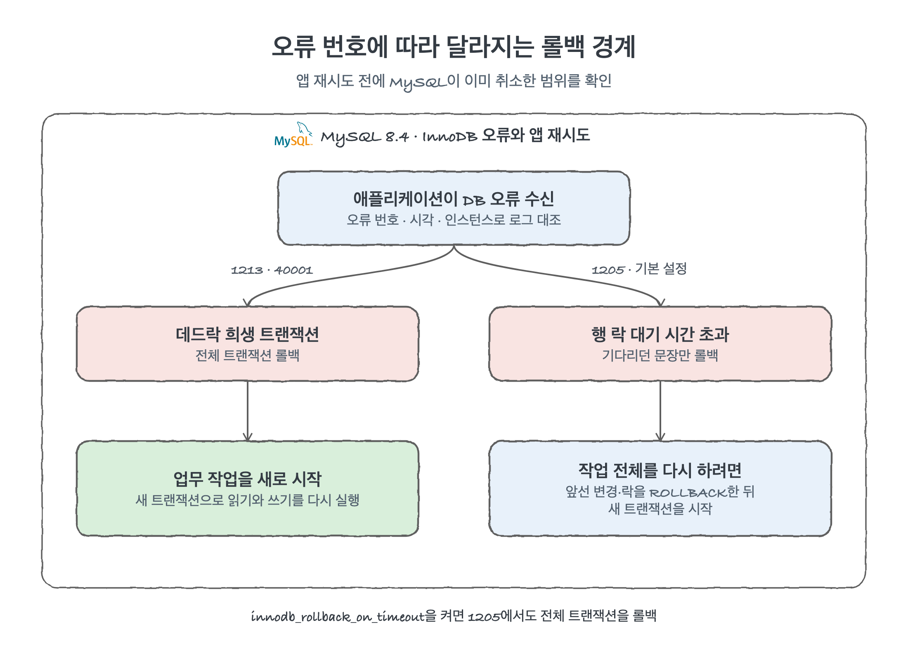

# Diagnosing and Retrying MySQL Deadlocks

InnoDB에서 트랜잭션들이 서로 보유한 락을 기다려 순환이 생기면, 기본 설정의 교착 상태 감지기가 희생 트랜잭션을 롤백해 순환을 끊는다. 운영에서는 애플리케이션에서 기록한 오류 번호, 시각, DB 인스턴스, 요청 ID로 시작해 해당 인스턴스의 기록을 찾는다. [MySQL 교착 상태](https://dev.mysql.com/doc/refman/8.4/en/innodb-deadlocks.html)

## 최근 교착 상태의 대기 관계를 읽는다

```sql
SHOW ENGINE INNODB STATUS\G
SELECT @@GLOBAL.innodb_deadlock_detect,
       @@GLOBAL.innodb_rollback_on_timeout,
       @@GLOBAL.innodb_print_all_deadlocks;
```

1. `mysql` 클라이언트에서 출력의 `LATEST DETECTED DEADLOCK` 구간 전체를 시각과 함께 보관한다. 최근 한 건을 보여주므로 애플리케이션 오류 시각과 맞춰 같은 사건인지 확인한다. `SHOW ENGINE`에는 `PROCESS` 권한이 필요하다. [MySQL SHOW ENGINE](https://dev.mysql.com/doc/refman/8.4/en/show-engine.html) · [MySQL 교착 상태 대응](https://dev.mysql.com/doc/refman/8.4/en/innodb-deadlocks-handling.html)
2. 각 트랜잭션의 실행 SQL, 보유한 락, 기다리는 락에서 테이블·인덱스·레코드와 락 모드를 대조한다. 누가 누구를 기다렸고 어느 트랜잭션이 롤백됐는지 확인한다. 기록에 나타난 문장보다 앞서 실행한 SQL이 락을 잡았을 수 있으므로 요청의 트랜잭션 로그도 함께 본다. [MySQL 교착 상태 예제](https://dev.mysql.com/doc/refman/8.4/en/innodb-deadlock-example.html)
3. 반복 발생해 최근 한 건으로 부족하면 `innodb_print_all_deadlocks`를 진단 기간에 활성화해 서버 오류 로그에서 각 사건을 수집한다. 현재 이어지는 InnoDB 데이터 락 대기는 Performance Schema의 `data_lock_waits`에서 살핀다. [MySQL 교착 상태 대응](https://dev.mysql.com/doc/refman/8.4/en/innodb-deadlocks-handling.html) · [MySQL data_lock_waits](https://dev.mysql.com/doc/refman/8.4/en/performance-schema-data-lock-waits-table.html)



그림의 근거 · [InnoDB 오류별 롤백](https://dev.mysql.com/doc/refman/8.4/en/innodb-error-handling.html) · [MySQL 서버 오류](https://dev.mysql.com/doc/mysql-errors/8.4/en/server-error-reference.html#error_er_lock_deadlock)

## 오류에 따라 재시도 범위를 정한다

| 오류 | InnoDB의 롤백 범위 | 애플리케이션 처리 |
| --- | --- | --- |
| `1213` / `40001` 교착 상태 | 희생 트랜잭션 전체 | 새 트랜잭션에서 읽기와 쓰기를 처음부터 다시 수행한다. |
| `1205` / `HY000` InnoDB 락 대기 시간 초과 | 기본값은 실패한 문장만 롤백한다. `innodb_rollback_on_timeout`이 켜져 있으면 트랜잭션 전체를 롤백한다. | 앞선 변경과 락이 남을 수 있다. 업무 작업 전체를 재시도하는 정책이라면 명시적으로 `ROLLBACK`한 뒤 새 트랜잭션을 시작한다. |

롤백 범위는 서버의 InnoDB 설정을 기준으로 확인한다. [MySQL 서버 오류 번호](https://dev.mysql.com/doc/mysql-errors/8.4/en/server-error-reference.html#error_er_lock_deadlock) · [MySQL InnoDB 오류 처리](https://dev.mysql.com/doc/refman/8.4/en/innodb-error-handling.html)

재시도는 트랜잭션 시작과 커밋을 소유한 코드에서 맡는다. 시도 간에는 트랜잭션을 정리한 뒤 짧은 지수 백오프와 무작위 지연을 적용하고, 요청 기한이나 최대 시도 횟수에 도달하면 오류를 반환한다. 결제 요청처럼 DB 롤백으로 되돌릴 수 없는 작업은 커밋 뒤에 실행하거나 같은 업무 키로 중복 처리를 막는다.

반복되는 쿼리 조합에서는 트랜잭션들이 같은 순서로 테이블과 행에 접근하도록 맞춘다. 락을 잡는 쿼리의 실행 계획이 필요한 행만 좁혀 읽는지 확인하고, 트랜잭션 안에서 외부 호출을 기다리는 시간을 줄인다. [MySQL 교착 상태 대응](https://dev.mysql.com/doc/refman/8.4/en/innodb-deadlocks-handling.html) · [교착 상태 재현](09_reproducing_and_handling_innodb_deadlocks.md) · [SELECT FOR UPDATE](31_locking_reads_with_select_for_update.md)
