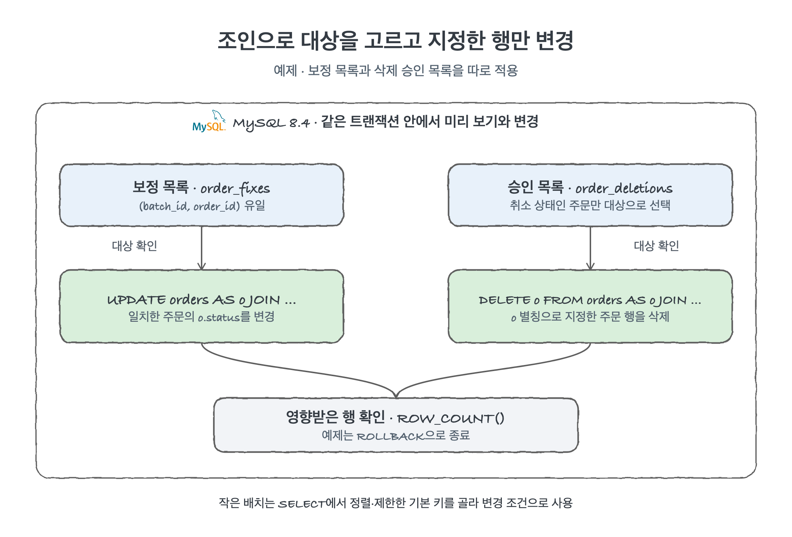

# Updating and Deleting Rows with Joins

MySQL 8.4에서 `UPDATE ... JOIN`은 `SET`에 적은 열을 바꾸고, `DELETE 대상_별칭 FROM ... JOIN`은 `FROM` 앞에 적은 대상의 행을 지운다. 변경 대상이 한 테이블이어도 두 예시는 다중 테이블 문법이므로 `ORDER BY`와 `LIMIT`을 사용할 수 없다. 작은 배치가 필요하면 대상 기본 키를 별도 `SELECT ... ORDER BY ... LIMIT ...`으로 골라 변경 조건에 넘긴다. [MySQL UPDATE](https://dev.mysql.com/doc/refman/8.4/en/update.html) · [MySQL DELETE](https://dev.mysql.com/doc/refman/8.4/en/delete.html)



그림의 근거 · [UPDATE 다중 테이블 문법](https://dev.mysql.com/doc/refman/8.4/en/update.html) · [DELETE 다중 테이블 문법](https://dev.mysql.com/doc/refman/8.4/en/delete.html) · [잠금 읽기](https://dev.mysql.com/doc/refman/8.4/en/innodb-locking-reads.html)

## 보정 목록으로 주문 상태를 갱신한다

`orders.order_id`는 기본 키이고, 보정 목록 `order_fixes`는 `(batch_id, order_id)`를 기본 키로 둔다. 같은 주문에 여러 원본 행이 매칭돼도 MySQL은 그 주문을 한 번만 갱신한다. 주문당 보정 값이 하나로 정해지도록 조인 키의 유일성을 제약으로 보장한다. [MySQL UPDATE](https://dev.mysql.com/doc/refman/8.4/en/update.html)

```sql
START TRANSACTION;
SELECT o.order_id, o.status AS old_status, f.new_status
FROM orders AS o JOIN order_fixes AS f ON f.order_id = o.order_id
WHERE f.batch_id = 7001 AND o.order_id IN (101, 102)
FOR UPDATE;

UPDATE orders AS o JOIN order_fixes AS f ON f.order_id = o.order_id
SET o.status = f.new_status
WHERE f.batch_id = 7001 AND o.order_id IN (101, 102);
SELECT ROW_COUNT();
ROLLBACK;
```

## 승인 목록으로 삭제 대상을 지정한다

이 예제에서 `order_deletions`는 `(batch_id, order_id)`가 기본 키인 삭제 승인 목록이다. 주문 상태도 조건에 넣어 아직 취소 상태인 주문만 지운다. [MySQL DELETE](https://dev.mysql.com/doc/refman/8.4/en/delete.html)

```sql
START TRANSACTION;
SELECT o.order_id, o.status
FROM orders AS o JOIN order_deletions AS d ON d.order_id = o.order_id
WHERE d.batch_id = 7002 AND o.order_id IN (103, 104) AND o.status = 'CANCELLED'
FOR UPDATE;

DELETE o FROM orders AS o JOIN order_deletions AS d ON d.order_id = o.order_id
WHERE d.batch_id = 7002 AND o.order_id IN (103, 104) AND o.status = 'CANCELLED';
SELECT ROW_COUNT();
ROLLBACK;
```

InnoDB에서는 같은 트랜잭션 안에서 변경과 동일한 `JOIN`·`WHERE` 조건으로 대상 ID와 값을 미리 조회한다. 확인한 ID만 변경문의 `IN`에 넘기고, `FOR UPDATE`의 락은 커밋이나 롤백까지 유지되므로 배치를 작게 유지한다. 예제는 `ROLLBACK`으로 끝난다. 실제로 반영할 때는 변경 직후 행 수와 결과를 확인해 `COMMIT`한다. `UPDATE`에서 기존 값과 같은 값을 대입한 행은 기본 설정의 변경 건수에 포함되지 않는다. 삭제할 행을 다른 테이블에서 참조한다면 `ON DELETE` 설정으로 함께 영향을 받는 행을 확인한다. [MySQL 잠금 읽기](https://dev.mysql.com/doc/refman/8.4/en/innodb-locking-reads.html) · [MySQL ROW_COUNT()](https://dev.mysql.com/doc/refman/8.4/en/information-functions.html#function_row-count) · [MySQL 외래 키](https://dev.mysql.com/doc/refman/8.4/en/create-table-foreign-keys.html)
