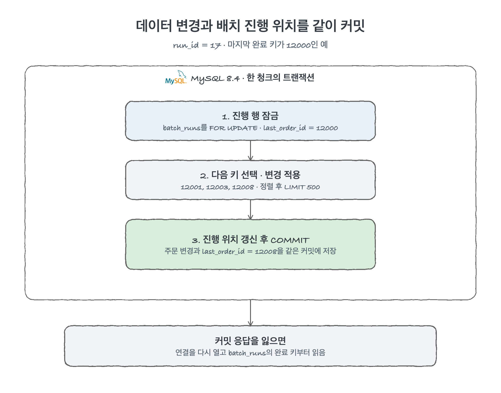

# Batch Processing and Transaction Sizing in MySQL

대량 변경을 한 트랜잭션으로 실행하면 잠금 보유 시간과 롤백 비용이 커지고, 로그 기록과 복제 적용에도 부하가 밀릴 수 있다. 작은 트랜잭션 단위로 나누고 완료 지점을 DB에 저장하면 실패한 범위부터 재개할 수 있다. 커밋 단위가 달라지므로 전체 작업을 한 번에 적용해야 하는 업무라면 부분 완료를 허용할 수 있는지 먼저 확인한다. [InnoDB 트랜잭션 관리](https://dev.mysql.com/doc/refman/8.4/en/optimizing-innodb-transaction-management.html)

## 대상과 진행 위치를 관리한다

예제에서 `batch_targets`는 실행 전에 정한 대상 집합이며 `(run_id, order_id)`가 기본 키다. `batch_runs.run_id`는 기본 키이고 `last_order_id`는 커밋이 끝난 마지막 키를 가리킨다. 같은 실행을 처리하는 워커는 진행 행에 잠금을 잡고, 아래 순서대로 한 묶음씩 변경한다.

```sql
START TRANSACTION;

SELECT last_order_id FROM batch_runs WHERE run_id = 17 FOR UPDATE;

-- 여기서는 조회한 last_order_id가 12000이라고 가정한다.
SELECT order_id FROM batch_targets
WHERE run_id = 17 AND order_id > 12000
ORDER BY order_id
LIMIT 500;

-- 조회 결과가 12001, 12003, 12008인 경우
UPDATE orders SET archived = 1
WHERE order_id IN (12001, 12003, 12008) AND archived = 0;

UPDATE batch_runs SET last_order_id = 12008 WHERE run_id = 17;
COMMIT;
```

앱은 조회된 키 목록과 그 마지막 키를 바인딩한다. 결과가 비어 있으면 진행 행의 잠금을 풀고 실행을 완료한다. 대상 주문이 삭제될 수 있다면 누락을 건너뛸지 배치를 실패시킬지 먼저 정한다. 데이터 변경과 진행 위치를 함께 커밋하므로, 커밋 응답이 끊겼을 때도 같은 실행 행을 다시 읽어 다음 범위를 정할 수 있다. 실행 중 후보 집합이 계속 변한다면 이미 지나간 키의 새 후보나 늦게 커밋한 행이 빠질 수 있어, 대상 고정이나 별도 재조정 규칙이 필요하다. [InnoDB 잠금 조회](https://dev.mysql.com/doc/refman/8.4/en/innodb-locking-reads.html) · [InnoDB 커밋과 롤백](https://dev.mysql.com/doc/refman/8.4/en/innodb-autocommit-commit-rollback.html)



그림의 근거 · [진행 행 잠금](https://dev.mysql.com/doc/refman/8.4/en/innodb-locking-reads.html) · [커밋과 롤백](https://dev.mysql.com/doc/refman/8.4/en/innodb-autocommit-commit-rollback.html)

## 처리량과 서비스 지연의 균형을 맞춘다

`500`은 예시다. 배치당 잠금 시간, 커밋 지연, 적용 행 수, 복제 반영 지연, 서비스 p95를 비교해 크기와 실행 간격을 조절한다. 큰 범위를 잠금으로 잡지 않도록 접근 인덱스를 확인하고, 데드락은 해당 트랜잭션을 새로 시작해 후보와 진행 위치부터 다시 읽는다. 외부 메시지까지 발행해야 하면 트랜잭션 안에 발행할 이벤트를 기록하고, 재전송 시 중복을 처리할 수 있게 구성한다. [MySQL 데드락 대응](https://dev.mysql.com/doc/refman/8.4/en/innodb-deadlocks-handling.html) · [MySQL 복제 상태 확인](https://dev.mysql.com/doc/refman/8.4/en/replication-administration-status.html) · [Production Data Processing and System Design](17_production_data_processing_and_system_design.md)

삽입 배치에서는 다중 행 `INSERT`로 왕복을 줄일 수 있다. 한 문장의 크기와 트랜잭션 크기를 따로 정하고, 레코드 폭과 연결의 패킷 한도를 고려한다. [Optimizing Single-Row and Bulk Inserts](04_optimizing_single_row_and_bulk_inserts.md) · [MySQL 패킷 크기 한도](https://dev.mysql.com/doc/refman/8.4/en/packet-too-large.html)
