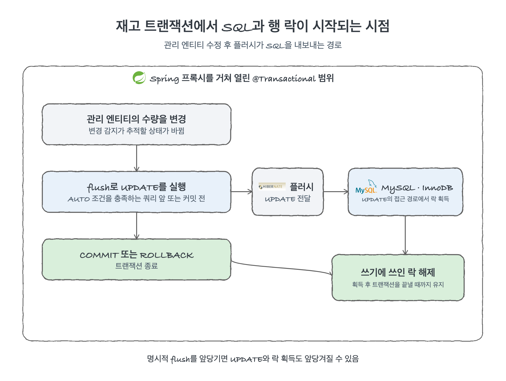

# JPA Transaction Boundaries and Inventory Locking

Spring Data JPA 3.5, Hibernate 6.6, MySQL 8.4 InnoDB를 기준으로 애플리케이션 코드에서 실제 SQL 실행 시점과 잠금 범위를 찾는다. [Spring Data JPA 잠금](https://docs.spring.io/spring-data/jpa/reference/3.5/jpa/locking.html) · [Hibernate 플러시](https://docs.hibernate.org/orm/6.6/userguide/html_single/#flushing)

## 1. Transactional 범위와 락 보유 시간

`@Transactional`은 트랜잭션 경계를 정하고, 락은 그 안에서 실행한 잠금 읽기와 DML이 획득한다. 메서드가 시작하는 순간부터 모든 락을 갖는 것은 아니며, 획득한 쓰기 락은 보통 커밋이나 롤백까지 유지된다. 기본 프록시 방식의 Spring 트랜잭션은 프록시를 통한 호출에 적용된다. 같은 객체의 자기 호출을 별도 트랜잭션 경계라고 가정하지 않는다. [Spring 선언적 트랜잭션](https://docs.spring.io/spring-framework/reference/6.2/data-access/transaction/declarative/annotations.html)

## 2. 변경 감지와 플러시 타이밍

관리 엔티티의 필드를 변경해도 그 시점에 UPDATE가 실행된다는 보장은 없다. 플러시는 변경을 SQL로 동기화한다. Hibernate의 기본 AUTO 모드에서는 해당 변경이 영향을 주는 JPQL/HQL 조회 앞이나 커밋 전에 플러시가 일어날 수 있다. 명시적 `flush()`로 SQL 실행이 앞당겨지면 그 SQL의 락을 더 일찍 획득할 수 있다. 플러시 후에도 실제 트랜잭션이 끝날 때까지 락이 남을 수 있다. [Hibernate AUTO 플러시](https://docs.hibernate.org/orm/6.6/userguide/html_single/#flushing-auto) · [영속성 컨텍스트와 플러시](../high-performance-spring-persistence/05_persistence_context_flushing_and_dirty_checking.md)



그림의 근거 · [Spring 선언적 트랜잭션](https://docs.spring.io/spring-framework/reference/6.2/data-access/transaction/declarative/annotations.html) · [Hibernate AUTO 플러시](https://docs.hibernate.org/orm/6.6/userguide/html_single/#flushing-auto) · [UPDATE가 잡는 락](https://dev.mysql.com/doc/refman/8.4/en/innodb-locks-set.html) · [트랜잭션 종료](https://dev.mysql.com/doc/refman/8.4/en/innodb-autocommit-commit-rollback.html)

## 3. PESSIMISTIC_WRITE가 잠그는 범위

Spring Data의 `@Lock(LockModeType.PESSIMISTIC_WRITE)`는 쿼리의 잠금 모드를 지정한다. 활성 트랜잭션 안에서 실행하고 Hibernate가 만든 SQL과 DB 실행 계획을 확인한다. 같은 애너테이션이어도 PK 한 건과 인덱스 없는 상태 범위의 물리 잠금은 다를 수 있다. 연관 테이블까지 잠그는지는 조인 SQL, JPA 잠금 범위, 방언 등에 따라 확인한다. [Spring Data JPA 잠금](https://docs.spring.io/spring-data/jpa/reference/3.5/jpa/locking.html) · [InnoDB SQL 문장별 잠금](https://dev.mysql.com/doc/refman/8.4/en/innodb-locks-set.html)

## 4. 외래 키 검사에서 획득하는 공유 락

자식 INSERT나 FK 변경에서 InnoDB는 제약을 검사하며 참조한 부모 인덱스 레코드에 공유 락을 걸 수 있다. 부모의 재고 UPDATE가 같은 레코드의 배타 락을 보유하면 자식 INSERT가 기다릴 수 있다. 로그에는 애플리케이션이 명시한 잠금 읽기 외에도 FK 검사와 실제 접근한 인덱스를 함께 대조한다. [InnoDB 외래 키 검사와 공유 락](https://dev.mysql.com/doc/refman/8.4/en/innodb-locks-set.html)

## 5. Version 낙관적 락과 재시도

`@Version` 필드는 관리 엔티티를 갱신할 때 읽었던 버전과 현재 버전을 비교하게 한다. 실패는 플러시나 커밋 시점에 드러날 수 있다. 외부 호출자가 실패를 관찰한 뒤 새 트랜잭션에서 최신 상태를 읽고, 남은 재고와 이미 처리한 요청인지 다시 확인한다. JPQL 벌크 UPDATE는 관리 엔티티의 자동 버전 검사·갱신을 건너뛰므로 아래 예제는 버전을 명시적으로 증가시킨다. [Jakarta Persistence 3.1 §3.4와 §4.10](https://jakarta.ee/specifications/persistence/3.1/jakarta-persistence-spec-3.1)

## 6. 실습 · 재고 차감을 한 UPDATE로 묶기

별도 트랜잭션에서 수량을 읽어 계산하고 결과를 대입하는 흐름을 아래 저장소 호출로 바꾼다. 매핑에는 `InventoryItem` 엔티티의 `id`, `available`, 수치형 `@Version`인 `version`이 필요하다. 이 서비스 호출은 다른 관리 객체의 변경이 쌓이지 않은 짧은 트랜잭션에서 수행한다.

```java
import org.springframework.data.jpa.repository.JpaRepository;
import org.springframework.data.jpa.repository.Modifying;
import org.springframework.data.jpa.repository.Query;
import org.springframework.data.repository.query.Param;
import org.springframework.stereotype.Service;
import org.springframework.transaction.annotation.Transactional;

interface InventoryRepository extends JpaRepository<InventoryItem, Long> {
    @Modifying(flushAutomatically = true, clearAutomatically = true)
    @Query("""
        update InventoryItem i
        set i.available = i.available - :quantity, i.version = i.version + 1
        where i.id = :id and i.available >= :quantity
        """)
    int decrementIfAvailable(@Param("id") long id, @Param("quantity") int quantity);
}

@Service
class InventoryService {
    private final InventoryRepository repository;

    InventoryService(InventoryRepository repository) {
        this.repository = repository;
    }

    @Transactional
    public boolean reserve(long id, int quantity) {
        if (quantity <= 0) {
            throw new IllegalArgumentException("quantity must be positive");
        }
        return repository.decrementIfAvailable(id, quantity) == 1;
    }
}
```

재고가 1인 같은 ID를 두 독립 호출에서 1씩 차감한다. 한 호출만 성공하고 최종 재고가 0인지 확인한다. 0행 갱신은 조건 불충족 또는 대상 부재다. 차감과 주문 기록을 하나의 업무 트랜잭션으로 묶어야 한다면 같은 로컬 트랜잭션에서 처리하고, 중복 요청 차단은 별도의 유일 키를 사용한다. [Spring Data JPA 수정 쿼리](https://docs.spring.io/spring-data/jpa/reference/3.5/jpa/query-methods.html#jpa.modifying-queries)
