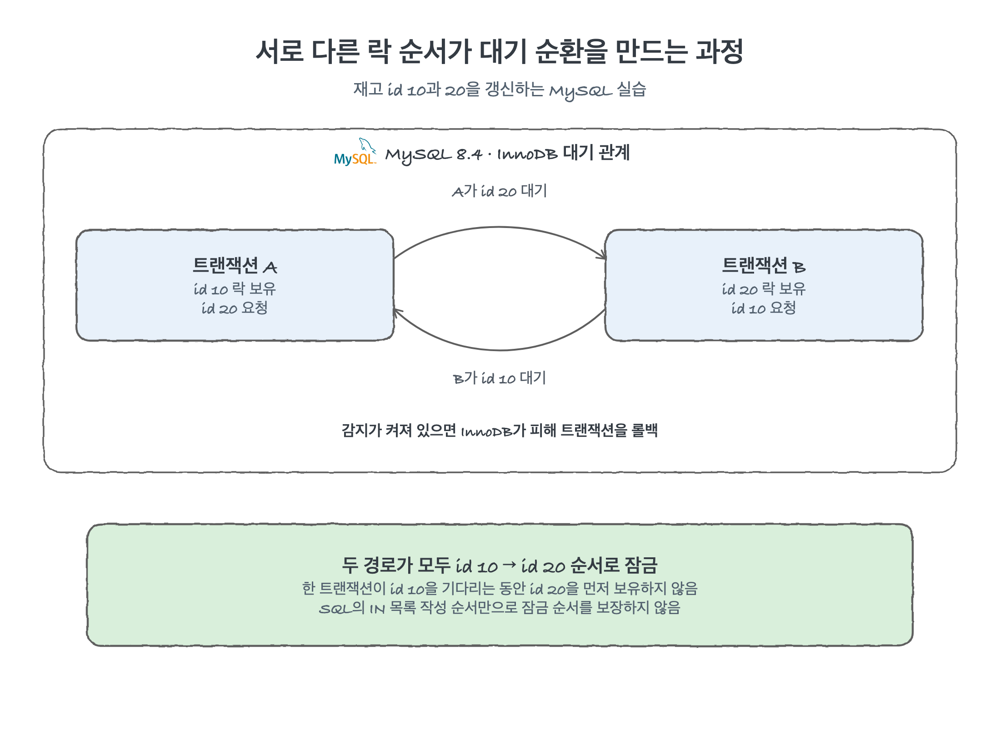

# InnoDB Deadlock Diagnosis and Prevention

InnoDB가 기록한 대기 관계를 읽고, 여러 경로에서 같은 자원을 다른 순서로 획득하는 문제를 찾는다. 실습 SQL은 폐기 가능한 MySQL 8.4 데이터베이스에서 실행한다. [InnoDB 데드락](https://dev.mysql.com/doc/refman/8.4/en/innodb-deadlocks.html)

## 1. 데드락을 설계 문제의 단서로 보기

데드락은 두 개 이상의 트랜잭션이 상대가 가진 락을 서로 기다리는 순환이다. 단방향 대기가 느린 것과는 다르다. 감지가 켜져 있으면 InnoDB가 피해 트랜잭션 하나를 롤백한다. 같은 형태가 반복되면 예외 횟수만 세지 말고 서로 경합하는 SQL과 접근 순서, 범위를 좁힐 인덱스를 살펴본다. [InnoDB 데드락 감지](https://dev.mysql.com/doc/refman/8.4/en/innodb-deadlock-detection.html)

## 2. 데드락 로그 원문에서 대기 관계 읽기

```sql
SHOW ENGINE INNODB STATUS;
```

`LATEST DETECTED DEADLOCK`에서 각 트랜잭션의 현재 SQL, 보유 락, 기다리는 락, 테이블과 인덱스 이름을 대응시킨다. 처리를 끝내려면 어떤 트랜잭션의 락이 해제돼야 하는지 화살표를 이어 순환을 그린다. 마지막 실패 SQL만으로 앞선 SQL이 잡은 락을 알기 어려울 수 있으므로 같은 트랜잭션의 호출 순서도 확인한다. 이 출력은 가장 최근의 사건만 보여 준다. 반복 사건은 서버의 `innodb_print_all_deadlocks` 로그나 애플리케이션의 추적 기록으로 확인한다. [InnoDB 데드락 대응](https://dev.mysql.com/doc/refman/8.4/en/innodb-deadlocks-handling.html)

## 3. 유형 1 · 여러 행을 고정된 ID 순서로 잠그기

한 경로가 10번, 20번 순으로 갱신하고 다른 경로가 20번, 10번 순으로 갱신하면 순환할 수 있다. 같은 테이블의 여러 행을 갱신하는 모든 경로에서 ID를 정렬하고, 실제로 해당 순서대로 한 행씩 갱신하거나 잠근다. IN 목록의 작성 순서만으로 엔진의 락 획득 순서를 보장할 수는 없다. [InnoDB 데드락 최소화](https://dev.mysql.com/doc/refman/8.4/en/innodb-deadlocks-handling.html)



그림의 근거 · [데드락과 접근 순서](https://dev.mysql.com/doc/refman/8.4/en/innodb-deadlocks-handling.html) · [데드락 감지](https://dev.mysql.com/doc/refman/8.4/en/innodb-deadlock-detection.html)

## 4. 유형 2 · 존재 확인과 INSERT를 유일 키로 묶기

존재 여부를 잠금 읽기로 확인한 뒤 없으면 INSERT하는 흐름에서는 여러 트랜잭션이 같은 빈 구간에 진입할 수 있다. 업무 키에 UNIQUE를 두고 한 INSERT 또는 업서트로 조건을 판정한다. 동일 키를 반복 호출할 때 어떤 값을 유지하거나 바꿀지 먼저 정한다. 업서트도 중복 확인과 갱신을 잠그므로 여러 키를 역순으로 처리하면 여전히 데드락이 날 수 있다. [InnoDB INSERT 잠금](https://dev.mysql.com/doc/refman/8.4/en/innodb-locks-set.html) · [MySQL 업서트](https://dev.mysql.com/doc/refman/8.4/en/insert-on-duplicate.html)

아래 예는 같은 ID의 설명을 새 값으로 저장한다.

```sql
INSERT INTO dl_requests (id, note)
VALUES (15, 'received') AS incoming
ON DUPLICATE KEY UPDATE note = incoming.note;
```

## 5. 유형 3 · 배치와 단건 처리의 접근 순서 맞추기

일괄 배치가 여러 키를 오래 잠그는 동안 단건 요청도 여러 행을 갱신하면 겹치는 키에서 대기할 수 있다. 배치와 온라인 경로에서 같은 키 순서를 따르고, 업무적으로 중간 커밋이 가능한 경우에만 청크를 줄여 잠금 보유 시간을 제한한다. 청크 단위 재개 위치와 중복 판정을 함께 저장한다. [MySQL 배치 트랜잭션 크기](48_batch_processing_and_transaction_sizing.md)

## 6. 유형 4 · 외래 키 검사의 숨은 공유 락 찾기

부모 재고 행을 갱신한 뒤 다른 부모를 참조하는 주문을 INSERT하면, 이미 가진 배타 락 외에 FK 검사용 공유 락을 요구할 수 있다. 다른 트랜잭션이 부모 순서를 반대로 처리하면 두 테이블 이름만 보고는 놓치기 쉬운 순환이 생긴다. 업무에 필요한 부모 키를 고정된 순서로 먼저 잠그고 자식 쓰기를 이어가는 방법을 검토한다. [InnoDB 외래 키 검사 락](https://dev.mysql.com/doc/refman/8.4/en/innodb-locks-set.html)

## 7. 피해 트랜잭션을 짧게 재시도하기

MySQL 데드락 오류 `1213`과 SQLSTATE `40001`을 받으면 피해 트랜잭션 전체가 롤백된다. 새 트랜잭션에서 입력과 조건을 다시 읽고 제한된 횟수만 재시도한다. 동시 재시도 집중을 완화하려면 짧은 지수 백오프에 지터를 줄 수 있다. 외부 결제나 알림은 멱등 키로 중복 실행을 제어한다. 락 대기 타임아웃 `1205`의 기본 롤백 범위는 별도로 확인한다. [InnoDB 오류별 롤백](https://dev.mysql.com/doc/refman/8.4/en/innodb-error-handling.html) · [데드락 관찰과 재시도](44_diagnosing_and_retrying_mysql_deadlocks.md)

## 8. 실습 · 네 가지 대기 순환과 수정 방향 비교하기

```sql
CREATE TABLE dl_inventory (
    id INT PRIMARY KEY,
    qty INT NOT NULL
) ENGINE = InnoDB;

CREATE TABLE dl_requests (
    id INT PRIMARY KEY,
    note VARCHAR(40) NOT NULL
) ENGINE = InnoDB;

CREATE TABLE dl_orders (
    id INT PRIMARY KEY,
    inventory_id INT NOT NULL,
    FOREIGN KEY (inventory_id) REFERENCES dl_inventory(id)
) ENGINE = InnoDB;

INSERT INTO dl_inventory VALUES (10, 30), (20, 30);
INSERT INTO dl_requests VALUES (10, 'existing'), (20, 'existing');
```

두 연결에서 REPEATABLE READ를 사용해 각각 `START TRANSACTION`을 실행한다. 각 유형은 독립 실험이다. 아래 표의 순서대로 A1 → B1 → A2 → B2를 실행한다. A2가 기다리는 동안 다른 터미널의 B2를 실행하고, 결과를 확인한 뒤 양쪽을 롤백한다. 데드락 피해자가 어느 연결인지는 고정하지 않는다.

| 유형 | A1과 B1 | A2와 B2 | 수정 후 비교 |
| --- | --- | --- | --- |
| 역순 UPDATE | A가 `dl_inventory.id=10`, B가 20의 `qty`를 갱신 | A가 20, B가 10을 갱신 | 둘 다 10부터 잠근다. B의 첫 대기를 확인한 뒤 A를 종료한다. |
| 빈 키 확인 후 삽입 | 둘 다 `SELECT id FROM dl_requests WHERE id=15 FOR UPDATE` | 양쪽이 `INSERT INTO dl_requests VALUES (15, 'received')` | 사전 잠금 읽기를 제거하고 유일 키 업서트로 다시 비교한다. |
| 배치와 온라인 요청 | 배치 A는 10, 온라인 B는 20의 `qty`를 갱신 | 배치의 다음 갱신은 20, 온라인의 다음 갱신은 10 | 두 경로가 10에서 20 순으로 접근하도록 맞춘다. |
| FK 검사 | A가 재고 20, B가 재고 10의 `qty`를 갱신 | A가 `dl_orders`에 `(101, 10)`, B가 `(102, 20)`를 INSERT | 두 경로 모두 필요한 부모 레코드를 같은 순서로 먼저 잠근다. |

갱신은 예를 들어 `UPDATE dl_inventory SET qty = qty - 1 WHERE id = 10`으로 실행한다. 대기 결과는 락 설정과 계획에 따라 달라질 수 있으므로 보유·대기 관계를 로그와 대조한다.
