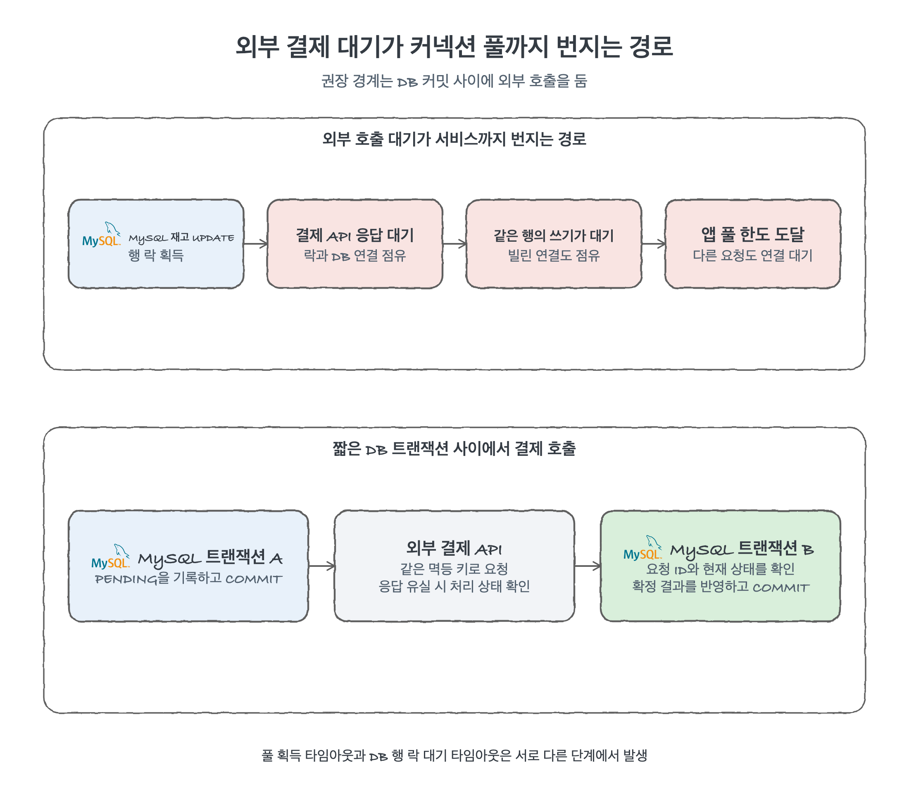

# Long Transactions and Connection Pool Exhaustion

MySQL 8.4 InnoDB에서 오래 열린 트랜잭션이 행 락과 커넥션 풀 대기로 이어지는 경로를 추적한다. 결제 API를 호출하는 흐름은 서로 다른 시스템의 결과를 재시도할 수 있도록 설계한다.

## 1. 트랜잭션 안의 외부 API 호출

재고를 수정해 락을 얻은 뒤 결제 서버를 호출하면 응답을 기다리는 동안 DB 락과 연결을 점유할 수 있다. 결제 서버의 타임아웃과 DB의 커밋·롤백은 서로 다른 상태다. DB 롤백으로 외부 결제가 취소되지는 않는다. 트레이스에서 첫 락 획득 SQL부터 커밋까지의 구간과 외부 요청 대기를 함께 확인한다. [InnoDB 락과 트랜잭션](https://dev.mysql.com/doc/refman/8.4/en/innodb-locking.html)

## 2. 락 대기 타임아웃이 취소하는 범위

InnoDB의 행 락 대기 `1205`는 기본 설정에서 대기한 문장만 롤백한다. 이전 문장의 변경과 락이 같은 트랜잭션에 남을 수 있다. `innodb_rollback_on_timeout`이 켜져 있으면 트랜잭션 전체가 롤백된다. 애플리케이션 업무 단위가 실패했다면 해당 트랜잭션을 종료하고 재시도는 새 경계에서 수행한다. 예외를 잡고 계속 실행할 때는 의도하지 않은 부분 커밋이 생기지 않는지 확인한다. [InnoDB 오류 처리](https://dev.mysql.com/doc/refman/8.4/en/innodb-error-handling.html)

## 3. 커넥션 풀 고갈로 번지는 과정

한 트랜잭션이 행을 오래 잡으면 같은 행을 쓰는 요청들이 연결을 빌린 채 기다린다. 사용 중인 연결이 풀 한도에 닿으면 관계없는 요청도 새 연결을 기다릴 수 있다. 이때 애플리케이션의 풀 획득 타임아웃과 DB의 락 대기 타임아웃을 구분한다. 활성 연결, 풀 대기, 트랜잭션 나이, 락 대기 증가를 같은 구간에서 비교한다. [커넥션 관리](46_managing_mysql_connections.md) · [InnoDB 락 대기 뷰](https://dev.mysql.com/doc/refman/8.4/en/sys-innodb-lock-waits.html)

## 4. 트랜잭션을 분리하고 상태로 이어가기

첫 로컬 트랜잭션에서 결제 요청 ID와 `PENDING` 상태를 기록한다. 비동기 전달이 필요하면 업무 상태와 outbox 행을 같은 로컬 트랜잭션에 저장할 수 있다. 외부 결제 호출은 로컬 트랜잭션이 닫힌 뒤 같은 멱등 키로 수행한다. 결과를 수신하면 두 번째 로컬 트랜잭션에서 현재 상태와 요청 ID를 확인하고 전이한다. 응답을 잃어 결과를 모르면 공급자에서 같은 키의 처리 상태를 확인한다. 실패 확정과 결과 미확정을 다른 상태로 다룬다.

Spring에서 이 경계를 만들려면 트랜잭션 없는 조정 코드가 별도 트랜잭션 서비스나 `TransactionTemplate`을 순차적으로 호출할 수 있다. 이미 열려 있는 외부 트랜잭션 안에서 `REQUIRES_NEW`를 쓰면 바깥 트랜잭션의 락과 연결은 유지될 수 있다. [Spring 트랜잭션 전파](https://docs.spring.io/spring-framework/reference/6.2/data-access/transaction/declarative/tx-propagation.html)



그림의 근거 · [행 락과 대기 관계](https://dev.mysql.com/doc/refman/8.4/en/sys-innodb-lock-waits.html) · [DB 트랜잭션 경계](https://dev.mysql.com/doc/refman/8.4/en/innodb-autocommit-commit-rollback.html) · [트랜잭션 전파](https://docs.spring.io/spring-framework/reference/6.2/data-access/transaction/declarative/tx-propagation.html)

## 5. 긴 트랜잭션과 실제 차단 세션 찾기

```sql
SELECT trx_mysql_thread_id, trx_started, trx_state,
       trx_rows_locked, trx_query
FROM information_schema.innodb_trx
ORDER BY trx_started;

SELECT waiting_pid, blocking_pid, wait_age_secs, locked_table, locked_index
FROM sys.innodb_lock_waits
ORDER BY wait_age_secs DESC;
```

트랜잭션이 열려 있으면서 현재 문장이 없으면 `trx_query`는 NULL일 수 있다. 스레드 ID와 서비스 요청 기록을 연결하고, 긴 트랜잭션이 실제로 차단 중인지 대기 관계에서 확인한다. 메타데이터 락 대기는 별도 뷰에서 본다. [INNODB_TRX](https://dev.mysql.com/doc/refman/8.4/en/information-schema-innodb-trx-table.html) · [sys.innodb_lock_waits](https://dev.mysql.com/doc/refman/8.4/en/sys-innodb-lock-waits.html) · [메타데이터 락](53_mysql_metadata_locks_and_online_ddl.md)

## 6. 실습 · 결제 호출을 락 구간 밖으로 옮기기

모의 결제 클라이언트를 사용해 동일한 요청을 첫 실행, 중복 실행, 응답을 잃은 뒤 재호출하는 경우로 나눈다. 요청 테이블에 `request_id` 유일 키를 두고, 외부 시스템에서 확인한 성공 결과만 아래 조건으로 반영한다.

```sql
CREATE TABLE payment_flow_lab (
    request_id VARCHAR(64) PRIMARY KEY,
    state VARCHAR(16) NOT NULL,
    provider_payment_id VARCHAR(64),
    UNIQUE (provider_payment_id)
) ENGINE = InnoDB;

INSERT INTO payment_flow_lab VALUES ('payment-1', 'PENDING', NULL);
```

INSERT가 커밋된 후 모의 서버를 호출한다. 성공 결과를 받으면 다음 SQL을 짧은 새 트랜잭션에서 실행한다.

```sql
UPDATE payment_flow_lab
SET state = 'PAID', provider_payment_id = 'provider-42'
WHERE request_id = 'payment-1' AND state = 'PENDING';
```

동일 성공 응답을 다시 적용하면 0행을 갱신한다. 그때 저장된 상태와 공급자 ID가 같은 결과인지 확인한다. 모의 서버의 응답을 지연시키고 대기 동안 결제 행의 쓰기 락과 연결을 계속 점유하지 않는지, 중복 요청에서도 공급자 결제가 한 번만 처리되는지 측정한다.
