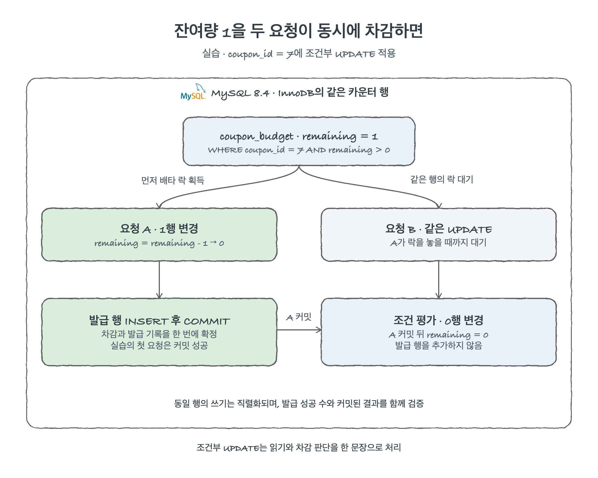

# MySQL Hot Rows and Concurrency Control Patterns

MySQL 8.4 InnoDB에서 한 행에 쓰기가 집중되는 상황을 측정하고, 재고와 쿠폰에 적용할 동시성 제어를 비교한다. 성공 응답 횟수와 DB에 커밋된 결과를 함께 확인한다.

## 1. 한 행에 쓰기가 몰릴 때 관찰할 지표

여러 요청이 같은 카운터 행을 갱신하면 그 행의 배타 락을 순서대로 획득한다. 기본 키 인덱스가 있어도 같은 레코드의 동시 쓰기는 직렬화된다. 락 대기 시간과 트랜잭션 실패율, 초당 커밋 수, 커넥션 풀 대기를 같은 구간에서 본다. [InnoDB 락 대기](https://dev.mysql.com/doc/refman/8.4/en/sys-innodb-lock-waits.html)

## 2. 단일 행의 조건과 차감을 한 UPDATE로 표현하기

잔여량이 양수인 경우에만 같은 문장에서 차감한다. 잔여량이 1인 상태에서 두 요청이 접근해도 먼저 커밋한 차감 뒤에는 다른 요청의 조건이 맞지 않는다. 조건 불충족과 대상 부재는 모두 0행일 수 있다. 커밋 실패나 응답 유실이 있는 요청에는 중복을 확인할 별도 식별자가 필요하다. [SQL 문장별 InnoDB 잠금](https://dev.mysql.com/doc/refman/8.4/en/innodb-locks-set.html)

```sql
UPDATE coupon_budget
SET remaining = remaining - 1, version = version + 1
WHERE coupon_id = 7 AND remaining > 0;
```



그림의 근거 · [SQL별 InnoDB 잠금](https://dev.mysql.com/doc/refman/8.4/en/innodb-locks-set.html) · [UPDATE의 변경 결과](https://dev.mysql.com/doc/refman/8.4/en/update.html) · [차감과 발급 커밋](https://dev.mysql.com/doc/refman/8.4/en/innodb-autocommit-commit-rollback.html)

## 3. 비관적·낙관적·원자적 갱신 실측 계획

| 방식 | 같은 경합에서 비교할 점 |
| --- | --- |
| 비관적 | 읽기에서 먼저 잠그므로 SQL 왕복과 락 보유 구간을 측정한다. |
| 낙관적 | 버전 조건 불일치에 따른 실패와 재시도 비용을 측정한다. |
| 원자적 UPDATE | 한 SQL로 판단과 차감을 끝낸다. 동일 행의 락 대기는 여전히 생길 수 있다. |

세 방식에 같은 재고·요청 수·클라이언트 동시성·연결 풀 크기를 적용한다. 성공한 커밋, 고갈, 버전 충돌, 데드락, 타임아웃을 구분하고 전체 요청과 성공 요청의 지연을 각각 기록한다. 초기 재고와 최종 재고의 차이가 커밋된 발급 수와 일치하는지 확인한 뒤 처리량을 비교한다.

## 4. 카운터를 여러 행으로 나누기

통계 카운터는 `(counter_id, shard_id)`로 나누고 같은 규칙으로 샤드를 선택하면 쓰기가 여러 행으로 분산된다. 읽을 때는 합계를 구한다. 쿠폰처럼 총량 제한이 필요한 경우에는 샤드별로 예산을 분할하고 각 샤드가 자신의 배정량만 차감하게 해야 한다. 특정 샤드가 먼저 고갈되는 상황과 예산 이전 시 동시성 제어를 따로 설계한다.

## 5. 분산 락을 검토할 상황

같은 DB의 한 행이나 UNIQUE 제약으로 지킬 수 있는 규칙은 해당 DB 트랜잭션에서 처리한다. DB 경계를 넘어 공유 자원에 접근하는 작업은 키를 공유하는 모든 실행 경로와 장애 시 소유권을 정의해야 한다. 리스의 유효 기간이 끝난 뒤 기존 작업자가 쓰기를 이어갈 수 있으므로, 필요하다면 저장소가 오래된 작업자의 쓰기를 거부할 수 있는 순서 토큰이나 버전 조건을 사용한다. 외부 부수 효과에는 별도 멱등성을 적용한다.

## 6. 실습 · 선착순 쿠폰 세 가지 방식 비교하기

```sql
CREATE TABLE coupon_budget (
    coupon_id INT PRIMARY KEY,
    remaining INT NOT NULL CHECK (remaining >= 0),
    version BIGINT NOT NULL
) ENGINE = InnoDB;

CREATE TABLE coupon_issue (
    coupon_id INT NOT NULL,
    user_id BIGINT NOT NULL,
    PRIMARY KEY (coupon_id, user_id)
) ENGINE = InnoDB;

INSERT INTO coupon_budget VALUES (7, 1, 0);
```

같은 초기 데이터에서 두 사용자 요청을 동시에 시작한다. 아래 방식으로 차감하고, 차감에 성공한 요청만 같은 트랜잭션에서 `coupon_issue`에 발급 기록을 INSERT한 뒤 커밋한다. 중복 발급 오류가 나면 해당 트랜잭션을 롤백해 차감도 취소한다.

1. 비관적 방식은 `SELECT remaining FROM coupon_budget WHERE coupon_id = 7 FOR UPDATE`로 잠근 뒤 잔여량을 검사하고 차감한다.
2. 낙관적 방식은 버전을 읽고 2절의 UPDATE에 `AND version = ?`를 추가한다. JDBC에서 읽은 버전을 바인딩한다. 0행이면 현재 트랜잭션을 종료하고 새 트랜잭션에서 최신 상태를 읽어 고갈과 버전 충돌을 구분한다.
3. 원자적 방식은 2절의 조건부 UPDATE를 바로 실행한다. 1행이면 발급 기록을 INSERT한다.

실험마다 초기화를 끝낸 뒤 다시 시작한다. 서로 다른 사용자 두 명 중 한 명만 발급받고 재고가 0인지 확인한다. 충분한 재고에서도 같은 사용자는 한 번만 발급되는지 확인한다. 이 실습에서 먼저 성공한다는 것은 DB에서 차감하고 커밋한 순서다. 요청 도착 순서를 보장하려면 별도의 순서 규칙이 필요하다.
