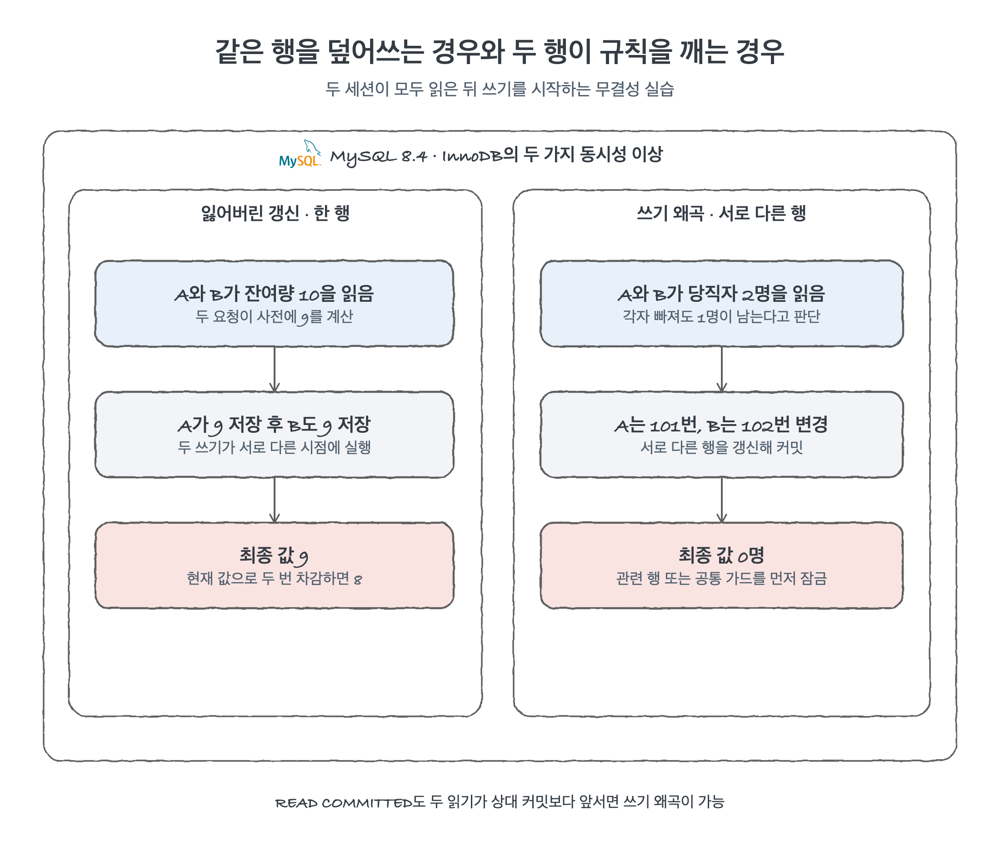

# MySQL Isolation Anomalies and Data Integrity Tests

MySQL 8.4 InnoDB에서 같은 행의 갱신을 덮어쓰는 경우와 서로 다른 행을 바꿔 업무 규칙을 깨는 경우를 재현한다. 테스트는 각 연결의 격리 수준과 실제 커밋 순서를 고정한다. [InnoDB 트랜잭션 격리 수준](https://dev.mysql.com/doc/refman/8.4/en/innodb-transaction-isolation-levels.html)

## 1. 잃어버린 갱신

두 요청이 잔여량 10을 각각 읽고, 애플리케이션에서 1을 빼서 9를 저장하면 두 요청이 성공해도 최종 값은 9일 수 있다. UPDATE의 배타 락은 쓰기 순서를 정하지만, 앞의 조회 결과로 애플리케이션이 계산한 값까지 검증해 주지는 않는다. `SET remaining = remaining - 1`처럼 DB에서 현재 값을 기준으로 계산하거나 버전 조건을 사용한다. [InnoDB 문장별 잠금](https://dev.mysql.com/doc/refman/8.4/en/innodb-locks-set.html)

## 2. 쓰기 왜곡

당직자 두 명 중 최소 한 명이 남아야 하는 업무에서 A와 B가 모두 두 명을 읽은 뒤 각자 자신의 행을 비활성화하면, 같은 행에 대한 쓰기 충돌 없이 두 사람 모두 빠질 수 있다. 두 행의 변경이 각자 유효해 보여도 두 결정이 의존한 조건을 합치면 불변식이 깨진다. 두 사람 모두 상대 트랜잭션이 커밋하기 전에 읽으면 READ COMMITTED로 바꿔도 이 순서는 가능하다.



그림의 근거 · [일관 읽기의 스냅샷](https://dev.mysql.com/doc/refman/8.4/en/innodb-consistent-read.html) · [트랜잭션 격리 수준](https://dev.mysql.com/doc/refman/8.4/en/innodb-transaction-isolation-levels.html) · [최신 상태를 잠금 읽기](https://dev.mysql.com/doc/refman/8.4/en/innodb-locking-reads.html)

## 3. 정합성 조건에 따라 제어 방법 고르기

| 보호할 조건 | 설계 예 |
| --- | --- |
| 한 행의 수치가 음수가 되면 안 됨 | 조건부 UPDATE와 CHECK 제약을 사용한다. |
| 동일한 업무 키는 한 번만 허용 | UNIQUE 제약으로 충돌을 판정한다. |
| 이미 읽은 한 행이 바뀌었으면 재계산 | 버전 비교 후 새 트랜잭션에서 값과 조건을 다시 읽는다. |
| 여러 행의 집합이 함께 지켜야 하는 규칙 | 관련 행이나 공통 가드 행을 먼저 잠근 뒤 최신 상태를 확인한다. 적합하면 SERIALIZABLE과 재시도도 검토한다. |

가드 행을 쓰는 모든 경로가 같은 잠금 규칙을 따라야 한다. InnoDB에서는 가드 락을 잡은 뒤 해당 행들의 상태를 잠금 읽기로 확인하면 앞서 만들어둔 일관 읽기 스냅샷을 재사용하는 문제를 피할 수 있다. SERIALIZABLE에서 명시적인 InnoDB 트랜잭션의 일반 SELECT는 공유 잠금 읽기로 동작하며 대기나 데드락이 생길 수 있다. 새 트랜잭션으로 재시도할 때는 조건을 다시 평가한다. [InnoDB 잠금 읽기](https://dev.mysql.com/doc/refman/8.4/en/innodb-locking-reads.html) · [InnoDB SERIALIZABLE](https://dev.mysql.com/doc/refman/8.4/en/innodb-transaction-isolation-levels.html)

## 4. READ COMMITTED로 바꿀 때 달라지는 동작

READ COMMITTED의 일반 SELECT는 문장마다 새 스냅샷을 사용하므로 같은 트랜잭션 안에서 다음 조회가 다른 커밋 결과를 볼 수 있다. 검색 범위의 갭 락은 대체로 줄어들고 FK와 중복 키 검사는 예외다. 갭 락이 줄면 삽입 대기가 줄 수 있지만, 범위에 새 행이 나타날 수 있다. 락 대기 개선과 업무 규칙 유지 여부를 각각 테스트한다. [InnoDB READ COMMITTED](https://dev.mysql.com/doc/refman/8.4/en/innodb-transaction-isolation-levels.html)

## 5. 실습 · 두 연결로 업무 규칙 검증하기

```sql
CREATE TABLE integrity_inventory (
    id INT PRIMARY KEY,
    remaining INT NOT NULL CHECK (remaining >= 0)
) ENGINE = InnoDB;

CREATE TABLE integrity_shift (
    shift_id INT NOT NULL,
    member_id INT NOT NULL,
    on_call BOOLEAN NOT NULL,
    PRIMARY KEY (shift_id, member_id)
) ENGINE = InnoDB;

CREATE TABLE integrity_shift_guard (
    shift_id INT PRIMARY KEY
) ENGINE = InnoDB;

INSERT INTO integrity_inventory VALUES (1, 10);
INSERT INTO integrity_shift_guard VALUES (7);
INSERT INTO integrity_shift VALUES (7, 101, TRUE), (7, 102, TRUE);
```

각 실험은 초기 데이터를 복구한 뒤 독립적으로 실행한다. 두 연결을 준비하고 두 조회가 모두 끝난 후에 갱신을 허용하도록 테스트의 시작 지점을 맞춘다.

1. 두 연결이 `integrity_inventory.id = 1`에서 10을 읽는다. A가 9를 저장하고 커밋한 뒤 B도 읽어 둔 값으로 9를 저장하고 커밋한다. 최종 값이 9인지 확인하고, 현재 값 기준 차감으로 바꿨을 때 최종 값이 8인지 단언한다.
2. 두 연결에서 `SELECT COUNT(*) FROM integrity_shift WHERE shift_id = 7 AND on_call = TRUE`를 실행해 모두 2를 읽는다. A는 101번, B는 102번을 각각 비활성화하고 커밋한다. 최종 당직자가 0명인지 확인한다.
3. 가드 행을 먼저 읽고 잠그는 흐름으로 바꾼다. 아래 두 SELECT를 같은 트랜잭션에서 실행하고, 당직자가 둘 이상인 경우에만 자신의 행을 비활성화한 뒤 커밋한다. 이 경우 두 요청 모두 가드를 얻을 때까지 기다리는 구조이므로 두 SELECT가 동시에 끝나기를 기다리는 동기화 지점을 쓰지 않는다.

```sql
SELECT shift_id FROM integrity_shift_guard WHERE shift_id = 7 FOR UPDATE;

SELECT member_id
FROM integrity_shift
WHERE shift_id = 7 AND on_call = TRUE
ORDER BY member_id
FOR UPDATE;
```

수정 후 독립된 세 번째 연결에서 당직자가 한 명 이상인지 검증한다. 테스트 종료 조건에는 최종 DB 상태, 성공한 커밋 수, 버전 충돌이나 데드락 발생 여부를 포함한다.
