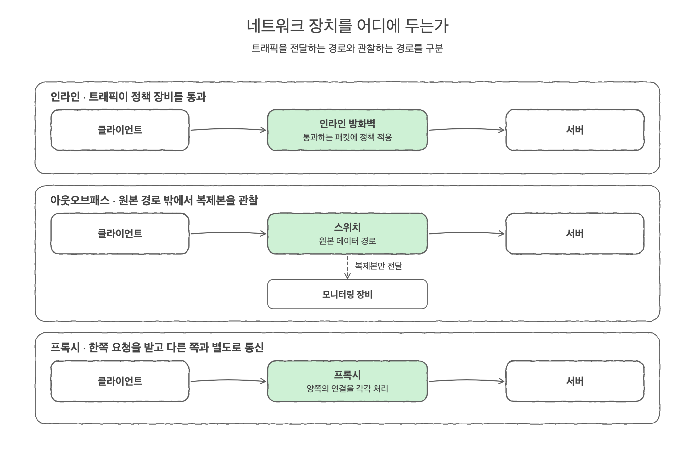
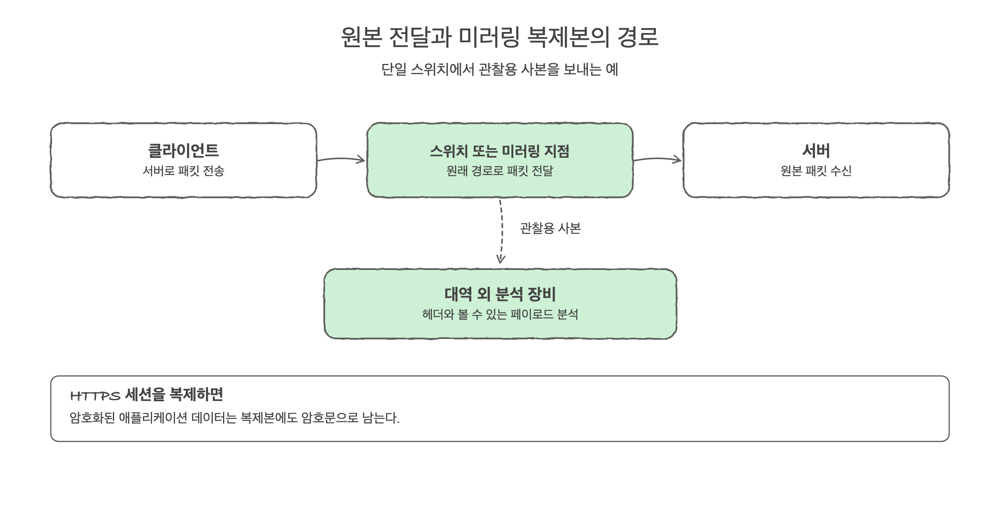
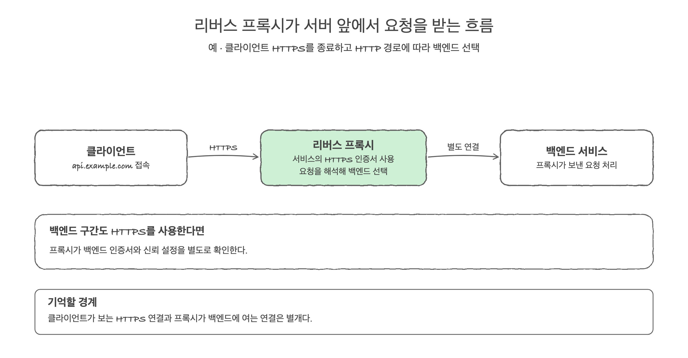

# 네트워크 장비 배치와 프록시 이해하기

## 1. 인라인, 아웃오브패스, 프록시 배치

- **인라인(inline)** 장비는 원본 트래픽의 전달 경로에 놓인다. 인라인 침입 방지 시스템(IPS)은 통과하는 패킷을 검사하고 정책에 따라 전달하거나 폐기한다. [Cisco Secure Firewall 7.4 · Inline Sets and Passive Interfaces](https://www.cisco.com/c/en/us/td/docs/security/secure-firewall/management-center/device-config/740/management-center-device-config-74/interfaces-settings-ifcs-ips.html)
- **아웃오브패스(out-of-path)** 장비는 별도 경로로 보내는 트래픽 복제본을 관찰한다. 원본 패킷은 기존 전달 경로를 따라 목적지로 간다. [AWS VPC · How Traffic Mirroring Works](https://docs.aws.amazon.com/vpc/latest/mirroring/traffic-mirroring-how-it-works.html)
- **프록시**(proxy)는 클라이언트와 서비스 사이에서 요청을 받아 다음 서버로 전달하는 중개자다. 인라인과 아웃오브패스는 원본 트래픽 경로에 대한 배치를, 프록시는 요청 처리 역할을 설명한다. 예를 들어 리버스 프록시가 서비스의 인입 경로에 있고, 별도의 센서가 그 경로의 패킷 복제본을 관찰할 수 있다. [RFC 9110 §3.7 · HTTP 중개자](https://www.rfc-editor.org/rfc/rfc9110.html#section-3.7) · [AWS VPC · How Traffic Mirroring Works](https://docs.aws.amazon.com/vpc/latest/mirroring/traffic-mirroring-how-it-works.html)

원본의 전달 경로와 복제 경로, 프록시의 두 통신 구간을 비교했다. [Cisco Secure Firewall 7.4 · Inline Sets and Passive Interfaces](https://www.cisco.com/c/en/us/td/docs/security/secure-firewall/management-center/device-config/740/management-center-device-config-74/interfaces-settings-ifcs-ips.html) · [AWS VPC · How Traffic Mirroring Works](https://docs.aws.amazon.com/vpc/latest/mirroring/traffic-mirroring-how-it-works.html) · [RFC 9110 §3.7 · HTTP 중개자](https://www.rfc-editor.org/rfc/rfc9110.html#section-3.7)

## 2. 인라인에서 패킷에 정책 적용하기

인라인 IPS는 대상 패킷을 목적지로 전달하기 전에 검사한다. 검사 규칙과 실제 트래픽 조합이 처리량과 지연에 영향을 주므로 운영에 사용할 정책을 적용한 상태에서 혼잡 시간대의 처리량, 패킷 손실, 응답 지연을 확인한다. [Cisco Snort 3 · Intrusion Prevention Performance Tuning](https://www.cisco.com/c/en/us/td/docs/security/secure-firewall/management-center/snort3/snort3-custom-policies/intrusion-performance.pdf) · [RFC 9411 §4 · 보안 장비 성능 시험 구성](https://www.rfc-editor.org/rfc/rfc9411.html#section-4)

장애 시 **fail-open**은 영향받은 트래픽을 검사 없이 통과시키고 **fail-closed**는 차단한다. 어떤 장애에 이 동작을 적용하는지는 제품, 모델, 설정에 따라 달라진다. Cisco Secure Firewall 7.4의 인라인 구성에서는 Snort 처리 과부하와 중단을 다루는 설정이 있고, 일부 모듈에는 전원 장애 시 트래픽을 통과시키는 별도 기능이 있다. [Cisco Secure Firewall 7.4 · Snort Fail Open vs. Hardware Bypass](https://www.cisco.com/c/en/us/td/docs/security/secure-firewall/management-center/device-config/740/management-center-device-config-74/interfaces-settings-ifcs-ips.html)

## 3. 아웃오브패스, DPI, 망 중립성

스위치 미러링 또는 네트워크 TAP에서 분기한 패킷 복제본을 분석 센서로 보낼 수 있다. 센서가 복제본만 받는 구성에서는 경보를 만들 수 있고, 원본의 전달 여부는 실제 전달 경로에 있는 장비가 결정한다. [RFC 9505 §4.2.5 · DPI Identification](https://www.rfc-editor.org/rfc/rfc9505.html#section-4.2.5) · [AWS VPC · How Traffic Mirroring Works](https://docs.aws.amazon.com/vpc/latest/mirroring/traffic-mirroring-how-it-works.html)

원본 전달 상태와 복제본 분석의 경계를 나타냈다. [AWS VPC · How Traffic Mirroring Works](https://docs.aws.amazon.com/vpc/latest/mirroring/traffic-mirroring-how-it-works.html) · [RFC 9505 §4.2.5 · DPI Identification](https://www.rfc-editor.org/rfc/rfc9505.html#section-4.2.5) · [RFC 9846 §5.2 · TLS 레코드 보호](https://datatracker.ietf.org/doc/html/rfc9846#section-5.2)

**심층 패킷 검사**(DPI)는 IP 주소와 포트 이외의 정보도 분석한다. 탐지 방식에 따라 흐름을 재조립해 애플리케이션 데이터가 보이는 경우 내용을 검사할 수 있다. 종단 간 TLS를 그대로 미러링하면 복제본에도 암호문이 담긴다. TLS 종단에서만 평문으로 처리되는 구성이라면, 미러링 센서가 패킷을 받아도 HTTP 경로나 본문은 읽을 수 없다. [RFC 9505 §4.2.5 · DPI Identification](https://www.rfc-editor.org/rfc/rfc9505.html#section-4.2.5) · [RFC 9846 §5.2 · TLS 레코드 보호](https://datatracker.ietf.org/doc/html/rfc9846#section-5.2)

**망 중립성** 논의에서는 인터넷 접속 사업자가 콘텐츠, 애플리케이션, 출발지나 목적지에 따라 트래픽을 어떻게 취급하는지를 살핀다. 기술적으로는 복제본 관찰, 트래픽 분류, 원본의 차단·속도 제한이 각각 다른 동작이다. 실제 영향을 파악하려면 무엇을 분류했는지와 어떤 전달 정책을 적용했는지 함께 확인한다. [BEREC · Introduction to Open Internet](https://www.berec.europa.eu/en/all-topics/introduction-to-open-internet) · [RFC 9505 §5.2 · 전송 계층 제어 사례](https://www.rfc-editor.org/rfc/rfc9505.html#section-5.2)

## 4. 포워드 프록시와 외부 연결 경로

**포워드 프록시**(forward proxy)는 클라이언트 쪽에 설정하는 중개자다. 명시적 HTTP 프록시를 사용하는 클라이언트는 요청을 프록시에 보내고, 프록시는 필요한 경우 목적지 서버나 다음 중개자에 별도로 연결한다. [RFC 9110 §3.7 · HTTP 중개자](https://www.rfc-editor.org/rfc/rfc9110.html#section-3.7) · [RFC 9110 §7.3.2 · 프록시로 요청 보내기](https://www.rfc-editor.org/rfc/rfc9110.html#section-7.3.2)

조직이 관리하는 네트워크에서는 내부 앱이 승인된 외부 서비스에 접속할 때 중앙 프록시를 경유하는 경로를 둘 수 있다. 앱은 프록시에 연결하고 외부 서비스로 나가는 연결은 프록시가 맡는다. 운영자는 이 지점에서 외부 목적지에 대한 접속 정책을 적용할 수 있다. [Google Cloud · Secure Web Proxy Overview](https://docs.cloud.google.com/secure-web-proxy/docs/overview)

## 5. 포워드 프록시에서 보호하고 관찰할 수 있는 범위

HTTP 포워드 프록시는 클라이언트를 인증하고 목적지 등을 기준으로 요청을 허용하거나 거부할 수 있다. 접속 결과, 처리 시간, 전송량은 프록시가 제공하는 로그 항목에 따라 확인한다. [RFC 9110 §11.7 · 프록시 인증](https://www.rfc-editor.org/rfc/rfc9110.html#section-11.7) · [Squid · http_access](https://www.squid-cache.org/Doc/config/http_access/) · [Squid · logformat](https://www.squid-cache.org/Doc/config/logformat/)

HTTPS용 HTTP `CONNECT` 요청에는 접속하려는 호스트와 포트가 들어간다. 프록시가 `2xx`를 반환해 터널을 열면 양방향 바이트를 전달한다. 클라이언트가 그 터널 안에서 목적지 서버와 TLS를 맺으면 프록시는 `CONNECT` 단계의 목적지와 응답을 볼 수 있다. 터널 안의 HTTP 경로, 헤더, 본문은 TLS 암호문으로 전달된다. [RFC 9110 §9.3.6 · CONNECT](https://www.rfc-editor.org/rfc/rfc9110.html#section-9.3.6) · [RFC 9846 §5.2 · TLS 레코드 보호](https://datatracker.ietf.org/doc/html/rfc9846#section-5.2)

## 6. 리버스 프록시에서 서비스 요청 받기

**리버스 프록시**(reverse proxy)는 서비스 앞에서 클라이언트 요청을 받는다. 클라이언트는 서비스의 공개 주소로 접속하고 프록시는 백엔드에 별도 연결로 요청을 전달한다. 프록시는 HTTP 요청의 `Host` 또는 `:authority`가 전달하는 호스트와 선택적 포트 정보를 보고 요청을 받을 서비스나 업스트림을 결정할 수 있다. [RFC 9110 §3.7 · 게이트웨이](https://www.rfc-editor.org/rfc/rfc9110.html#section-3.7) · [RFC 9110 §7.2 · Host와 :authority](https://www.rfc-editor.org/rfc/rfc9110.html#section-7.2)

TLS를 종료하는 리버스 프록시 앞뒤의 통신 구간이다. [NGINX · HTTPS 서버 설정](https://nginx.org/en/docs/http/configuring_https_servers.html) · [NGINX · proxy_pass](https://nginx.org/en/docs/http/ngx_http_proxy_module.html#proxy_pass) · [RFC 9525 §6 · 서비스 식별자 검증](https://www.rfc-editor.org/rfc/rfc9525.html#section-6)

리버스 프록시에서 HTTPS를 종료하면 프록시가 공개 서비스 이름에 맞는 인증서를 제시하고 클라이언트의 TLS 연결을 처리한다. 프록시에서 백엔드까지의 구간에는 별도 연결을 사용한다. NGINX에서는 이 구간에 HTTP 또는 HTTPS를 선택할 수 있고, HTTPS를 사용하면 프록시가 TLS 클라이언트가 된다. [NGINX · HTTPS 서버 설정](https://nginx.org/en/docs/http/configuring_https_servers.html) · [NGINX · proxy_pass](https://nginx.org/en/docs/http/ngx_http_proxy_module.html#proxy_pass) · [RFC 9525 §6 · 서비스 식별자 검증](https://www.rfc-editor.org/rfc/rfc9525.html#section-6)

관련 문서 · [NGINX 리버스 프록시와 HTTPS](../nginx/04_nginx_reverse_proxy_load_balancing_and_https.md) · [웹 PKI와 TLS](../ssl-and-cryptography/03_understanding_web_pki_and_tls.md)

## 7. 클라이언트 애플리케이션에서 로컬 프록시 사용하기

로컬 프록시는 클라이언트와 같은 호스트에서 실행되는 중개 프로그램이다. 로컬 검사 범위를 한정하려면 프록시를 루프백 주소에서만 수신하게 하고, 프록시를 명시적으로 사용하는 테스트 앱과 승인된 테스트 목적지의 연결을 대상으로 삼는다. 프록시 설정이 적용되는 범위는 클라이언트 구현에 따라 달라진다. [RFC 1122 §3.2.1.3 · IPv4 루프백](https://www.rfc-editor.org/rfc/rfc1122.html#section-3.2.1.3) · [RFC 9110 §7.3.2 · 클라이언트 프록시 설정](https://www.rfc-editor.org/rfc/rfc9110.html#section-7.3.2)

테스트 앱에서 프록시까지 연결한 결과와 프록시의 `CONNECT` 응답을 비교하면 프록시 접속과 터널 성립 여부를 구분할 수 있다. `CONNECT`가 성공한 뒤에도 목적지와의 TLS 핸드셰이크나 앱의 HTTP 요청은 별도로 실패할 수 있으므로 해당 결과는 테스트 앱에서 확인한다. [RFC 9110 §9.3.6 · CONNECT](https://www.rfc-editor.org/rfc/rfc9110.html#section-9.3.6) · [RFC 9846 §4 · TLS 핸드셰이크](https://datatracker.ietf.org/doc/html/rfc9846#section-4)
