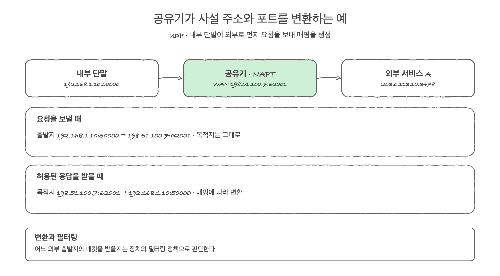
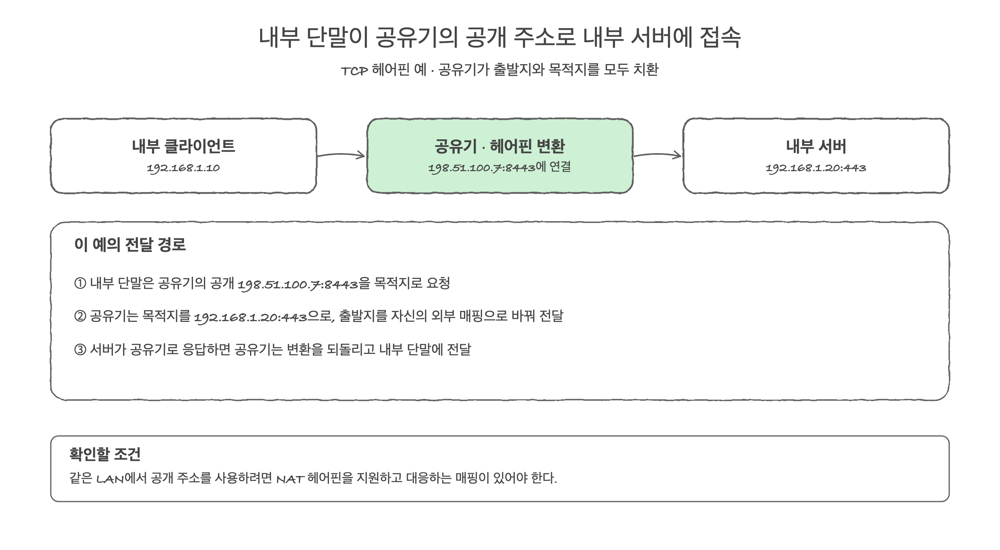
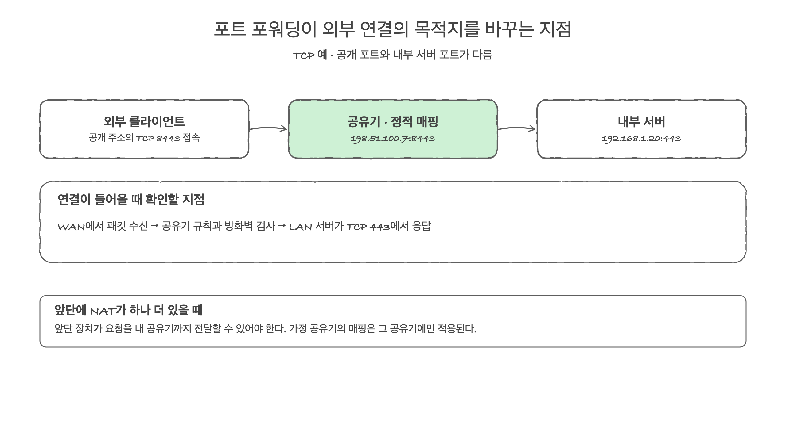

# 가정용 공유기와 NAT

## 1. 가정용 공유기의 NAT와 변환 테이블

가정용 공유기는 LAN과 WAN 사이의 게이트웨이다. IPv4 주소만 변환하는 방식은 Basic NAT이고, IP 주소와 TCP·UDP 포트까지 변환하는 방식은 NAPT(Network Address Port Translation)다. NAPT를 쓰면 여러 내부 단말이 외부 IPv4 주소 하나를 공유할 수 있다. [RFC 3022 §1, §2.2](https://www.rfc-editor.org/rfc/rfc3022.html#section-2.2)

UDP 예시에서 LAN 단말 `192.168.1.10:50000`이 외부 A `203.0.113.10:3478`에 보내면 공유기가 출발지를 WAN 쪽 `198.51.100.7:62001`로 바꿔 내보낸다. A의 응답이 이 외부 주소와 포트로 오면, 공유기는 기존 매핑을 찾아 목적지를 `192.168.1.10:50000`으로 되돌린다. 예시의 외부 주소는 문서용 대역에서 골랐다. [RFC 3022 §3.1](https://www.rfc-editor.org/rfc/rfc3022.html#section-3.1) · [RFC 3022 §4.1](https://www.rfc-editor.org/rfc/rfc3022.html#section-4.1) · [RFC 5737 §3](https://www.rfc-editor.org/rfc/rfc5737.html#section-3)

```text
변환 테이블 예시
프로토콜   내부 IP:포트           변환된 외부 IP:포트
UDP        192.168.1.10:50000     198.51.100.7:62001

방향       LAN에서 보이는 패킷                               WAN에서 보이는 패킷
송신       192.168.1.10:50000 → 203.0.113.10:3478              198.51.100.7:62001 → 203.0.113.10:3478
수신       203.0.113.10:3478 → 192.168.1.10:50000              203.0.113.10:3478 → 198.51.100.7:62001
```

**매핑(mapping)**은 내부 IP·포트를 어떤 외부 IP·포트로 변환하고 언제 재사용하는지를 결정한다. **필터링(filtering)**은 그 외부 IP·포트에 도착한 패킷 중 어느 출발지를 허용할지 결정한다. 두 동작은 독립적이며 외부 패킷의 허용 범위는 필터링에 달려 있다. [RFC 4787 §4.1](https://datatracker.ietf.org/doc/html/rfc4787#section-4.1) · [RFC 4787 §5](https://datatracker.ietf.org/doc/html/rfc4787#section-5)

위 표는 동적 매핑 한 건을 보여 준다. NAT는 활성 상태의 매핑을 재사용할 수 있고, UDP 매핑은 정해진 시간 동안 갱신되지 않으면 만료된다. RFC 7857은 엔드포인트 독립 매핑과 필터링을 전송 프로토콜별로 적용하도록 권고하며, 이를 바꿀 수 있는 설정을 제공하는 장비에서도 프로토콜별 적용을 기본값으로 요구한다. [RFC 4787 §4.1](https://datatracker.ietf.org/doc/html/rfc4787#section-4.1) · [RFC 4787 §4.3](https://datatracker.ietf.org/doc/html/rfc4787#section-4.3) · [RFC 7857 §5–6](https://www.rfc-editor.org/rfc/rfc7857.html#section-5)



공유기가 요청과 허용된 응답에서 각각 어느 주소와 포트를 바꾸는지 그렸다. [RFC 3022 §3.1](https://www.rfc-editor.org/rfc/rfc3022.html#section-3.1) · [RFC 4787 §4.1](https://datatracker.ietf.org/doc/html/rfc4787#section-4.1) · [RFC 4787 §5](https://datatracker.ietf.org/doc/html/rfc4787#section-5) · [RFC 5737 §3](https://www.rfc-editor.org/rfc/rfc5737.html#section-3)

## 2. 대칭 NAT

대칭 NAT(Symmetric NAT)는 초기 STUN 규격 RFC 3489가 정의한 UDP 동작이다. 내부 IP·포트와 외부 목적지 IP·포트가 모두 같은 동안 매핑을 재사용한다. 같은 내부 소켓에서 다른 목적지로 보내면 새 외부 매핑을 사용하고, 각 매핑은 해당 목적지에서 오는 패킷을 허용한다. [RFC 3489 §5](https://www.rfc-editor.org/rfc/rfc3489.html#section-5)

예를 들어 `192.168.1.10:50000`이 A `203.0.113.10:3478`에 보낼 때 `198.51.100.7:62001`을 썼다면, B `203.0.113.20:3478`에 보낼 때는 `198.51.100.7:62002`처럼 다른 매핑을 쓸 수 있다. B가 A용 매핑 `198.51.100.7:62001`에 보내면 대칭 NAT 예시에서는 허용되지 않는다. [RFC 3489 §5](https://www.rfc-editor.org/rfc/rfc3489.html#section-5)

RFC 4787은 이 매핑을 주소·포트 종속 매핑(Address and Port-Dependent Mapping)이라고 부른다. 목적지 IP가 같으면 포트가 달라도 매핑을 재사용하는 주소 종속 매핑(Address-Dependent Mapping)도 별도로 정의하며, 유니캐스트 UDP NAT에는 목적지와 무관하게 재사용하는 엔드포인트 독립 매핑(Endpoint-Independent Mapping)을 요구한다. A와 B는 IP가 달라 위 예시의 결과만으로는 두 종속 매핑을 구분할 수 없다. [RFC 4787 §4.1](https://datatracker.ietf.org/doc/html/rfc4787#section-4.1)

RFC 3489의 네 가지 명칭은 당시 관찰한 동작을 설명하는 용어다. RFC 5389는 RFC 3489를 대체하면서 NAT 유형 판별 기능을 제거했다. 현행 STUN 규격인 RFC 8489는 NAT가 할당한 외부 IP·포트 확인과 연결 가능성 확인 등에 STUN을 사용한다. [RFC 3489 §5](https://www.rfc-editor.org/rfc/rfc3489.html#section-5) · [RFC 5389 §19](https://www.rfc-editor.org/rfc/rfc5389.html#section-19) · [RFC 8489 §1](https://www.rfc-editor.org/rfc/rfc8489.html#section-1)

## 3. 풀 콘 NAT와 내부에서의 접속

풀 콘 NAT(Full Cone NAT)는 엔드포인트 독립 매핑과 엔드포인트 독립 필터링(Endpoint-Independent Filtering)을 함께 적용하는 동작이다. `192.168.1.10:50000`이 A로 보낸 뒤 매핑이 유효하다면, 이전에 통신한 적 없는 B가 `198.51.100.7:62001`로 보낸 UDP 패킷도 이 NAT의 필터를 통과할 수 있다. [RFC 3489 §5](https://www.rfc-editor.org/rfc/rfc3489.html#section-5) · [RFC 4787 §5](https://datatracker.ietf.org/doc/html/rfc4787#section-5)

같은 LAN의 단말이 다른 내부 단말의 WAN 쪽 매핑으로 접속할 때 공유기가 트래픽을 다시 LAN으로 보내는 동작을 **NAT 헤어핀(hairpinning)**이라고 한다. 6절의 TCP 포트 포워딩을 예로 들면, LAN 클라이언트가 `198.51.100.7:8443`으로 접속하고 헤어핀을 지원하는 공유기가 그 목적지를 내부 웹 서버 `192.168.1.20:443`으로 변환한다. [RFC 4787 §6](https://datatracker.ietf.org/doc/html/rfc4787#section-6) · [RFC 5382 §7.2](https://datatracker.ietf.org/doc/html/rfc5382#section-7.2) · [RFC 3022 §2.2](https://www.rfc-editor.org/rfc/rfc3022.html#section-2.2)

RFC 4787과 RFC 5382는 각각 UDP와 TCP에 헤어핀을 요구하며, 헤어핀 패킷의 출발지도 송신자의 변환된 외부 IP·포트로 전달하도록 정한다. 같은 LAN에서 WAN 주소로 접속할 수 있는지는 장비의 헤어핀 동작에 달려 있으므로 풀 콘 여부만으로 판단할 수 없다. [RFC 4787 §5–6](https://datatracker.ietf.org/doc/html/rfc4787#section-5) · [RFC 5382 §7.2](https://datatracker.ietf.org/doc/html/rfc5382#section-7.2)



외부용 매핑을 같은 LAN의 단말이 사용할 때 공유기를 거쳐 돌아오는 경로다. [RFC 4787 §6](https://datatracker.ietf.org/doc/html/rfc4787#section-6) · [RFC 5382 §7.2](https://datatracker.ietf.org/doc/html/rfc5382#section-7.2) · [RFC 3022 §2.2](https://www.rfc-editor.org/rfc/rfc3022.html#section-2.2)

## 4. 주소 제한 콘 NAT

주소 제한 콘 NAT(Restricted Cone NAT)는 엔드포인트 독립 매핑을 사용하며, 수신 패킷에 **주소 종속 필터링(Address-Dependent Filtering)**을 적용한다. 내부 소켓이 이전에 패킷을 보낸 외부 IP에서 오는 트래픽은 출발지 포트가 달라도 통과한다. [RFC 3489 §5](https://www.rfc-editor.org/rfc/rfc3489.html#section-5) · [RFC 4787 §5](https://datatracker.ietf.org/doc/html/rfc4787#section-5)

내부 단말이 A `203.0.113.10:3478`에만 보냈고 매핑이 유효하다면, A의 `203.0.113.10:4000`에서 `198.51.100.7:62001`로 보내는 패킷도 필터를 통과한다. B `203.0.113.20:3478`에서 같은 매핑으로 보내는 패킷은 출발지 IP가 달라 차단된다. [RFC 4787 §5](https://datatracker.ietf.org/doc/html/rfc4787#section-5)

## 5. 포트 제한 콘 NAT

포트 제한 콘 NAT(Port Restricted Cone NAT)도 엔드포인트 독립 매핑을 사용한다. 수신 패킷에는 **주소·포트 종속 필터링(Address and Port-Dependent Filtering)**을 적용해 내부 소켓이 이전에 패킷을 보낸 외부 IP와 포트가 모두 일치해야 통과시킨다. [RFC 3489 §5](https://www.rfc-editor.org/rfc/rfc3489.html#section-5) · [RFC 4787 §5](https://datatracker.ietf.org/doc/html/rfc4787#section-5)

내부 단말이 A `203.0.113.10:3478`에만 보냈고 매핑이 유효하다면, `198.51.100.7:62001`로 오는 패킷 중 `203.0.113.10:3478`에서 온 패킷은 통과한다. `203.0.113.10:4000`과 B `203.0.113.20:3478`은 각각 포트와 IP가 달라 차단된다. [RFC 4787 §5](https://datatracker.ietf.org/doc/html/rfc4787#section-5)

## 6. 정적 포트 포워딩

정적 포트 포워딩은 관리자가 지정한 프로토콜과 외부 포트로 들어오는 트래픽을 내부 서비스 IP·포트로 전달하는 규칙이다. 예를 들어 외부 접속을 승인한 웹 서비스에 대해 TCP `198.51.100.7:8443 → 192.168.1.20:443`을 구성하면, 공유기는 그 외부 포트로 들어온 TCP 패킷의 목적지를 내부 서버로 바꾼다. 이 정적 매핑은 내부 단말의 선행 송신 없이도 외부에서 시작하는 연결에 적용된다. [RFC 3022 §2.2](https://www.rfc-editor.org/rfc/rfc3022.html#section-2.2) · [RFC 6269 §5.2.1](https://www.rfc-editor.org/rfc/rfc6269.html#section-5.2.1)



정적 매핑이 적용되는 장치와 내부 서버까지의 전달 경로다. [RFC 3022 §2.2](https://www.rfc-editor.org/rfc/rfc3022.html#section-2.2) · [RFC 6269 §5.2.1](https://www.rfc-editor.org/rfc/rfc6269.html#section-5.2.1) · [RFC 6888 §1–2](https://www.rfc-editor.org/rfc/rfc6888.html#section-1)

외부 연결이 성립하려면 외부에서 해당 주소·포트에 도달할 수 있어야 하고 경로의 필터링 정책이 허용해야 하며, 서버가 지정된 내부 포트에서 연결을 받아야 한다. [RFC 5382 §4.3](https://datatracker.ietf.org/doc/html/rfc5382#section-4.3) · [RFC 6269 §5.2.1](https://www.rfc-editor.org/rfc/rfc6269.html#section-5.2.1)

라우터 두 대가 연달아 NAT를 하면 외부 트래픽이 두 변환 경계를 모두 지나는 이중 NAT가 된다. 두 장비를 관리할 수 있다면 상위 NAT가 하위 공유기의 WAN IP·포트로, 하위 공유기가 내부 서비스로 전달하도록 각 경계의 매핑을 맞춘다. 상위 장비가 통신사의 CGNAT라면 집 공유기에 추가한 규칙의 효력은 공유기까지이며, 상위 매핑은 통신사의 지원과 정책에 달려 있다. [RFC 6888 §1–2](https://www.rfc-editor.org/rfc/rfc6888.html#section-1) · [RFC 6269 §5.2.1](https://www.rfc-editor.org/rfc/rfc6269.html#section-5.2.1)

공유기 WAN 주소가 `100.64.0.0/10`에 속하면 CGNAT를 의심할 단서다. RFC 6598은 이 범위를 통신사 NAT와 가입자 장비 사이에 사용할 공유 주소 공간으로 지정한다. CGNAT의 가입자 측에는 다른 주소 범위도 쓰일 수 있으므로 WAN 주소만으로 전체 경로를 단정하기 어렵다. [RFC 6598 §5.1–5.2](https://www.rfc-editor.org/rfc/rfc6598.html#section-5.1) · [RFC 6598 §7](https://www.rfc-editor.org/rfc/rfc6598.html#section-7)

## 7. UPnP IGD와 NAT

UPnP IGD(Internet Gateway Device)는 LAN 쪽 애플리케이션이 지원되는 공유기에 포트 매핑을 요청할 수 있게 한다. IGD v2의 `WANIPConnection:2` 서비스는 `AddPortMapping`으로 매핑을 생성하고 `DeletePortMapping`으로 삭제한다. 임대 시간이 있는 매핑은 만료 시 제거된다. [UPnP WANIPConnection:2 §2.4.6](https://upnp.org/specs/gw/UPnP-gw-WANIPConnection-v2-Service.pdf#page=29) · [UPnP WANIPConnection:2 §2.5.16](https://upnp.org/specs/gw/UPnP-gw-WANIPConnection-v2-Service.pdf#page=49) · [UPnP WANIPConnection:2 §2.5.18](https://upnp.org/specs/gw/UPnP-gw-WANIPConnection-v2-Service.pdf#page=56)

IGD v2 게이트웨이는 포트 매핑 요청에 장비의 보안 정책을 적용한다. 자동 매핑도 외부에서 해당 내부 서비스로 트래픽을 전달하므로 어떤 단말과 서비스의 매핑을 승인할지 관리해야 한다. 상위 NAT가 있다면 인터넷에서 시작한 연결에 필요한 매핑은 상위 장비에도 있어야 한다. [UPnP WANIPConnection:2 §2.5.16](https://upnp.org/specs/gw/UPnP-gw-WANIPConnection-v2-Service.pdf#page=50) · [RFC 6269 §5.2.1](https://www.rfc-editor.org/rfc/rfc6269.html#section-5.2.1)
