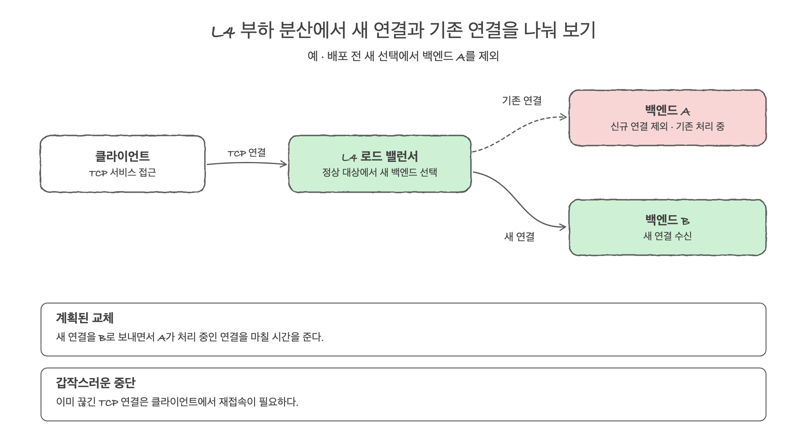
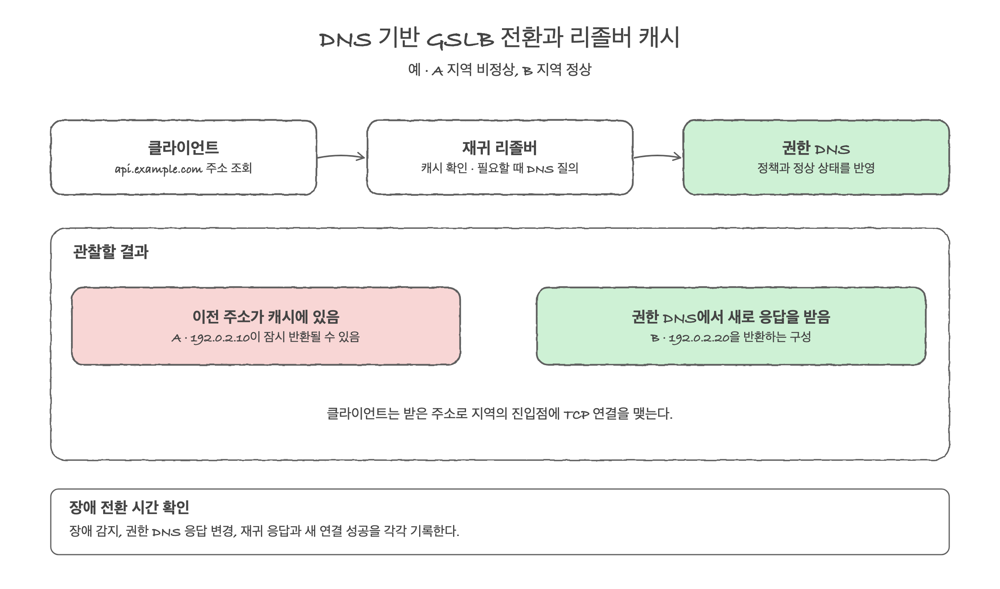

# L4 부하 분산과 DNS 기반 GSLB

## 1. L4 부하 분산과 서비스 연속성

L4 로드 밸런서는 전송 계층의 연결이나 플로를 기준으로 백엔드를 고른다. 예를 들어 TCP 모드의 로드 밸런서는 `api.example.com:443`에 들어온 새 연결마다 사용할 백엔드를 선택하고 바이트 스트림을 전달한다. 라운드 로빈은 선택 가능한 대상을 순차적으로 사용한다. TLS를 통과시키는 구성이라면 백엔드가 TLS를 처리한다. HTTP 경로나 헤더에 따라 목적지를 정하는 구성은 HTTP를 해석하는 L7 동작으로, [리버스 프록시](01_understanding_network_device_placement_and_proxies.md)에서 이어서 본다. [HAProxy 3.2 · mode](https://docs.haproxy.org/3.2/configuration.html#4-mode) · [HAProxy 3.2 · balance](https://docs.haproxy.org/3.2/configuration.html#4-balance)

- **상태 확인.** 백엔드를 여러 대 준비하고 확인에 실패한 대상을 새 연결의 선택에서 뺀다. TCP 연결이 성립하는지를 보는 검사는 포트가 열렸음을 보여 준다. 실제 업무 처리가 가능한지 판단하려면 애플리케이션 상태를 확인하는 프로브가 필요할 수 있다. 백엔드를 둘 다 잃었을 때의 동작은 로드 밸런서 설정과 제품 조건을 확인한다. [HAProxy 3.2 · server health check](https://docs.haproxy.org/3.2/configuration.html#5.2-check) · [HAProxy · TCP health checks and application-level checks](https://www.haproxy.com/documentation/haproxy-configuration-tutorials/reliability/health-checks/)
- **계획된 교체와 장애 전환.** 배포에서는 교체할 대상을 새 연결에서 제외한 뒤 기존 연결이 마무리될 시간을 둘 수 있다. 백엔드가 이미 중단됐다면 그 연결을 다른 서버의 새 연결로 그대로 옮길 수 없다. TCP 연결은 양쪽 소켓과 시퀀스 상태를 유지하므로, 클라이언트의 재접속과 실패한 요청의 재처리 조건이 필요하다. [HAProxy Runtime API · Ready, drain, maintenance](https://www.haproxy.com/documentation/haproxy-runtime-api/reference/set-server/#change-a-servers-state) · [RFC 9293 §3.4.1 · TCP 연결과 시퀀스 번호](https://www.rfc-editor.org/rfc/rfc9293.html#section-3.4.1)

서비스 연속성을 확인하는 실습에서는 테스트 연결을 하나 유지한 상태에서 대상 A를 제외하고, 새 연결이 대상 B로 향하는지와 기존 연결이 언제까지 유지되는지를 각각 관찰한다. 예고된 교체와 갑작스러운 장애는 따로 시험한다. 서비스와 연결을 다루는 장치 모두의 장애를 고려하며, HTTP 쓰기 요청을 재시도할 때는 요청이 적용됐는지와 재시도가 안전한지 확인한다. [HAProxy Runtime API · Server state](https://www.haproxy.com/documentation/haproxy-runtime-api/reference/set-server/) · [RFC 9110 §9.2.2 · HTTP 메서드의 멱등성과 재시도](https://www.rfc-editor.org/rfc/rfc9110.html#section-9.2.2)

상태 확인과 배포 중 새 연결 선택이 기존 연결에 미치는 영향을 나눠 살펴본다. [HAProxy Runtime API · Ready, drain, maintenance](https://www.haproxy.com/documentation/haproxy-runtime-api/reference/set-server/#change-a-servers-state) · [RFC 9293 §3.4.1 · TCP 연결과 시퀀스 번호](https://www.rfc-editor.org/rfc/rfc9293.html#section-3.4.1) · [HAProxy 3.2 · server health check](https://docs.haproxy.org/3.2/configuration.html#5.2-check)

## 2. GSLB로 여러 지역의 접속 대상 선택하기

GSLB(Global Server Load Balancing)는 여러 지역의 서비스 엔드포인트 중 연결할 곳을 고른다. **DNS 기반 GSLB**에서는 권한 DNS가 설정한 정책과 엔드포인트 상태를 바탕으로 DNS 응답을 선택한다. 클라이언트는 받은 주소를 사용해 해당 지역의 로드 밸런서에 접속한다. 지역을 선택한 뒤 그 지역의 백엔드를 고르는 일은 [지역 내 부하 분산](../aws/16_distributing_traffic_with_elb_and_auto_scaling.md)이 담당할 수 있다. [Amazon Route 53 · DNS Failover](https://docs.aws.amazon.com/Route53/latest/DeveloperGuide/dns-failover.html) · [Amazon Route 53 · Routing policies](https://docs.aws.amazon.com/Route53/latest/DeveloperGuide/routing-policy.html)

예를 들어 `api.example.com`의 주 지역 A에는 `192.0.2.10`, 대기 지역 B에는 `192.0.2.20`을 둔다. DNS 상태 검사에서 A가 비정상이고 B가 정상이라면 전환 정책이 이후 질의에 B 주소를 반환할 수 있다. 재귀 리졸버가 기존 A 응답을 캐시에 갖고 있으면 캐시 조건에 따라 한동안 A 주소를 반환할 수 있다. 이미 열린 TCP 연결도 DNS 응답이 바뀌었다고 이동하지 않는다. [Amazon Route 53 · Failover records and health](https://docs.aws.amazon.com/Route53/latest/DeveloperGuide/health-checks-how-route-53-chooses-records.html) · [RFC 9499 §5 · TTL과 캐시](https://www.rfc-editor.org/rfc/rfc9499.html#section-5) · [RFC 9293 §3.4.1 · TCP 연결과 소켓](https://www.rfc-editor.org/rfc/rfc9293.html#section-3.4.1)

검증할 때는 장애 감지 시점, 권한 DNS가 B를 반환하기 시작한 시점, 실제 사용자가 쓰는 리졸버의 응답, 새 연결의 성공 시점을 나눠 기록한다. TTL은 캐시 정책의 입력이다. 권한 서버에 질의할 수 없을 때 만료된 데이터를 이용하는 리졸버도 있어 TTL만으로 복구 시간을 계산하기 어렵다. 대기 지역에서 함께 사용할 데이터나 쓰기 작업 상태까지 이어지는지는 별도로 확인한다. [RFC 8767 §4–5 · Serve Stale 구현과 절차](https://www.rfc-editor.org/rfc/rfc8767.html#section-4) · [Amazon Route 53 · DNS 모범 사례](https://docs.aws.amazon.com/Route53/latest/DeveloperGuide/best-practices-dns.html) · [Amazon Route 53 · DNS Failover](https://docs.aws.amazon.com/Route53/latest/DeveloperGuide/dns-failover.html)

DNS와 CDN의 역할, 읽기와 쓰기가 다른 경로를 선택하는 예는 [CDN과 글로벌 부하 분산 설계](../system-design/11_designing_content_delivery_and_global_load_balancing.md)에서 다룬다. DNS는 연결 위치를 알려주고 HTTP 캐시는 적합한 응답을 재사용한다. [Amazon Route 53 · Routing policies](https://docs.aws.amazon.com/Route53/latest/DeveloperGuide/routing-policy.html) · [RFC 9111 §4 · 캐시의 저장 응답 사용](https://www.rfc-editor.org/rfc/rfc9111.html#section-4)

권한 DNS의 지역 선택과 재귀 캐시의 전환 시점을 구분했다. [Amazon Route 53 · Failover records and health](https://docs.aws.amazon.com/Route53/latest/DeveloperGuide/health-checks-how-route-53-chooses-records.html) · [RFC 9499 §5 · TTL과 캐시](https://www.rfc-editor.org/rfc/rfc9499.html#section-5) · [RFC 8767 §4–5 · Serve Stale 구현과 절차](https://www.rfc-editor.org/rfc/rfc8767.html#section-4)
