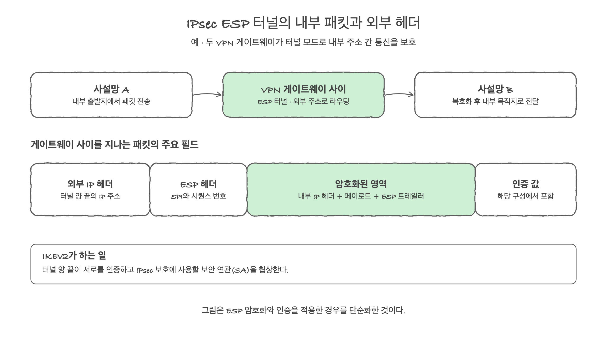
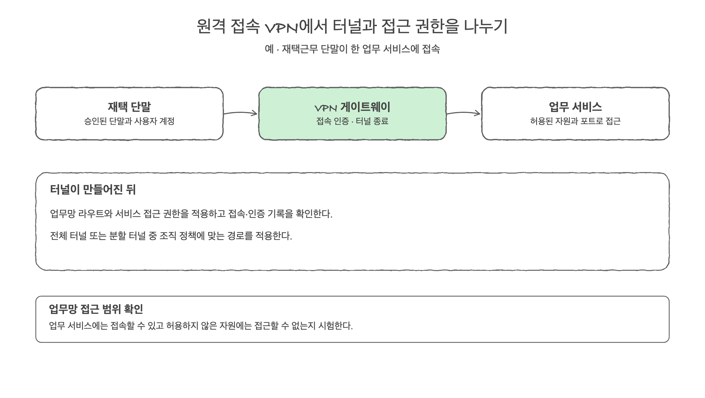

# VPN과 네트워크 보안 통제 이해하기

## 1. 사설망과 VPN의 역할 이해하기

이 문서에서 PN(Private Network)은 조직이 접근 범위를 정해 운영하는 사설망을 뜻한다. 사설 IPv4 주소는 조직 내부에서 사용할 수 있고 공용 인터넷에 경로를 광고하지 않는다. 사설 주소는 주소 지정과 라우팅 범위를 정한다. 조직은 방화벽 정책으로 구간 간 접근을 제어하고, 통신 내용을 보호하려면 해당 구간에 암호화도 적용한다. [RFC 1918 §3 · 사설 주소의 사용 범위](https://www.rfc-editor.org/rfc/rfc1918.html#section-3) · [NIST SP 800-41 Rev. 1 §2 · 방화벽의 역할](https://nvlpubs.nist.gov/nistpubs/Legacy/SP/nistspecialpublication800-41r1.pdf#page=12) · [NIST SP 800-77 Rev. 1 §2.3 · VPN 개요](https://nvlpubs.nist.gov/nistpubs/SpecialPublications/NIST.SP.800-77r1.pdf#page=25)

VPN(Virtual Private Network)은 인터넷 같은 기존 네트워크 위에 논리적 연결을 만든다. 암호화된 VPN은 터널 양 끝 사이를 지나는 트래픽을 보호한다. 터널을 통과할 패킷은 VPN 정책으로 정하고, 내부 서비스에 대한 사용자의 권한은 서비스의 접근 정책으로 따로 판단한다. [NIST SP 800-77 Rev. 1 §2.3 · VPN 개요](https://nvlpubs.nist.gov/nistpubs/SpecialPublications/NIST.SP.800-77r1.pdf#page=25) · [RFC 4301 §4.4.1 · IPsec 보안 정책](https://www.rfc-editor.org/rfc/rfc4301.html#section-4.4.1) · [NIST SP 800-207 §2.1 · 리소스별 접근 정책](https://nvlpubs.nist.gov/nistpubs/SpecialPublications/NIST.SP.800-207.pdf#page=14)

## 2. IPsec VPN의 협상과 터널 모드 따라가기

**IKEv2**는 IPsec 양 끝의 인증과 보안 연결(SA) 설정을 맡는다. 최초 `IKE_SA_INIT` 교환에서 양측은 IKE용 암호 알고리즘과 키 합의에 필요한 값을 교환한다. 이어지는 `IKE_AUTH`에서 서로를 인증하고, 일반적인 ESP 구성에서는 사용자 패킷 보호에 쓸 첫 Child SA를 설정한다. [RFC 7296 §1.2 · 초기 교환](https://www.rfc-editor.org/rfc/rfc7296.html#section-1.2)

**ESP(Encapsulating Security Payload) 터널 모드**에서는 원래 IP 헤더와 페이로드가 내부 패킷으로 함께 들어간다. 내부 헤더에는 실제 출발지와 목적지 주소가 있고, 새 외부 IP 헤더에는 터널 양 끝의 주소가 있다. 인터넷의 라우터는 외부 헤더를 보고 전달하며, 암호화를 사용하면 내부 IP 헤더까지 암호문에 포함된다. 외부 헤더는 ESP 암호화와 무결성 검증 범위 밖에 있다. 수신 측 터널 종단은 ESP 처리를 거쳐 내부 패킷을 꺼내 전달한다. [RFC 4303 §3.1.2 · 터널 모드의 보호 범위](https://www.rfc-editor.org/rfc/rfc4303.html#section-3.1.2) · [RFC 4301 §5.2 · 수신 패킷 처리](https://www.rfc-editor.org/rfc/rfc4301.html#section-5.2)

ESP가 제공하는 보호는 SA 설정에 따라 달라진다. 암호화는 내용을 숨기고, 무결성 검증은 전송 중 변경을 탐지한다. AES-GCM 같은 인증 암호화(AEAD)는 둘을 함께 제공하며, 별도의 암호화 알고리즘과 무결성 알고리즘을 사용할 수도 있다. ESP 규격에는 무결성 전용과 암호화 전용 선택지도 있으며, 암호화 전용은 능동적인 패킷 변조에 대한 방어가 약하다. [RFC 4303 §1 · ESP 보안 서비스](https://www.rfc-editor.org/rfc/rfc4303.html#section-1) · [RFC 4303 §3.3.2 · 분리형과 결합형 처리](https://www.rfc-editor.org/rfc/rfc4303.html#section-3.3.2) · [RFC 4106 §2 · ESP의 AES-GCM](https://www.rfc-editor.org/rfc/rfc4106.html#section-2)

IPsec 터널이 보호하는 내부 패킷과 라우터가 사용하는 외부 IP 헤더를 표시했다. [RFC 7296 §1.2 · 초기 교환](https://www.rfc-editor.org/rfc/rfc7296.html#section-1.2) · [RFC 4303 §3.1.2 · 터널 모드의 보호 범위](https://www.rfc-editor.org/rfc/rfc4303.html#section-3.1.2) · [RFC 4303 §3.3.2 · 분리형과 결합형 처리](https://www.rfc-editor.org/rfc/rfc4303.html#section-3.3.2)

## 3. 재택근무 VPN의 연결 범위와 접근 권한 정하기

- **사이트 간 VPN(Site-to-Site VPN)**은 본사와 지사처럼 두 네트워크의 게이트웨이를 연결한다. 이 구성에서 터널이 보호하는 구간은 게이트웨이 사이이며, 양쪽 내부망에서 최종 호스트까지의 보호는 각 구간의 구성에 달려 있다. [NIST SP 800-77 Rev. 1 §2.4.1 · 게이트웨이 간 VPN](https://nvlpubs.nist.gov/nistpubs/SpecialPublications/NIST.SP.800-77r1.pdf#page=28)
- **원격 접속 VPN(Remote-Access VPN)**은 재택근무자의 단말과 조직의 VPN 게이트웨이 사이를 연결한다. 접속 정책은 허용된 사용자와 단말을 지정하고, 다중 요소 인증(MFA)과 단말 보안 상태 확인을 적용한다. 역할별로 업무에 필요한 서비스만 허용하면 계정이나 단말이 침해됐을 때 접근 가능한 범위를 줄일 수 있다. [NIST SP 800-77 Rev. 1 §2.4.2 · 원격 접속 VPN](https://nvlpubs.nist.gov/nistpubs/SpecialPublications/NIST.SP.800-77r1.pdf#page=30) · [NIST SP 800-46 Rev. 2 §3.3.2 · 단말 상태 확인](https://nvlpubs.nist.gov/nistpubs/SpecialPublications/NIST.SP.800-46r2.pdf#page=27) · [CISA · 원격 접속과 VPN의 한계](https://www.cisa.gov/sites/default/files/2024-06/joint-guide-modern-approaches-to-secure-network-access-security-508c.pdf#page=4) · [CISA TIC 3.0 §7.2.8 · 원격 접속 통제와 MFA](https://www.cisa.gov/sites/default/files/2025-07/CISA%20TIC%203.0%20Remote%20User%20Use%20Case.pdf)
- **전체 터널(Full Tunnel)**은 업무망과 인터넷으로 향하는 트래픽을 모두 VPN 게이트웨이로 보낸다. **분할 터널(Split Tunnel)**은 조직이 지정한 트래픽만 터널에 넣고, 나머지는 일반 경로로 보낸다. 조직이 분할 터널을 허용할 때는 승인된 라우팅 범위를 명확히 하고, 터널 밖 트래픽에 조직의 VPN 보호와 그 경로에서 수행하는 검사가 적용되지 않는 점을 고려한다. [NIST SP 800-46 Rev. 2 §3.3.3 · 분할 터널과 네트워크 접근 제어](https://nvlpubs.nist.gov/nistpubs/SpecialPublications/NIST.SP.800-46r2.pdf#page=28) · [NIST SP 800-77 Rev. 1 §2.4.2 · 원격 접속 트래픽 경로](https://nvlpubs.nist.gov/nistpubs/SpecialPublications/NIST.SP.800-77r1.pdf#page=30)

VPN의 접속 인증과 터널 내부의 자원별 접근 제어를 구분했다. [NIST SP 800-77 Rev. 1 §2.4.2 · 원격 접속 VPN](https://nvlpubs.nist.gov/nistpubs/SpecialPublications/NIST.SP.800-77r1.pdf#page=30) · [NIST SP 800-46 Rev. 2 §3.3.3 · 분할 터널과 네트워크 접근 제어](https://nvlpubs.nist.gov/nistpubs/SpecialPublications/NIST.SP.800-46r2.pdf#page=28) · [CISA TIC 3.0 §7.2.8 · 원격 접속 통제와 MFA](https://www.cisa.gov/sites/default/files/2025-07/CISA%20TIC%203.0%20Remote%20User%20Use%20Case.pdf)

## 4. VPN 악용 위험을 줄이고 이상 접속 탐지하기

- **계정 도용**은 정상 원격 접속처럼 보일 수 있다. 피싱에 강한 MFA를 적용하고, 계정별 접속 권한을 제한한다. 반복 인증 실패나 평소와 다른 로그인은 조사 신호로 삼고, 침해가 확인되면 해당 세션을 종료하고 계정 접근 권한을 회수한다. [CISA · 인증과 로그 모니터링](https://www.cisa.gov/sites/default/files/publications/AA22-137A-Weak_Security_Controls_and_Practices_Routinely_Exploited_for_Initial_Access.pdf) · [NIST SP 800-207 §5.3 · 자격 증명 도용](https://nvlpubs.nist.gov/nistpubs/SpecialPublications/NIST.SP.800-207.pdf#page=38) · [CISA TIC 3.0 §7.2.8 · 원격 접속 권한 회수](https://www.cisa.gov/sites/default/files/2025-07/CISA%20TIC%203.0%20Remote%20User%20Use%20Case.pdf)
- **인터넷에 노출된 게이트웨이**는 내부 자원으로 이어지는 접점이다. 업데이트를 미룬 장비와 불필요하게 활성화한 기능은 침해 위험을 키운다. 보안 업데이트를 신속히 적용하고 기능과 관리 접속을 필요한 범위로 제한한다. [NSA·CISA · 원격 접속 VPN 강화](https://www.nsa.gov/Press-Room/News-Highlights/Article/Article/2791320/nsa-cisa-release-guidance-on-selecting-and-hardening-remote-access-vpns/)
- **출발지 IP와 위치 정보**는 접속 경로에 대한 단서다. 예를 들어 로그를 남기는 위치에 따라 VPN 종단 주소가 보일 수 있다. IP나 추정 위치를 조사 신호로 쓰고, 계정 인증 결과와 단말 상태, 접속 시각, 서비스 로그를 함께 대조해 실제 접근을 판단한다. [RFC 4303 §3.1.2 · 외부 IP 헤더](https://www.rfc-editor.org/rfc/rfc4303.html#section-3.1.2) · [NIST SP 800-207 §2.1 · 신원·단말·환경 신호](https://nvlpubs.nist.gov/nistpubs/SpecialPublications/NIST.SP.800-207.pdf#page=14) · [CISA · 의심스러운 로그인과 중앙 로그 수집](https://www.cisa.gov/sites/default/files/publications/AA22-137A-Weak_Security_Controls_and_Practices_Routinely_Exploited_for_Initial_Access.pdf)

## 5. 네트워크 보안 솔루션별 적용 범위 이해하기

- **방화벽(Firewall)**은 네트워크나 호스트 간 트래픽을 정책에 따라 허용하거나 차단한다. 패킷 필터는 주소, 프로토콜, 포트 같은 필드를 기준으로 판단하며, 상태 기반 방화벽은 연결 상태를 함께 본다. 애플리케이션에서 어떤 사용자가 어떤 작업을 할 수 있는지는 애플리케이션의 권한 정책에서 판단한다. [NIST SP 800-41 Rev. 1 §2.1.1–2.1.2 · 패킷 필터와 상태 기반 검사](https://nvlpubs.nist.gov/nistpubs/Legacy/SP/nistspecialpublication800-41r1.pdf#page=12) · [NIST SP 800-207 §2.1 · 리소스별 접근 정책](https://nvlpubs.nist.gov/nistpubs/SpecialPublications/NIST.SP.800-207.pdf#page=14)
- **침입 탐지 시스템(IDS)**은 관측한 이벤트에서 의심스러운 활동을 찾아 알린다. **침입 방지 시스템(IPS)**은 탐지에 더해 정책에 따라 트래픽을 차단하는 등 대응할 수 있다. 암호화된 구간의 네트워크 센서는 복호화할 수 없는 페이로드를 직접 검사할 수 없으므로, 터널 종단 뒤에서 볼 수 있는 트래픽과 단말·서비스 로그가 탐지 범위를 보완한다. [NIST SP 800-94 §2.1 · IDS와 IPS의 역할](https://nvlpubs.nist.gov/nistpubs/Legacy/SP/nistspecialpublication800-94.pdf#page=15) · [NIST SP 800-94 §4.3.3.4 · 암호화된 트래픽 검사 한계](https://nvlpubs.nist.gov/nistpubs/Legacy/SP/nistspecialpublication800-94.pdf#page=45)
- **웹 애플리케이션 방화벽(WAF)**은 웹 서비스 앞에서 HTTP 요청의 내용을 검사해 정책에 맞지 않는 트래픽을 차단한다. HTTPS의 요청 내용을 검사하려면 WAF가 TLS를 종료하거나 복호화된 트래픽을 받아야 한다. 데이터에 대한 접근 권한은 애플리케이션에서 검사한다. [CISA·ACSC·NSA · 웹 접근 제어와 WAF](https://www.cisa.gov/sites/default/files/2023-07/aa23-208a_joint_csa_preventing_web_application_access_control_abuse.pdf#page=7) · [RFC 9110 §4.2.2 · HTTPS URI와 보호 범위](https://www.rfc-editor.org/rfc/rfc9110.html#section-4.2.2)
- **제로 트러스트 네트워크 접근(ZTNA)**은 사용자 신원, 단말 상태와 요청 맥락을 정책에 대조해 허용된 애플리케이션이나 리소스에 연결한다. 허용 범위는 적용한 리소스와 정책에 한정되며, 접근 판단에 필요한 신원과 단말 상태 정보는 운영 과정에서 갱신해야 한다. [CISA · ZTNA의 역할](https://www.cisa.gov/sites/default/files/2024-06/joint-guide-modern-approaches-to-secure-network-access-security-508c.pdf#page=6) · [NIST SP 800-207 §2.1 · 동적 접근 정책과 단말 상태](https://nvlpubs.nist.gov/nistpubs/SpecialPublications/NIST.SP.800-207.pdf#page=14)

게이트웨이에서 VPN 터널이 끝나도 클라이언트와 웹 서비스 사이의 HTTPS 연결은 TLS 종단까지 보호할 수 있다. 웹 서비스 이름과 인증서 검증은 [웹 PKI와 TLS](../ssl-and-cryptography/03_understanding_web_pki_and_tls.md)에서 다룬다. [NIST SP 800-77 Rev. 1 §2.4.2 · 원격 접속 터널의 보호 구간](https://nvlpubs.nist.gov/nistpubs/SpecialPublications/NIST.SP.800-77r1.pdf#page=30) · [RFC 9110 §4.2.2 · HTTPS URI와 보호 범위](https://www.rfc-editor.org/rfc/rfc9110.html#section-4.2.2)
