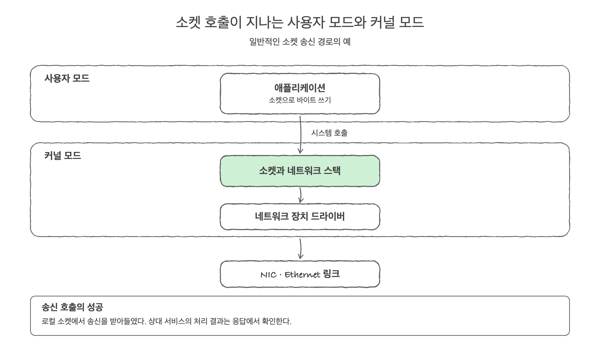

# 네트워크 계층과 운영체제의 경계

## 1. 네트워크와 네트워킹

네트워크는 호스트와 전달 장비가 링크를 통해 연결된 구조다. 네트워킹은 그 구조에서 주소를 부여하고, 데이터를 전달하고, 서로 통신하도록 만드는 일이다. 인터넷에서는 여러 링크와 네트워크를 라우터가 이어 준다. 같은 링크에서는 이웃에게 프레임을 보낼 수 있고, 다른 네트워크로 갈 때는 IP 목적지에 맞는 다음 홉을 선택한다. 여기서 **프로토콜**은 통신 참여자가 메시지 형식과 처리 동작을 공유하는 규칙이고, **링크**는 한 구간에서 패킷을 운반하는 수단이다. [RFC 1122 §1.1.3 · 인터넷 프로토콜 계층](https://www.rfc-editor.org/rfc/rfc1122.html#section-1.1.3) · [RFC 1812 §5.2 · IPv4 패킷 전달](https://www.rfc-editor.org/rfc/rfc1812.html#section-5.2)

## 2. 계층을 나누면 어떤 문제가 분리되는가

계층의 경계에서 위쪽은 아래쪽이 제공하는 서비스를 사용한다. 같은 계층의 송신 측과 수신 측은 서로 해석할 수 있는 프로토콜을 사용한다. 예를 들어 HTTP는 요청과 응답의 의미를 정하고, TCP는 애플리케이션에 순서대로 이어지는 바이트 스트림을 제공한다. IP는 목적지 주소로 데이터그램을 전달하고, Ethernet처럼 실제 구간에서 쓰는 링크 프로토콜은 로컬 프레임을 전달한다. 이 구분을 적용하면 포트 연결 실패, IP 경로 문제, HTTP 응답 오류를 각각 확인할 수 있다. [ITU-T X.200 §7 · OSI 참조 모델](https://www.itu.int/rec/T-REC-X.200-199407-I/en) · [RFC 1122 §1.1.3 · 인터넷 프로토콜 계층](https://www.rfc-editor.org/rfc/rfc1122.html#section-1.1.3) · [RFC 9293 §2.2 · TCP 연결과 전송 특성](https://www.rfc-editor.org/rfc/rfc9293.html#section-2.2) · [RFC 9110 §3.4 · HTTP 메시지](https://www.rfc-editor.org/rfc/rfc9110.html#section-3.4)

## 3. 사용자 모드에서 소켓을 쓰면 커널이 하는 일

일반적인 Linux 소켓 경로에서 애플리케이션은 사용자 모드로 실행되다가 소켓 시스템 호출로 커널에 송신·수신을 요청한다. 커널 네트워크 스택과 드라이버가 전송·IP·링크 처리를 맡고, 네트워크 인터페이스가 물리 링크를 통해 프레임을 주고받는다. 수신 경로에서는 커널이 수신한 데이터를 해당 소켓에 전달하고, 앱이 `recv()` 등으로 읽는다. 운영체제의 권한 모드 전환은 계층 모델과 별개의 실행 경계다. [Linux send(2) · 소켓 송신](https://man7.org/linux/man-pages/man2/send.2.html#DESCRIPTION) · [Linux recv(2) · 소켓 수신](https://man7.org/linux/man-pages/man2/recv.2.html#DESCRIPTION) · [Linux syscalls(2) · 시스템 호출 인터페이스](https://man7.org/linux/man-pages/man2/syscalls.2.html#DESCRIPTION) · [Linux 커널 · NAPI 수신 경로](https://docs.kernel.org/networking/napi.html)

`send()`가 성공하면 호출에 의해 송신할 데이터가 받아들여졌음을 알 수 있다. 상대 앱이 요청을 읽고 처리했는지는 애플리케이션 응답 등으로 확인한다. 예를 들어 HTTP에서는 서버가 돌려준 응답의 상태와 본문을 확인해야 요청 결과를 해석할 수 있다. [Linux send(2) · 소켓 송신](https://man7.org/linux/man-pages/man2/send.2.html#DESCRIPTION) · [RFC 9110 §3.4 · HTTP 메시지](https://www.rfc-editor.org/rfc/rfc9110.html#section-3.4)

소켓 송신이 실행 권한의 경계를 지나는 지점이다. [Linux syscalls(2) · 시스템 호출 인터페이스](https://man7.org/linux/man-pages/man2/syscalls.2.html#DESCRIPTION) · [Linux send(2) · 소켓 송신](https://man7.org/linux/man-pages/man2/send.2.html#DESCRIPTION) · [Linux 커널 · NAPI 수신 경로](https://docs.kernel.org/networking/napi.html)
