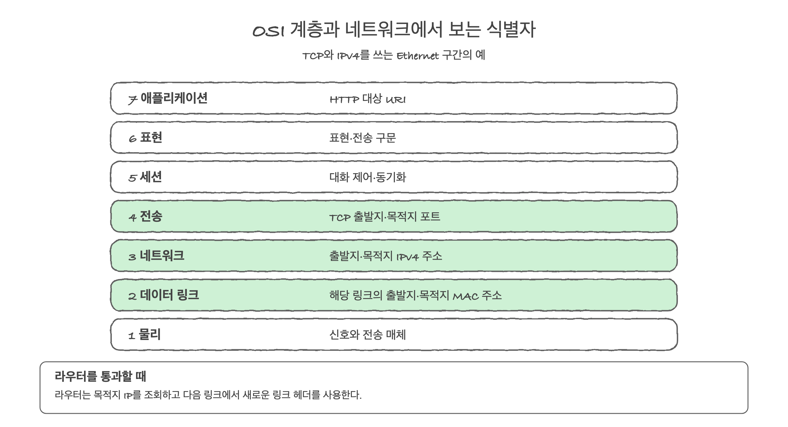

# OSI 7계층과 호스트·스위치의 역할

## 1. OSI 계층과 식별자

OSI 참조 모델은 통신 기능을 일곱 계층으로 나눈다. 인터넷 호스트의 구현을 살필 때는 링크·인터넷(IP)·전송·애플리케이션이라는 TCP/IP 관점도 함께 쓴다. 아래의 예는 각 계층에서 관찰할 수 있는 역할을 보여 준다. 실제 프로토콜 하나가 여러 역할에 걸치는 경우도 있다. [ITU-T X.200 §7 · OSI 참조 모델](https://www.itu.int/rec/T-REC-X.200-199407-I/en) · [RFC 1122 §1.1.3 · 인터넷 프로토콜 계층](https://www.rfc-editor.org/rfc/rfc1122.html#section-1.1.3)

| 계층 | 대표 역할과 관찰 단서 |
| --- | --- |
| 7. 애플리케이션 | HTTP 요청 메서드와 대상 URI처럼 서비스가 해석하는 의미를 다룬다. [ITU-T X.200 §7 · OSI 참조 모델](https://www.itu.int/rec/T-REC-X.200-199407-I/en) · [RFC 9110 §3.4 · HTTP 메시지](https://www.rfc-editor.org/rfc/rfc9110.html#section-3.4) |
| 6. 표현 | 데이터의 표현과 전송 구문을 다룬다. [ITU-T X.200 §7 · OSI 참조 모델](https://www.itu.int/rec/T-REC-X.200-199407-I/en) |
| 5. 세션 | 상대 애플리케이션과 대화의 제어와 동기화를 다룬다. [ITU-T X.200 §7 · OSI 참조 모델](https://www.itu.int/rec/T-REC-X.200-199407-I/en) |
| 4. 전송 | TCP·UDP 포트로 전송 계층의 끝점을 구분한다. TCP 연결은 양쪽의 IP·포트 조합으로 식별한다. [ITU-T X.200 §7 · OSI 참조 모델](https://www.itu.int/rec/T-REC-X.200-199407-I/en) · [RFC 9293 §2.2 · TCP 연결과 전송 특성](https://www.rfc-editor.org/rfc/rfc9293.html#section-2.2) · [RFC 768 · UDP 데이터그램과 헤더](https://www.rfc-editor.org/rfc/rfc768.html) |
| 3. 네트워크 | 목적지 IP와 경로 정보를 사용해 다음 홉을 선택한다. [ITU-T X.200 §7 · OSI 참조 모델](https://www.itu.int/rec/T-REC-X.200-199407-I/en) · [RFC 1812 §5.2 · IPv4 패킷 전달](https://www.rfc-editor.org/rfc/rfc1812.html#section-5.2) |
| 2. 데이터 링크 | Ethernet 프레임의 목적지 MAC 주소를 링크 구간에서 사용한다. [ITU-T X.200 §7 · OSI 참조 모델](https://www.itu.int/rec/T-REC-X.200-199407-I/en) · [RFC 894 · IPv4의 Ethernet 캡슐화](https://www.rfc-editor.org/rfc/rfc894.html) · [Cisco Catalyst · Ethernet MAC Address Learning](https://www.cisco.com/c/en/us/td/docs/switches/lan/catalyst6500/ios/15-3SY/config_guide/sup2T/15_2_sy_swcg_2T/ethernet_virtual_connection.html) |
| 1. 물리 | 전기·광·무선 신호로 비트를 전달하는 물리 매체의 조건을 다룬다. [ITU-T X.200 §7 · OSI 참조 모델](https://www.itu.int/rec/T-REC-X.200-199407-I/en) |

MAC 주소는 링크에서 프레임을 보낼 상대를, IP 주소는 IP 전달의 출발지와 목적지를, 전송 계층 포트는 해당 IP의 소켓 끝점을 구분하는 데 사용된다. 같은 HTTPS 연결이라도 라우터를 지난 프레임에는 새 구간의 MAC 주소가 들어간다. [RFC 1122 §1.1.3 · 인터넷 프로토콜 계층](https://www.rfc-editor.org/rfc/rfc1122.html#section-1.1.3) · [RFC 1812 §5.2 · IPv4 패킷 전달](https://www.rfc-editor.org/rfc/rfc1812.html#section-5.2) · [RFC 894 · IPv4의 Ethernet 캡슐화](https://www.rfc-editor.org/rfc/rfc894.html) · [RFC 9293 §2.2 · TCP 연결과 전송 특성](https://www.rfc-editor.org/rfc/rfc9293.html#section-2.2)

각 필드를 볼 때 어떤 계층의 전달 문제인지 짚을 수 있다. [ITU-T X.200 §7 · OSI 참조 모델](https://www.itu.int/rec/T-REC-X.200-199407-I/en) · [RFC 1122 §1.1.3 · 인터넷 프로토콜 계층](https://www.rfc-editor.org/rfc/rfc1122.html#section-1.1.3) · [RFC 1812 §5.2 · IPv4 패킷 전달](https://www.rfc-editor.org/rfc/rfc1812.html#section-5.2) · [RFC 9293 §3.1 · TCP 헤더 형식](https://www.rfc-editor.org/rfc/rfc9293.html#section-3.1)

## 2. 호스트, 인터페이스, 라우터

호스트는 클라이언트나 서버처럼 통신의 끝점으로 데이터를 만들고 소비하는 시스템이다. 한 호스트가 여러 네트워크 인터페이스와 IP 주소를 가질 수 있다. 웹 서비스 이름은 DNS로 주소를 찾는 데 쓰이며, 소켓이 바인딩한 주소와 포트는 연결할 끝점을 정한다. 라우터는 여러 네트워크를 이어 IP 패킷을 다음 홉으로 전달한다. 하나의 장비에서 호스트와 라우터 역할이 함께 동작할 수도 있다. [RFC 1122 §1.1.3 · 인터넷 프로토콜 계층](https://www.rfc-editor.org/rfc/rfc1122.html#section-1.1.3) · [RFC 1812 §5.2 · IPv4 패킷 전달](https://www.rfc-editor.org/rfc/rfc1812.html#section-5.2) · [RFC 1034 §5.3.3 · DNS 리졸버의 해석 과정](https://www.rfc-editor.org/rfc/rfc1034.html#section-5.3.3) · [RFC 9293 §2.2 · TCP 연결과 전송 특성](https://www.rfc-editor.org/rfc/rfc9293.html#section-2.2)

## 3. 스위치가 프레임을 전달하는 방법과 비용

L2 스위치는 같은 브리지 도메인에서 MAC 주소를 기준으로 프레임을 전달한다. L3 스위치라고 부르는 장비는 이더넷 스위칭과 IP 라우팅을 함께 제공할 수 있다. 예를 들어 같은 VLAN의 단말 사이에서는 프레임을 스위칭하고 서로 다른 VLAN 사이에서는 VLAN 인터페이스에서 IP 라우팅을 수행한다. [Cisco Catalyst · Ethernet MAC Address Learning](https://www.cisco.com/c/en/us/td/docs/switches/lan/catalyst6500/ios/15-3SY/config_guide/sup2T/15_2_sy_swcg_2T/ethernet_virtual_connection.html) · [RFC 1812 §5.2 · IPv4 패킷 전달](https://www.rfc-editor.org/rfc/rfc1812.html#section-5.2) · [Cisco Catalyst · Inter-VLAN Routing](https://www.cisco.com/c/en/us/support/docs/lan-switching/inter-vlan-routing/41260-189.html)

스위치의 비용을 볼 때는 포트의 링크 속도와 스위치가 프레임을 처리하는 지연을 나눠 본다. 저장 후 전달(store-and-forward)은 프레임 전체를 받은 뒤 프레임 검사 시퀀스(FCS)를 확인해 전달할 수 있다. 컷스루(cut-through)는 전체를 받기 전에 전달을 시작해 지연을 줄일 수 있다. 실제 지원 모드와 손상된 프레임의 처리는 장비와 구성에 따라 달라진다. [Cisco Nexus 9000 · Configuring Switching Modes](https://www.cisco.com/c/en/us/td/docs/dcn/nx-os/nexus9000/104x/configuration/layer-2-switching/cisco-nexus-9000-series-nx-os-layer-2-switching-configuration-guide-104x/m-configuring-switching-modes.pdf)
