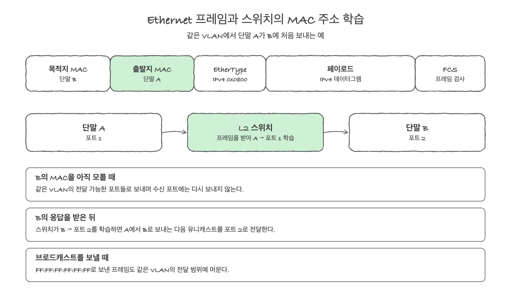
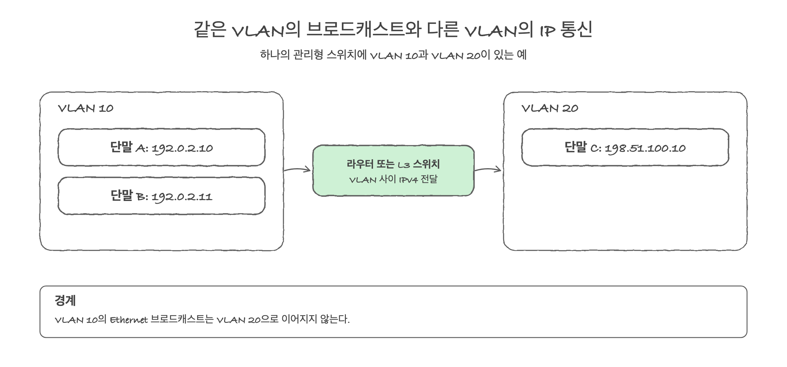

# Ethernet 프레임, MAC 주소와 L2 스위칭

## 1. NIC에서 보내는 프레임

물리 NIC(Network Interface Controller)는 호스트를 링크에 연결하는 네트워크 인터페이스의 하드웨어 구현이다. Ethernet II 프레임은 목적지 MAC, 출발지 MAC, 상위 프로토콜을 나타내는 EtherType, 페이로드와 FCS를 포함한다. VLAN 태그가 없는 IPv4 프레임의 EtherType은 `0x0800`이다. Ethernet MAC 주소는 48비트이며, 목적지가 `ff:ff:ff:ff:ff:ff`인 프레임은 해당 브리지 도메인의 브로드캐스트다. NIC와 드라이버의 수신 경로는 운영체제 구현에 따라 달라질 수 있다. [RFC 894 · IPv4의 Ethernet 캡슐화](https://www.rfc-editor.org/rfc/rfc894.html) · [RFC 9542 §2.1 · 48비트 MAC 식별자](https://www.rfc-editor.org/rfc/rfc9542.html#section-2.1) · [Cisco Catalyst · Ethernet MAC Address Learning](https://www.cisco.com/c/en/us/td/docs/switches/lan/catalyst6500/ios/15-3SY/config_guide/sup2T/15_2_sy_swcg_2T/ethernet_virtual_connection.html) · [Cisco Nexus 9000 · Configuring Switching Modes](https://www.cisco.com/c/en/us/td/docs/dcn/nx-os/nexus9000/104x/configuration/layer-2-switching/cisco-nexus-9000-series-nx-os-layer-2-switching-configuration-guide-104x/m-configuring-switching-modes.pdf) · [Linux 커널 · NAPI 수신 경로](https://docs.kernel.org/networking/napi.html)

## 2. L2 스위치가 학습하고 전달하는 순서

1. 스위치는 프레임이 들어온 포트와 출발지 MAC의 관계를 해당 VLAN의 MAC 주소 테이블에 학습한다. [Cisco Catalyst · Ethernet MAC Address Learning](https://www.cisco.com/c/en/us/td/docs/switches/lan/catalyst6500/ios/15-3SY/config_guide/sup2T/15_2_sy_swcg_2T/ethernet_virtual_connection.html)
2. 목적지 MAC이 테이블에 있는 유니캐스트라면 그 주소에 연결된 포트로 보낸다. 같은 포트에서 다시 전달할 필요가 없다면 필터링한다. [Cisco Catalyst · Ethernet MAC Address Learning](https://www.cisco.com/c/en/us/td/docs/switches/lan/catalyst6500/ios/15-3SY/config_guide/sup2T/15_2_sy_swcg_2T/ethernet_virtual_connection.html)
3. 목적지 MAC을 모르는 유니캐스트는 같은 VLAN의 전달 가능한 포트로 플러딩한다. 브로드캐스트도 같은 VLAN 안에 플러딩하지만, 브로드캐스트의 목적지 주소는 프레임 자체에 명시돼 있다. 답장하는 단말의 출발지 MAC을 학습하면 이후 유니캐스트는 필요한 포트로 보낼 수 있다. [Cisco Catalyst · Ethernet MAC Address Learning](https://www.cisco.com/c/en/us/td/docs/switches/lan/catalyst6500/ios/15-3SY/config_guide/sup2T/15_2_sy_swcg_2T/ethernet_virtual_connection.html)

MAC 학습에 쓰는 출발지 주소와 전달에 쓰는 목적지 주소를 함께 표시했다. [RFC 894 · IPv4의 Ethernet 캡슐화](https://www.rfc-editor.org/rfc/rfc894.html) · [Cisco Catalyst · Ethernet MAC Address Learning](https://www.cisco.com/c/en/us/td/docs/switches/lan/catalyst6500/ios/15-3SY/config_guide/sup2T/15_2_sy_swcg_2T/ethernet_virtual_connection.html) · [Cisco Nexus 9000 · Configuring Switching Modes](https://www.cisco.com/c/en/us/td/docs/dcn/nx-os/nexus9000/104x/configuration/layer-2-switching/cisco-nexus-9000-series-nx-os-layer-2-switching-configuration-guide-104x/m-configuring-switching-modes.pdf)

## 3. LAN, WAN과 브로드캐스트 도메인

LAN과 WAN은 연결 범위와 운영에서 쓰는 구분이다. Ethernet에서 브로드캐스트의 범위를 따질 때는 **브로드캐스트 도메인**이 중요하다. 스위치가 여러 대라도 같은 VLAN이 이어지면 같은 L2 도메인이 될 수 있다. 한 스위치 안에서도 VLAN을 분리하면 브로드캐스트 도메인이 나뉘며, 두 VLAN의 IP 통신에는 라우팅이 필요하다. [Cisco Catalyst · Ethernet MAC Address Learning](https://www.cisco.com/c/en/us/td/docs/switches/lan/catalyst6500/ios/15-3SY/config_guide/sup2T/15_2_sy_swcg_2T/ethernet_virtual_connection.html) · [RFC 1812 §5.2 · IPv4 패킷 전달](https://www.rfc-editor.org/rfc/rfc1812.html#section-5.2)

호스트가 다른 IPv4 네트워크로 보낼 때 Ethernet의 목적지 MAC은 보통 다음 홉인 게이트웨이의 MAC이다. IP 목적지는 여전히 원격 호스트의 IP다. ARP 요청에 사용한 링크 브로드캐스트도 그 링크 안에서 처리된다. 라우터가 다음 링크로 IP 패킷을 전달하면 그 링크에 맞는 새 프레임을 만든다. [RFC 826 · Ethernet 주소 해석](https://www.rfc-editor.org/rfc/rfc826.html) · [RFC 1122 §3.3.1 · 송신 경로 선택](https://www.rfc-editor.org/rfc/rfc1122.html#section-3.3.1) · [RFC 1812 §5.2 · IPv4 패킷 전달](https://www.rfc-editor.org/rfc/rfc1812.html#section-5.2)

스위치 한 대에서도 VLAN을 나누면 링크의 브로드캐스트 범위가 갈라진다. [Cisco Catalyst · Ethernet MAC Address Learning](https://www.cisco.com/c/en/us/td/docs/switches/lan/catalyst6500/ios/15-3SY/config_guide/sup2T/15_2_sy_swcg_2T/ethernet_virtual_connection.html) · [RFC 1812 §5.2 · IPv4 패킷 전달](https://www.rfc-editor.org/rfc/rfc1812.html#section-5.2) · [Cisco Catalyst · Inter-VLAN Routing](https://www.cisco.com/c/en/us/support/docs/lan-switching/inter-vlan-routing/41260-189.html) · [RFC 5737 §3 · IPv4 문서용 주소 대역](https://www.rfc-editor.org/rfc/rfc5737.html#section-3)
